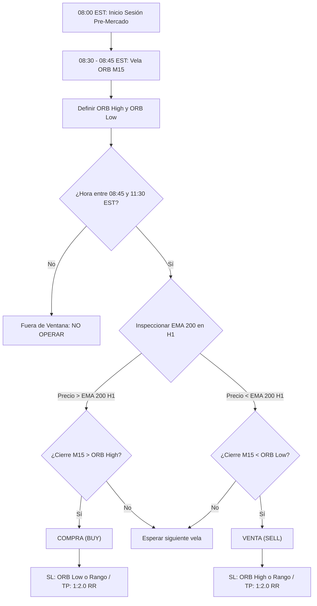
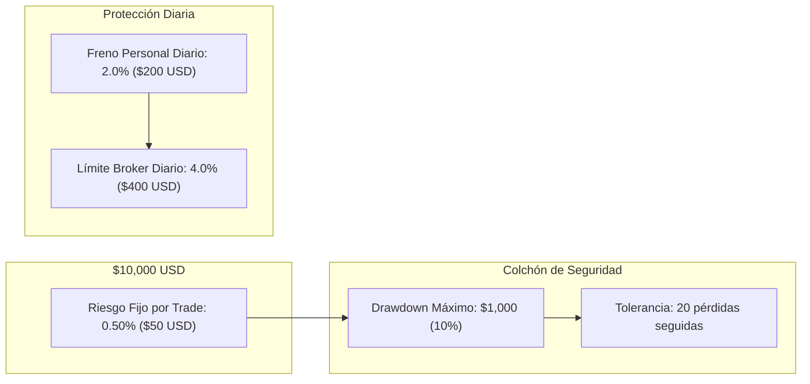
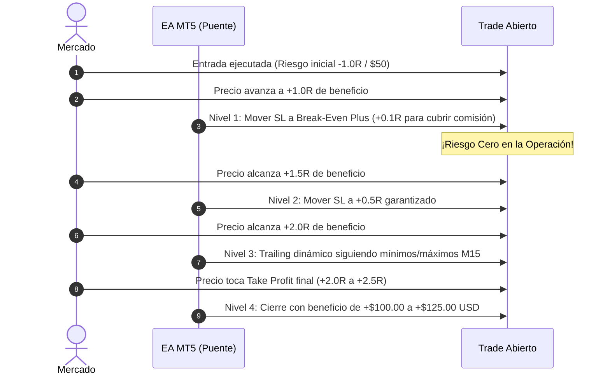
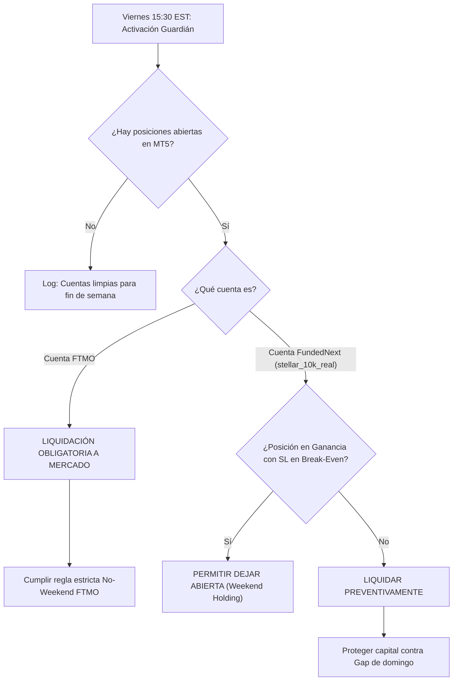

# Manual Maestro: Estrategia de Trading Institucional ORB + Gestión Cuantitativa

Este documento contiene la especificación completa, paso a paso y fundamentada, de la **Estrategia Oficial de Ruptura de Rango de Apertura (ORB M15)** combinada con el **Sistema de Control de Riesgo Cuantitativo** utilizado por los perfiles [`stellar_10k_real`](file:///L:/Python/FTMO_Stellar_Lite/profiles.py#L200) (FundedNext $10K) y [`ftmo_10k_challenge`](file:///L:/Python/FTMO_Stellar_Lite/profiles.py#L170) (FTMO $10K).

---

## 1. Fundamentos y Especificaciones del Desafío (Plan 10K FundedNext)

El perfil [`stellar_10k_real`](file:///L:/Python/FTMO_Stellar_Lite/profiles.json#L109) fue estructurado a partir de las especificaciones oficiales de **FundedNext Stellar Lite 2-Step** con sus add-ons de élite seleccionados:

### Parámetros Clave de la Cuenta:
* **Capital Inicial:** $10,000 USD.
* **Plataforma & Modo:** MetaTrader 5 (MT5), Swap-Free (+10%).
* **Meta Fase 1:** **+8.0%** ($800 USD) $\rightarrow$ Saldo objetivo: **$10,800 USD**.
* **Meta Fase 2:** **+4.0%** ($400 USD) $\rightarrow$ Saldo objetivo: **$10,400 USD**.
* **Límite Pérdida Diaria:** **4.0%** ($400 USD) sobre el balance inicial del día.
* **Límite Pérdida Máxima Total:** **10.0%** ($1,000 USD estático gracias al add-on *Maximum Loss Limit 10%*). Piso de liquidación inamovible en **$9,000 USD**.
* **Días Mínimos de Trading:** **2 días** por fase.
* **Reparto de Beneficios (Profit Split):** **95% de por vida** (*Lifetime Reward 95%*).
* **Magic Number asignado:** `505003`.
* **Activos Autorizados:** Oro (`XAUUSD`), S&P 500 (`US500`) y Forex (`USDJPY`).

---

## 2. Los 3 Pilares de la Estrategia ORB M15 Institucional

La estrategia se basa en aprovechar la inyección de liquidez de la apertura de Wall Street y Nueva York, filtrando falsos rompimientos mediante tendencia de orden superior.

### Regla 1: Definición del Rango de Apertura (Opening Range)
1. **Horario de Referencia:** **08:30 a 08:45 EST (Hora de Nueva York)**.
2. Durante estos primeros 15 minutos se forma la **Vela de Referencia M15**.
3. Se registran exactamente dos niveles:
   * **`ORB_HIGH`:** El precio máximo alcanzado por la vela de 08:30–08:45 EST.
   * **`ORB_LOW`:** El precio mínimo alcanzado por la vela de 08:30–08:45 EST.

### Regla 2: Filtro de Tendencia Macro (EMA 200 en Gráfico H1)
No se operan rompimientos en contra de la marea institucional:
* **Solo se permiten COMPRAS (BUY):** Si el precio cotiza por **encima de la Media Móvil Exponencial de 200 periodos en H1** (`Close H1 > EMA 200 H1`).
* **Solo se permiten VENTAS (SELL):** Si el precio cotiza por **debajo de la Media Móvil Exponencial de 200 periodos en H1** (`Close H1 < EMA 200 H1`).

### Regla 3: Filtro Anti-Fakeout por Cierre de Vela M15
* **Estrictamente prohibido entrar por mecha:** Una penetración momentánea del rango no activa orden.
* **Gatillo de Entrada:** Una vela completa de 15 minutos debe **cerrar con su cuerpo por fuera del rango**:
  * Para **BUY**: `Close M15 > ORB_HIGH`.
  * Para **SELL**: `Close M15 < ORB_LOW`.

---

## 3. Gestión Monetaria Cuantitativa y Cálculo de Lotes

El secreto de los traders institucionales no reside en acertar siempre, sino en que ninguna racha perdedora pueda poner en peligro la cuenta.

### Fórmula de Dimensionamiento Exacto de Lote:
$$\text{Lotes} = \frac{\text{Riesgo en Dólares (\$50.00)}}{\text{Distancia del Stop Loss (Puntos)} \times \text{Tamaño del Contrato}}$$

* **Oro (`XAUUSD`):**
  * Contrato: 100 oz.
  * Si el Stop Loss está a $5.00 dólares de distancia ($500 puntos):
    $$\text{Lotes} = \frac{\$50.00}{\$5.00 \times 100} = 0.10 \text{ lotes}$$
* **S&P 500 (`US500`):**
  * Contrato CFD: 1.0.
  * Si el Stop Loss está a 50 puntos del índice:
    $$\text{Lotes} = \frac{\$50.00}{50.0 \times 1.0} = 1.0 \text{ lote (o 0.10 según especificación del broker)}$$

### Frenos de Seguridad en Código ([`risk_manager.py`](file:///L:/Python/FTMO_Stellar_Lite/risk_manager.py)):
1. **Límite de Riesgo Abierto:** Máximo **1.5%** ($150 USD) en total simultáneo. Si ya hay 3 posiciones vivas arriesgando $50 cada una, el sistema bloquea cualquier nueva señal.
2. **Freno de Mano Diario (Daily Cap):** Si en un día se acumulan **-$200 USD (-2.0%)**, el bot se auto-bloquea por el resto del día. Quedamos a la mitad del límite del broker (-4.0% o -$400), impidiendo quemar la cuenta en un día difícil.
3. **Filtro Anti-Tilt:** Tras **3 pérdidas consecutivas** en la misma sesión, el sistema apaga las entradas hasta el día siguiente.

---

## 4. Gestión Activa de la Posición: Los 4 Niveles de Trailing

Una vez que la orden está en el mercado, el Asesor Experto en MT5 ([`StellarLite_Webhook_Bridge.mq5`](file:///L:/Python/FTMO_Stellar_Lite/StellarLite_Webhook_Bridge.mq5)) gestiona la salida dinámicamente:

1. **Nivel 1 (Break-Even Plus a +1.0R):** Cuando el trade recorre la misma distancia que su Stop Loss a favor, el SL se mueve inmediatamente a `Precio Entrada + Spread/Comisión`. La operación se vuelve matemáticamente libre de riesgo.
2. **Nivel 2 (Asegurar Ganancia a +1.5R):** Al superar 1.5R, el Stop Loss se fija en `+0.5R` (ganancia neta blindada).
3. **Nivel 3 (Trailing por Estructura Técnica M15 a +2.0R):** El SL rastrea el mínimo de las últimas 2 velas M15 cerradas (para compras) o el máximo (para ventas).
4. **Nivel 4 (Take Profit Objetivo):** Salida programada por defecto en **1:2.0 R:R**.

---

## 5. El Protocolo Guardián de Viernes (Anti-Gap de Fin de Semana)

El módulo especializado [`friday_guardian.py`](file:///L:/Python/FTMO_Stellar_Lite/friday_guardian.py) vigila todas las semanas a partir de las **15:30 EST de cada viernes** con lógica discriminada:

* **Acceso de Emergencia:** Si en cualquier momento deseas cerrar todo a mano antes del fin de semana, ejecuta el archivo [`Cierre_Emergencia_Viernes.bat`](file:///L:/Python/FTMO_Stellar_Lite/Cierre_Emergencia_Viernes.bat).

---

## 6. Hoja de Ruta para Pasar las 2 Fases

| Etapa | Objetivo | Riesgo por Trade | Rendimiento Esperado | Tiempo Estimado |
| :--- | :--- | :--- | :--- | :--- |
| **Fase 1** | **+8.0% ($800)** | 0.50% ($50) | ~16R netos con R:R 1:2 | **4 a 6 semanas** |
| **Fase 2** | **+4.0% ($400)** | 0.50% ($50) | ~8R netos con R:R 1:2 | **2 a 3 semanas** |
| **Cuenta Fondeada** | Retiros quincenales | 0.40% a 0.50% | 95% de profit split para ti | **Consistencia a largo plazo** |

> [!TIP]
> **Consejo del Trader Profesional:** La consistencia no proviene de intentar pasar la prueba en 3 días. Con el colchón estático del 10% ($1,000 USD) y arriesgando $50 por posición, las probabilidades matemáticas están completamente de tu lado mientras respetes los filtros y no sobreoperes.
