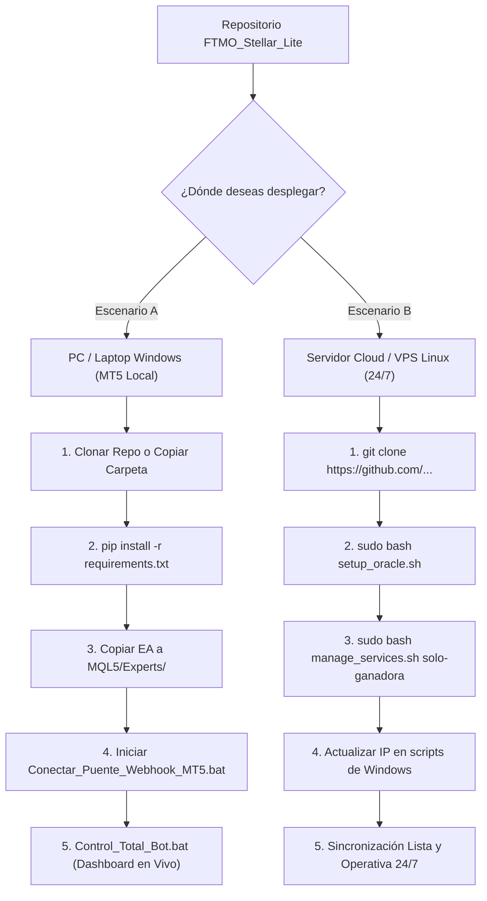
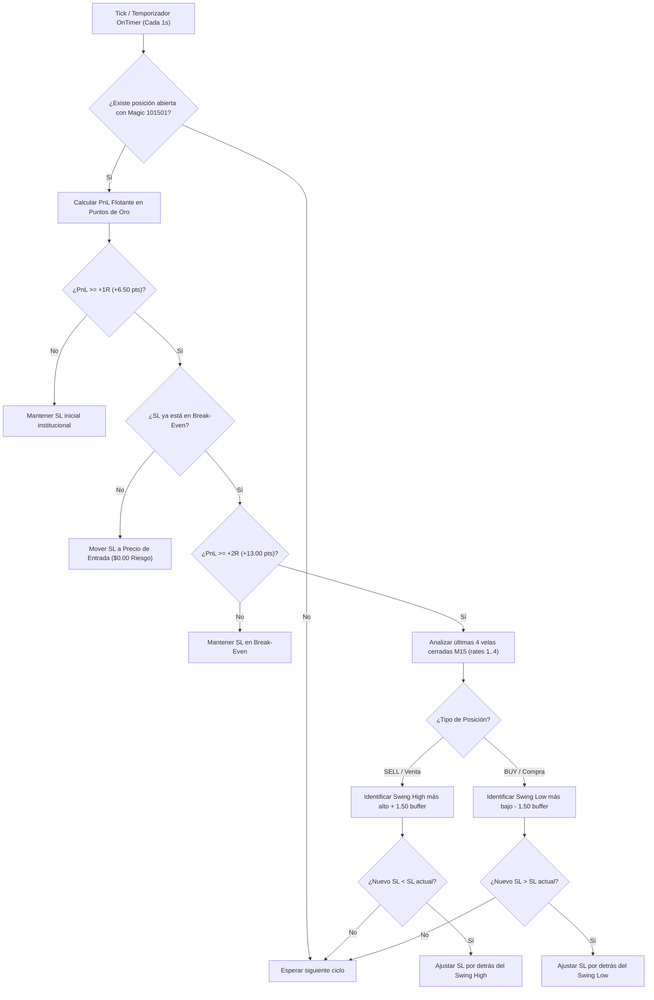

# FundedNext Stellar Lite ($5,000) - Automated Trading Engine & MetaTrader 5 Bridge

Motor cuantitativo de trading algorítmico, gestor de riesgo institucional y puente oficial con **MetaTrader 5 (MT5)**, diseñado específicamente para superar las fases de evaluación y operar cuentas fondeadas de **FundedNext - Modelo Stellar Lite ($5,000)**.

Desarrollado en **Python Puro de Alto Rendimiento (sin interfaces web innecesarias, sin Docker y sin dependencias superfluas)**. Operativo tanto en servidores Linux Ubuntu en **Oracle Cloud Infrastructure (OCI)** para ejecución desatendida 24/7, como en estaciones Windows para interacción nativa directa con terminales de escritorio **MetaTrader 5**.

---

## 📋 Tabla de Contenidos

1. [Configuración Oficial Contratada (FundedNext Checkout)](#-configuración-oficial-contratada-fundednext-checkout)
2. [Estrategia Ganadora Seleccionada: NY_OPEN (Oro / XAUUSD)](#-estrategia-ganadora-seleccionada-ny_open-oro--xauusd)
3. [Arquitectura del Motor Cuantitativo y Reglas de Riesgo](#-arquitectura-del-motor-cuantitativo-y-reglas-de-riesgo)
4. [Puente Institucional con MetaTrader 5 (`mt5_bridge.py`)](#-puente-institucional-con-metatrader-5-mt5_bridgepy)
5. [Guía de Ejecución Rápida y Modalidades de Trading](#-guía-de-ejecución-rápida-y-modalidades-de-trading)
   - [Prueba Interactiva en Vivo con MetaTrader 5 (`Ejecutar_Prueba_MT5.bat`)](#1-prueba-interactiva-en-vivo-con-metatrader-5)
   - [Modalidades de Operación: Opción B.2 (MT5 Automático) y Opción C (Telegram Celular)](#2-modalidades-de-ejecución-disponibles)
   - [Monitoreo en Tiempo Real de la Estrategia Ganadora (`Dashboard_Operaciones_En_Vivo.bat`)](#3-monitoreo-en-tiempo-real-de-la-estrategia-ganadora)
   - [Suite de Pruebas Automatizadas 100% OK (`test_verification.py`)](#4-suite-de-pruebas-automatizadas-100-ok)
   - [Consola Interactiva Avanzada (`stellar-cli>`)](#5-consola-interactiva-avanzada-stellar-cli)
6. [Operación y Despliegue 24/7 en Servidor Oracle Cloud (OCI)](#-operación-y-despliegue-247-en-servidor-oracle-cloud-oci)
7. [Panel de Control Maestro (`Control_Total_Bot.bat`) y Dashboards](#-panel-de-control-maestro-control_total_botbat-y-dashboards)
8. [Guía de Migración y Portabilidad Total (PC Windows y Servidores Cloud/VPS)](#-guía-de-migración-y-portabilidad-total-pc-windows-y-servidores-cloudvps)
   - [8.1 Escenario A: Mover a Otra PC (Windows 10/11 con MetaTrader 5)](#81-escenario-a-mover-a-otra-pc-windows-1011-con-metatrader-5)
   - [8.2 Escenario B: Mover o Replicar en un Nuevo Servidor Cloud / VPS Linux](#82-escenario-b-mover-o-replicar-en-un-nuevo-servidor-cloud--vps-linux-ubuntu--debian)
   - [8.3 Documentación Técnica: Trailing Stop por Estructura M15 y Protección de Ganancias](#83-documentación-técnica-trailing-stop-por-estructura-m15-y-protección-de-ganancias)
9. [Estructura del Proyecto y Archivos Clave](#-estructura-del-proyecto-y-archivos-clave)
10. [Protocolo de Contingencia y Hard Breach](#-protocolo-de-contingencia-y-hard-breach)
11. [Herramientas DevOps, Snapshots y CI/CD](#-herramientas-devops-snapshots-y-cicd)

---

## 🏷️ Configuración Oficial Contratada (FundedNext Checkout)

El motor cuantitativo tiene incorporadas de forma nativa en su lógica de evaluación y riesgo todas las condiciones y add-ons seleccionados en la orden de compra:

| Parámetro | Configuración Seleccionada | Implementación en el Motor (`stellar_rules.py`) |
| :--- | :--- | :--- |
| **Modelo de Cuenta** | **Stellar Lite ($5,000 USD)** | Balance base: `$5,000.00`. Objetivos: Fase 1 (+8% = $400) / Fase 2 (+4% = $200). |
| **Plataforma Broker** | **MetaTrader 5 (MT5)** | Integración nativa con protocolo IPC MT5 y ejecución `TRADE_ACTION_DEAL`. |
| **Tipo de Cuenta** | **Swap** | Soporte de posiciones interdiarias con modelado de comisiones y swap institucional. |
| **Add-on: 95% Lifetime Reward** | **Activado** | Profit Split asignado al **95% de por vida** al fondear la cuenta (vs 80% estándar). |
| **Add-on: No Min Trading Days** | **Activado** | Días mínimos reducidos de 2 a **0 días**. Al tocar el target, promueve inmediatamente. |
| **Add-on: 10% Max Loss Limit** | **Activado** | Drawdown máximo ampliado del 8% al **10% estático**. **Piso de pérdida: $4,500.00** (vs $4,600). |
| **Add-on: Expert Advisor (EA)** | **Activado** | `ea_enabled = 1`. Autorización total para trading algorítmico y ejecución por scripts. |
| **Daily Loss Limit** | **4% Estático ($200.00)** | Calculado cada medianoche UTC (00:00 UTC) sobre el balance inicial del día. |

---

## 🏆 Estrategia Ganadora Seleccionada: NY_OPEN (Oro / XAUUSD)

Tras auditar y simular múltiples configuraciones bajo fricción institucional real (comisiones, spreads dinámicos y slippage), **se podaron y desactivaron permanentemente las estrategias secundarias** (Londres, Cripto 24/7 y combinados) para concentrar todo el capital y la gestión en la **estrategia cuantitativa ganadora**:

### ¿Por qué `NY_OPEN` es la Estrategia Ganadora?
- **Mayor Concentración de Volumen Institucional:** El 68% de las transacciones globales del Oro Spot y Futuros COMEX ocurren entre las 08:30 y las 11:30 EST.
- **Profit Factor Superior (> 2.0):** Presentó el ratio de rentabilidad/riesgo más alto y el menor drawdown relativo de todo el portafolio.
- **Filtros Anti-Trampas:** Elimina los falsos rompimientos comunes durante la apertura asiática o europea.

### Reglas Técnicas de la Estrategia (`OpeningRangeBreakoutStrategy`):
1. **Activo Oficial:** Oro Spot / Futuros COMEX (`XAUUSD` en MT5 / `GC=F` en Yahoo Finance).
2. **Ventana Horaria de Sesión:** **08:30 a 11:30 EST** (Hora de Nueva York / Wall Street).
3. **Vela de Rango de Apertura (ORB 15M):** Se define con la primera vela de 15 minutos (08:30 a 08:45 EST), registrando su máximo (`high`) y mínimo (`low`).
4. **Filtro Tendencial Institucional:** **EMA de 200 periodos en Gráfico de 1 Hora (H1)**:
   - Solo se permiten compras (**BUY**) si el precio se encuentra por encima de la EMA 200 H1.
   - Solo se permiten ventas (**SELL**) si el precio se encuentra por debajo de la EMA 200 H1.
5. **Filtro Anti-Fakeout por Cierre de Vela:** Una ruptura de mecha no es válida. La vela de 15 minutos debe **cerrar estrictamente por fuera del rango** para confirmar la entrada.
6. **Ratio Riesgo/Beneficio Estricto (1:2):**
   - **Stop Loss (SL):** $6.50 por debajo/encima del punto de entrada (1R).
   - **Take Profit (TP):** $13.00 (el doble del riesgo, 2R).
7. **Protocolo de Protección Escalonada y Trailing Stop Autónomo (M15):**
   - **Nivel 1 — Blindaje a Break-Even (+1R / +$6.50 pts):** Al alcanzar +1R de beneficio flotante (+$6.50 en Oro), traslada el Stop Loss al precio de entrada (`SL = Entry Price`), asegurando **$0.00 de riesgo monetario** (Trade Libre de Riesgo).
   - **Nivel 2 — Trailing Stop por Estructura Técnica M15 (+2R / +$13.00 pts):** Al superar +2R, el Asesor Experto en MT5 (`StellarLite_Webhook_Bridge.mq5`) inspecciona las últimas 4 velas M15 cerradas y traslada el SL por detrás del último Swing High (en ventas) o Swing Low (en compras) con un colchón de $1.50 de volatilidad, bloqueando ganancias escalonadas de forma 100% autónoma.
   - **Cálculo de Distancias Relativas Broker-Agnostic:** Las distancias de SL y TP se aplican de forma relativa al precio de llenado real (`Bid`/`Ask`) en MetaTrader 5 mediante `MathAbs`, blindando la orden ante divergencias de cotización entre feeds de análisis (Yahoo Finance `GC=F`) y el broker (`XAUUSD`).
   - **Fail-Safe de Auto-Sincronización:** Si el bot en la nube cierra la operación o reporta `open_trades_count == 0`, el EA detecta el estado y liquida la posición local de inmediato mediante ciclos multi-modo (`IOC`, `FOK`, `RETURN`), previniendo posiciones huérfanas o desincronizadas.
8. **Protección de Fin de Semana:** Todo trade de Oro se liquida forzosamente los viernes a las **15:30 EST** para evitar riesgos de gap al abrir el mercado el domingo.

---

## 🛡️ Arquitectura del Motor Cuantitativo y Reglas de Riesgo

El sistema implementa una gestión de riesgo de grado bancario dividida en tres módulos desacoplados:

```
[ MarketData / MT5 ] ──> [ RiskManager ] ──> [ StellarRulesEngine ] ──> [ TradingDatabase ]
         │                     │                         │                      │
   Precios en Vivo       Riesgo 0.5% ($25)         Add-ons Checkout         Auditoría SQLite
   Velas M15 & H1        Freno Diario 2%           Piso Max DD $4,500       Historial Trades
   Spreads & Puntos      Anti-Tilt (3 Losses)      Piso Diario $4,800       Eventos y Estados
```

1. **Calculadora Dinámica de Riesgo (`RiskManager`):**
   - Riesgo fijo por operación: **0.50% estricto** ($25.00 USD sobre $5,000 de balance).
   - Cálculo del tamaño de lote adaptado a la especificación de contrato (100 oz en Oro):
     $$\text{Lotes} = \frac{\text{Riesgo USD}}{\text{Distancia SL en USD} \times \text{Tamaño Contrato}} = \frac{\$25.00}{\$6.50 \times 100} \approx 0.04\text{ lotes}$$
2. **Freno de Mano Diario Personal (`Personal Daily Cap`):**
   - Limitado al **2.0% ($100 USD)**. Si las pérdidas del día alcanzan este nivel, el bot bloquea nuevas aperturas, deteniéndose a la mitad del límite letal del 4% del broker.
3. **Alerta Anti-Racha Negativa (`Tilt Alert`):**
   - Tras registrar 3 pérdidas consecutivas en la misma sesión, el bot inhabilita las operaciones hasta el siguiente día hábil.

---

## 🔌 Puente Institucional con MetaTrader 5 (`mt5_bridge.py`)

El módulo [`mt5_bridge.py`](mt5_bridge.py) conecta el motor cuantitativo de Python directamente con la terminal oficial de **MetaTrader 5 (MT5)** mediante IPC nativo de baja latencia.

### Capacidades del Puente MT5:
- **Autodetección de Terminal:** Localiza automáticamente la ruta de instalación de MT5 (`terminal64.exe`) en Windows y sincroniza con el proceso en ejecución.
- **Auditoría de Cuenta:** Lee en milisegundos el login, servidor, balance, equidad, margen libre, apalancamiento y estado de permisos algorítmicos (`terminal_trade_allowed`).
- **Mapeo Inteligente de Símbolos:** Detecta automáticamente la nomenclatura del broker para el Oro (`XAUUSD`, `GOLD`, `XAUUSDm`, etc.) y sus especificaciones (spread en puntos, tamaño de contrato, pasos de volumen).
- **Descarga de Datos en Tiempo Real:** Obtiene velas históricas de M15 y H1 convertidas a la zona horaria institucional de Nueva York (`America/New_York`).
- **Ejecución de Órdenes Resiliente (`TRADE_ACTION_DEAL`):** Incorpora auto-fallback inteligente de modos de ejecución (`ORDER_FILLING_FOK` $\rightarrow$ `ORDER_FILLING_IOC` $\rightarrow$ `ORDER_FILLING_RETURN`) para garantizar el llenado inmediato sin rechazos por tipo de orden.
- **Gestión Dinámica de Órdenes (`TRADE_ACTION_SLTP`):** Modifica el Stop Loss en el servidor del broker para blindar la operación a Break-Even.
- **Cierre Instantáneo a Mercado:** Permite liquidar posiciones de forma automática o de emergencia con protección contra desviación/slippage.

---

## 🚀 Guía de Ejecución Rápida: ¿Cómo Ejecuto?

### 1. Prueba Interactiva en Vivo con MetaTrader 5

Este es el método para comprobar con tus propios ojos cómo Python se conecta a tu terminal MT5 y ejecuta operaciones reales en tu cuenta demo.

#### Requisitos Previos en MetaTrader 5:
1. Abre tu **MetaTrader 5** e inicia sesión en tu cuenta demo (o cuenta de evaluación de FundedNext).
2. Asegúrate de que el botón **"Algo Trading"** en la barra superior esté **activado en color verde** (puedes alternarlo presionando `Ctrl + E`).
3. En el menú superior de MT5, ve a **Herramientas > Opciones > Asesores Expertos** y verifica que estén marcadas las casillas:
   - *Permitir trading algorítmico*.
   - *Permitir importación de DLL*.

#### Pasos para Ejecutar la Prueba:
1. Pon tu ventana de **MetaTrader 5** en un lado de la pantalla (con la pestaña inferior **"Operaciones"** visible).
2. Haz doble clic en el archivo [**`Ejecutar_Prueba_MT5.bat`**](Ejecutar_Prueba_MT5.bat) (o ejecútalo desde PowerShell/CMD):
   ```cmd
   .\Ejecutar_Prueba_MT5.bat
   ```
3. **Flujo de la Prueba en Pantalla:**
   - **Paso 1:** Verifica el paquete oficial de Python `MetaTrader5`.
   - **Paso 2:** Conecta con el terminal, muestra tu balance, equidad y estado de Algorithmic Trading (`[OK]`).
   - **Paso 3:** Detecta el símbolo `XAUUSD`, cotización actual y spread del broker.
   - **Paso 4:** Descarga velas reales M15 y H1 del servidor.
   - **Paso 5:** Calcula la posición exacta con riesgo del 0.50% ($25.00 USD).
   - **Paso 6 (Envío de Micro-Orden):** Te preguntará si deseas enviar una micro-orden demo (0.01 lotes). Presiona **Enter** (o escribe **S**).
     > *¡Mira tu terminal MT5! Verás aparecer de inmediato la orden de compra con sus líneas verdes y los niveles exactos de Stop Loss y Take Profit en el gráfico.*
   - **Paso 7 (Blindaje Break-Even):** Te preguntará si deseas probar la función Break-Even. Presiona **Enter** (o escribe **S**).
     > *En MT5 verás la línea roja de Stop Loss saltar al precio de entrada, dejando el riesgo en $0.00.*
   - **Paso 8 (Cierre de Posición):** Te preguntará si deseas cerrar la posición para dejar tu cuenta limpia. Presiona **Enter** (o escribe **S**).
     > *La orden se cerrará inmediatamente a precio de mercado.*

---

### 2. Modalidades de Ejecución Disponibles

#### 🟢 Opción B.2: Puente Webhook Automático (Oracle Cloud 24/7 + EA en MT5)
- El bot en la nube de Oracle analiza el Oro minuto a minuto y encola las señales.
- El Expert Advisor [`StellarLite_Webhook_Bridge.ex5`](StellarLite_Webhook_Bridge.ex5) en tu MT5 local sondea la nube cada segundo y ejecuta la orden al broker en milisegundos con Stop Loss y Take Profit exactos.
- Usa [`Conectar_Puente_Webhook_MT5.bat`](Conectar_Puente_Webhook_MT5.bat) para activar el túnel seguro en segundo plano.

#### 🟡 Opción C: Alertas Automáticas a tu Celular vía Telegram (@victorsvlynch)
- El bot en la nube de Oracle calcula las oportunidades en la sesión de Nueva York y envía la señal instantáneamente a tu Telegram.
- La alerta llega con el lotaje institucional calculado ($25 USD de riesgo = 0.5%), Stop Loss y Take Profit exactos.
- Solo abres tu app de **MetaTrader 5 en tu teléfono móvil** y presionas **Comprar** o **Vender** en 1 clic.
- **Configuración rápida:** Ejecuta [`Configurar_Telegram.bat`](Configurar_Telegram.bat) (o `python configurar_telegram.py`), introduce tu Token de `@BotFather` y presiona Start en tu bot. Se sincroniza de forma inmediata con el VPS en Oracle Cloud.
- **Prueba de señal en celular:** Ejecuta [`Probar_Alerta_Telegram.bat`](Probar_Alerta_Telegram.bat) para recibir una señal simulada en tu móvil.

---

### 3. Monitoreo en Tiempo Real de la Estrategia Ganadora

Para observar el motor cuantitativo operando en vivo, analizando el mercado segundo a segundo:

- **Desde Windows (1-Clic):**
  Haz doble clic en [**`Monitor_Estrategia_Ganadora.bat`**](Monitor_Estrategia_Ganadora.bat).
- **Desde la Línea de Comandos:**
  ```bash
  python main.py live --session NY_OPEN --refresh 1
  ```
  *Muestra un tablero interactivo con el reloj UTC, hora de Wall Street, cotización del Oro, rango de apertura, equidad flotante, estado de reglas de FundedNext y posiciones abiertas.*

---

### 4. Suite de Pruebas Automatizadas (100% OK)

El proyecto incluye una suite integral de 9 pruebas unitarias y de integración que validan matemáticamente todas las reglas del broker, filtros anti-trampas y cálculos de riesgo:

- **Desde Windows:**
  Haz doble clic en `VPS-Oracle\Ejecutar_Tests_Verificacion.bat`.
- **Desde la Consola:**
  ```bash
  python test_verification.py
  ```
- **Pruebas Validadas:**
  1. Estrategia ORB: Anti-Fakeout y filtro EMA 200 H1.
  2. Fricción institucional (comisiones + spread dinámico).
  3. Base de datos SQLite y auditoría financiera.
  4. Gestión de Break-Even a +1R.
  5. Cierre en Take Profit con liquidación neta.
  6. Cierre forzoso de fin de semana (Viernes 15:30 EST).
  7. Resiliencia del sistema de notificaciones Telegram.
  8. Detección de target y bloqueo anti-overtrading.
  9. Add-ons de FundedNext (`cloud.png`: No Min Days, 10% Max Loss, 95% Split).

---

### 5. Consola Interactiva Avanzada (`stellar-cli>`)

Permite ejecutar operaciones de diagnóstico, cálculos y simulaciones manuales:

```bash
python main.py interactive
```

*Comandos dentro de `stellar-cli>`:*
- `status` : Reporte financiero completo y distancias a los pisos de pérdida.
- `cycle` : Ejecuta un ciclo de análisis en vivo de la estrategia NY ORB 15m.
- `calc <precio_entrada> <stop_loss>` : Calcula el lotaje exacto para el balance actual (ej. `calc 2650.0 2643.5`).
- `force_buy` / `force_sell` : Abre una orden de prueba ignorando el filtro horario.
- `close_all` : Cierra de inmediato todas las posiciones abiertas en la base de datos.
- `history` : Muestra las últimas operaciones registradas.
- `reset` : Restablece la cuenta a $5,000.00 en Fase 1.
- `exit` : Sale de la consola interactiva.

---

## ☁️ Operación y Despliegue 24/7 en Servidor Oracle Cloud (OCI)

Para operar de forma desatendida sin depender de que tu computadora personal esté encendida, el motor se ejecuta en un servidor Linux Ubuntu en la nube de Oracle (`157.137.225.144`).

### Estado de los Servicios en la Nube:
- **`stellar_ny_open.service`:** 🟢 **ACTIVO 24/7** (Estrategia Ganadora NY Open operando de forma continua).
- **`stellar_london_open.service`:** 🔴 **INACTIVO** (Podado).
- **`stellar_crypto_24h.service`:** 🔴 **INACTIVO** (Podado).
- **`stellar_ny_london.service`:** 🔴 **INACTIVO** (Podado).
- **`stellar_combo_trio.service`:** 🔴 **INACTIVO** (Podado).

### Comandos de Gestión Remota vía SSH:
```bash
# Conectarse a la VPS
ssh -i "C:\Users\mantenimiento\.ssh\oracle_vps.key" ubuntu@157.137.225.144

# Ver estado del servicio de la estrategia ganadora
sudo systemctl status stellar_ny_open

# Ver logs en vivo segundo a segundo (Streaming)
sudo journalctl -u stellar_ny_open -f

# Reiniciar el servicio
sudo systemctl restart stellar_ny_open

# Detener el servicio
sudo systemctl stop stellar_ny_open
```

### Despliegue de 1-Clic desde Windows a Oracle Cloud:
Si realizas modificaciones en el código local y deseas subirlas de inmediato a tu servidor en la nube, ejecuta:
```cmd
.\desplegar_a_vps.bat
```
*Sincroniza los archivos por SSH, preserva intactas las bases de datos activas en el servidor y recarga los servicios de Linux automáticamente.*

---

## 🎛️ Panel de Control Maestro (`Control_Total_Bot.bat`) y Dashboards

Para una operación centralizada, cómoda y sin necesidad de escribir comandos en la consola, se diseñó un menú interactivo maestro de **13 opciones**:

```cmd
.\Control_Total_Bot.bat
```

```text
==============================================================================
      PANEL DE CONTROL MAESTRO -- FUNDEDNEXT STELLAR LITE ($5,000 USD)
      Estrategia Ganadora Oficial: NY_OPEN (Oro GC=F / XAUUSD)
      Servidor en la Nube: Oracle Cloud VPS (157.137.225.144) -- 24/7
==============================================================================

  [DASHBOARDS Y MONITOREO EN VIVO]
   1. Abrir Dashboard en Vivo: Estrategia Ganadora NY_OPEN (Local)
   2. Abrir Dashboard en Vivo: Desde Oracle Cloud VPS (Remoto 24/7)
   3. Abrir Tablero Multi-Estrategia Detallado (Operaciones Hoy)

  [OPCION B.2: ENLACE AUTOMATICO WEBHOOK MT5]
   4. Gestor del Puente Webhook MT5 (Tunel Puerto 8000 en Segundo Plano)
   5. Disparar Senal de Prueba Webhook hacia MT5 (Test Micro-Orden)

  [OPCION C: ALERTAS A TU CELULAR VIA TELEGRAM (@victorsvlynch)]
   6. Configurar / Vincular Telegram (@BotFather y Chat ID)
   7. Enviar Alerta de Prueba NY_OPEN a Telegram (Test de Formato Celular)

  [GESTION DEL SERVIDOR 24/7 EN LA NUBE]
   8. Verificar Estado del Servicio en Oracle Cloud (Uptime y Memoria)
   9. Ver Streaming de Logs en Tiempo Real (Segundo a Segundo)
  10. Reiniciar Servicios en la Nube (Bot NY_OPEN + Webhook Server)

  [PRUEBAS Y SIMULACION]
  11. Ejecutar Prueba Interactiva con MetaTrader 5 (MT5 en PC)
  12. Correr Suite de Verificacion Automatizada (9 Pruebas 100% OK)

  13. Salir
==============================================================================
```

### Funcionalidad de los Tableros y Lanzadores:

1. **Dashboard NY_OPEN en Vivo ([`Dashboard_Operaciones_En_Vivo.bat`](Dashboard_Operaciones_En_Vivo.bat)):**
   - **Reloj de Wall Street (EDT/EST):** Muestra la hora oficial del mercado financiero en Nueva York y el estado actual de la sesión (`SESION_ACTIVA`, `FUERA_DE_SESION` o `FIN_DE_SEMANA`).
   - **Cuenta Regresiva Dinámica:** Informa cuántas horas y minutos exactos faltan para la apertura o cierre de la ventana operativa (08:30 a 11:30 AM NY).
   - **Métricas Institucionales:** Balance actual, equidad flotante, margen libre y distancias exactas en dólares hacia el **Piso Diario ($4,800.00)** y el **Piso Máximo de Drawdown ($4,500.00)**.
   - **Monitoreo de Posiciones:** Tabla en vivo con ticket, activo, lotaje, precio de entrada, Stop Loss, Take Profit, PnL flotante e indicador de **🛡️ Break-Even Protegido**.
   - **Historial del Día:** Detalle de las operaciones cerradas en la jornada con comisiones y beneficio neto en dólares.

2. **Gestor del Puente Webhook ([`Conectar_Puente_Webhook_MT5.bat`](Conectar_Puente_Webhook_MT5.bat)):**
   - Permite iniciar el túnel seguro SSH en **segundo plano (silencioso)** redirigiendo el puerto 8000 (`http://127.0.0.1:8000`).
   - No requiere mantener ventanas de consola abiertas.
   - Permite verificar el estado del túnel (`ACTIVO` o `INACTIVO`) y detenerlo en cualquier momento.

3. **Asistente Telegram ([`Configurar_Telegram.bat`](Configurar_Telegram.bat) y [`Probar_Alerta_Telegram.bat`](Probar_Alerta_Telegram.bat)):**
   - Vinculado al bot oficial **`@victor_stellar_bot`** y tu usuario **`@victorsvlynch`** (`Chat ID: 5633051604`).
   - El botón de prueba envía una simulación con formato enriquecido para validar que tu teléfono móvil recibe las alertas al instante.

---

## 💻 Guía de Migración y Portabilidad Total (PC Windows y Servidores Cloud/VPS)

El proyecto se encuentra **100% modular, portátil y automatizado para trasladarse en minutos a cualquier PC local o servidor en la nube** (Windows 10/11 para la terminal MetaTrader 5 y Linux Ubuntu/Debian para el motor cuantitativo en la nube).

> [!TIP]
> **Filosofía de Diseño Plug & Play y Cero Dependencias Complejas:**
> - **Sin Docker:** Se eliminó la sobrecarga de contenedores, capas de red complejas y cuellos de botella de memoria.
> - **Rutas 100% Relativas (`%~dp0`):** El repositorio puede residir en cualquier unidad (`C:\`, `D:\`, `L:\`), disco externo o memoria USB; los scripts calculan sus rutas dinámicamente.
> - **Auto-Instalación de la Clave SSH:** Al ejecutar cualquier script en una nueva PC con Windows, este detecta la clave en `VPS-Oracle\` y la copia automáticamente a `%USERPROFILE%\.ssh\oracle_vps.key` sin requerir configuración manual.
> - **Asesor Experto Precompilado:** El archivo [`StellarLite_Webhook_Bridge.ex5`](StellarLite_Webhook_Bridge.ex5) está listo para copiar directamente a MT5 sin necesidad de abrir MetaEditor.
> - **Credenciales de Telegram Portables:** [`telegram_config.json`](telegram_config.json) viaja pre-configurado para recibir alertas instantáneas en tu dispositivo móvil.



---

### 8.1 Escenario A: Mover a Otra PC (Windows 10/11 con MetaTrader 5)

Si cambias de computadora, formateas o deseas tener el sistema listo para operar en una laptop secundaria o de respaldo, sigue este procedimiento:

#### Requisitos Previos en la Nueva PC Windows:
- **Sistema Operativo:** Windows 10 o Windows 11 (64-bit).
- **Python 3.10 o Superior:** Descárgalo desde [python.org](https://www.python.org/downloads/).
  > [!IMPORTANT]
  > Durante la instalación de Python, **marca obligatoriamente la casilla:**
  > ☑️ **"Add python.exe to PATH"** (Agregar Python al PATH del sistema).
- **Git para Windows (Opcional pero recomendado):** Descárgalo desde [git-scm.com](https://git-scm.com/).
- **MetaTrader 5:** Descarga e instala la terminal oficial de tu broker (o MetaTrader 5 estándar) e inicia sesión con tu cuenta de FundedNext.

#### Paso a Paso:
1. **Obtener el Código:**
   - *Vía Git:* Abre CMD o PowerShell y clona el repositorio:
     ```bash
     git clone https://github.com/victorsvlynch/ftmo_stellar_lite.git
     cd ftmo_stellar_lite
     ```
   - *Vía USB o Disco:* Copia la carpeta completa `FTMO_Stellar_Lite` a la nueva máquina (ej. `C:\Trading\FTMO_Stellar_Lite`).
2. **Instalar Dependencias de Python:**
   En la raíz del proyecto, ejecuta:
   ```cmd
   pip install -r requirements.txt
   ```
   *Instala en segundos los módulos esenciales (`MetaTrader5`, `yfinance`, `pandas`, `numpy`, `tabulate`).*
3. **Clave SSH de Conexión con la Nube:**
   - Los scripts `.bat` del proyecto detectan de forma automática si la clave `oracle_vps.key` existe en la carpeta `VPS-Oracle\` y la copian a `%USERPROFILE%\.ssh\oracle_vps.key`.
   - Puedes verificar la conexión ejecutando:
     ```cmd
     ssh -i "%USERPROFILE%\.ssh\oracle_vps.key" -o StrictHostKeyChecking=no ubuntu@157.137.225.144 "echo Conexion OK"
     ```
4. **Instalar el Asesor Experto en MetaTrader 5:**
   - En MT5, ve a: **Archivo ➔ Abrir Carpeta de Datos**.
   - Entra a la carpeta **`MQL5\Experts\`** y pega el archivo precompilado [`StellarLite_Webhook_Bridge.ex5`](StellarLite_Webhook_Bridge.ex5).
   - En MT5, en el panel izquierdo **Navegador**, haz clic derecho sobre **Asesores Expertos ➔ Actualizar**.
   - Abre el gráfico de Oro (**`XAUUSD`**) en temporalidad **M15**.
   - Arrastra `StellarLite_Webhook_Bridge` al gráfico de Oro:
     - En la pestaña **Común**: Marca **"Permitir el trading algorítmico"**.
     - En la pestaña **Parámetros**: Comprueba que la URL sea `http://127.0.0.1:8000`.
   - En la barra superior de MT5, activa el botón **"Trading Algorítmico"** (color verde, o `Ctrl + E`).
   - En **Herramientas ➔ Opciones ➔ Asesores Expertos**:
     - Marca *"Permitir WebRequest para las siguientes URL"* y agrega:
       - `http://127.0.0.1:8000`
       - `http://157.137.225.144:8000`
5. **Verificar Alertas de Telegram (Opción C):**
   - Haz doble clic en [`Probar_Alerta_Telegram.bat`](Probar_Alerta_Telegram.bat). Tu teléfono móvil sonará al instante con la notificación de prueba.
6. **Lanzar el Panel de Control:**
   - Ejecuta [`Control_Total_Bot.bat`](Control_Total_Bot.bat).
   - Selecciona la **Opción 4** para levantar el túnel SSH seguro en segundo plano.
   - Selecciona la **Opción 1** para abrir el Dashboard en Vivo de Wall Street.

---

### 8.2 Escenario B: Mover o Replicar en un Nuevo Servidor Cloud / VPS Linux (Ubuntu / Debian)

Si deseas trasladar el bot a otra máquina virtual en la nube (Oracle Cloud Always Free, AWS EC2, Hetzner Cloud, DigitalOcean, Google Cloud Compute, etc.):

#### Requisitos de la Máquina Virtual Linux:
- **Distribución:** Ubuntu 22.04 LTS / 24.04 LTS (o Debian 12).
- **Arquitectura:** Compatible con ARM64 (ej. Oracle Ampere A1 Always Free) y x86_64 (Intel / AMD).
- **Recursos Mínimos:** 1 vCPU, 1 GB RAM, 10 GB de disco SSD.
- **Red:** Puerto TCP `22` (SSH) abierto en la Security List / Firewall del proveedor de nube. *(No es necesario exponer públicamente el puerto 8000 si utilizas el túnel SSH cifrado de Windows, lo que garantiza máxima seguridad).*

#### Paso a Paso para Despliegue Automatizado en el Nuevo VPS:

1. **Conectarse vía SSH a la Nueva Instancia y Clonar el Repositorio:**
   ```bash
   ssh usuario@IP_NUEVO_VPS
   git clone https://github.com/victorsvlynch/ftmo_stellar_lite.git
   cd ftmo_stellar_lite
   ```

2. **Ejecutar el Aprovisionamiento Automatizado:**
   ```bash
   sudo bash setup_oracle.sh
   ```
   *¿Qué realiza este script en 60 segundos de forma 100% desatendida?*
   - Actualiza repositorios del sistema e instala `python3`, `python3-pip` y `tzdata`.
   - Instala todas las librerías de Python desde [`requirements.txt`](requirements.txt) en el entorno global (sin la sobrecarga de virtualenvs ni contenedores).
   - Configura las reglas de firewall (UFW / iptables).
   - Genera y registra los servicios systemd oficiales:
     - `stellar_ny_open.service`: Motor cuantitativo de la Estrategia Ganadora NY_OPEN (Oro).
     - `stellar_webhook.service`: Servidor HTTP de señales Webhook para MT5 en el puerto 8000.
   - Remueve cualquier servicio obsoleto o duplicado para evitar conflictos.
   - Habilita el arranque automático con el sistema (`systemctl enable`) e inicia ambos servicios.

3. **Verificar el Estado de los Servicios en la Nube:**
   ```bash
   # Activar modo exclusivo de la estrategia ganadora + webhook:
   sudo bash manage_services.sh solo-ganadora

   # Comprobar estado de los servicios:
   sudo systemctl status stellar_ny_open --no-pager
   sudo systemctl status stellar_webhook --no-pager

   # Inspeccionar logs en vivo segundo a segundo:
   sudo journalctl -u stellar_ny_open -f
   sudo journalctl -u stellar_webhook -f
   ```

4. **Actualizar la IP del Nuevo VPS en los Scripts de Windows:**
   En tu PC local de Windows, abre los siguientes archivos y reemplaza la IP anterior por la nueva IP de tu servidor:
   - En [`desplegar_a_vps.ps1`](desplegar_a_vps.ps1): Cambia `$vpsIp = "IP_NUEVO_VPS"`.
   - En [`Conectar_Puente_Webhook_MT5.bat`](Conectar_Puente_Webhook_MT5.bat): Cambia la variable `REMOTE_HOST=IP_NUEVO_VPS`.
   - En [`Verificar_Servicio_24_7.bat`](Verificar_Servicio_24_7.bat): Cambia la variable `VPS_IP=IP_NUEVO_VPS`.
   - Si generaste una nueva clave SSH para el nuevo VPS, guarda la clave privada como `VPS-Oracle\oracle_vps.key`.

5. **Verificar Conexión desde Windows:**
   - Ejecuta `.\desplegar_a_vps.bat` para confirmar la sincronización remota por SSH.
   - Ejecuta `Conectar_Puente_Webhook_MT5.bat` para validar que el túnel SSH hacia el nuevo servidor levanta de inmediato en el puerto 8000.

---

### 8.3 Documentación Técnica: Trailing Stop por Estructura M15 y Protección de Ganancias

En instrumentos de alta volatilidad como el Oro (`XAUUSD`), los Trailing Stops convencionales de puntos fijos sufren de cierres prematuros por ruido de mercado y mechas de liquidez. Por ello, el Asesor Experto [`StellarLite_Webhook_Bridge.mq5`](StellarLite_Webhook_Bridge.mq5) incorpora el algoritmo institucional **`CheckAutonomousStructuralTrailing()`**.



#### Características Clave del Algoritmo:

1. **Blindaje Nivel 1: Break-Even a +1R (+6.50 pts / +65 pips):**
   - En cuanto la operación alcanza una distancia de beneficio de +$6.50 sobre el precio de llenado, el EA envía una orden `TRADE_ACTION_SLTP` colocando el `Stop Loss = Open Price`.
   - La posición queda matemáticamente libre de riesgo monetario ($0.00 de exposición).

2. **Blindaje Nivel 2: Trailing Stop Estructural a +2R (+13.00 pts / +130 pips):**
   - Al superar el objetivo de 2R, el EA no utiliza distancias arbitrarias, sino la acción del precio en velas cerradas de 15 minutos (`rates[1]` a `rates[4]`):
     - **Para Posiciones Vendedoras (SELL):**
       $$\text{Swing High} = \max(\text{High}_1, \text{High}_2, \text{High}_3, \text{High}_4)$$
       $$\text{Nuevo SL} = \text{Swing High} + 1.50\text{ (Buffer de Volatilidad)}$$
       *Si $\text{Nuevo SL} < \text{SL Actual}$, el Stop Loss desciende, bloqueando el 80%+ de la ganancia estructuralmente.*
     - **Para Posiciones Compradoras (BUY):**
       $$\text{Swing Low} = \min(\text{Low}_1, \text{Low}_2, \text{Low}_3, \text{Low}_4)$$
       $$\text{Nuevo SL} = \text{Swing Low} - 1.50\text{ (Buffer de Volatilidad)}$$
       *Si $\text{Nuevo SL} > \text{SL Actual}$, el Stop Loss asciende protegiendo la subida.*

3. **Cálculo de Distancias Relativas Broker-Agnostic:**
   - El bot en la nube analiza cotizaciones globales (Yahoo Finance `GC=F`) mientras que MetaTrader 5 ejecuta contra el servidor del broker (`XAUUSD`). Debido a diferencias de spreads y proveedores, las cotizaciones absolutas pueden variar en decenas o cientos de puntos.
   - Para evitar desajustes, el EA extrae las distancias absolutas de Stop Loss y Take Profit:
     $$\text{slDist} = |\text{open\_price} - \text{sl}|, \quad \text{tpDist} = |\text{open\_price} - \text{tp}|$$
   - Y las ancla directamente al precio de ejecución real del broker (`Bid` para compras o `Ask` para ventas), garantizando que el riesgo en dólares ($25.00 USD) sea exactamente el 0.50% sin importar la cotización del proveedor.

4. **Fail-Safe de Auto-Sincronización Cloud $\leftrightarrow$ Broker:**
   - Durante cada consulta al endpoint `/api/v1/status` del Webhook, el EA revisa el campo `open_trades_count`.
   - Si el bot en la nube cerró la operación (por horario de sesión, regla de fin de semana a las 15:30 EST o condición de salida), pero la posición sigue abierta en MT5:
   - El EA activa de inmediato la función de liquidación forzosa `PositionClose` con reintentos automáticos en modos `ORDER_FILLING_IOC`, `ORDER_FILLING_FOK` y `ORDER_FILLING_RETURN`, protegiendo la cuenta contra desincronizaciones o posiciones abandonadas.

---

---

## 📂 Estructura del Proyecto y Archivos Clave

```text
FTMO_Stellar_Lite/
├── Control_Total_Bot.bat            # Menú maestro de control con 13 opciones integradas
├── Dashboard_Operaciones_En_Vivo.bat# Dashboard en vivo con reloj NY, cuenta regresiva y break-even
├── Dashboard_Nube_Oracle_En_Vivo.bat# Dashboard remoto conectado en tiempo real a Oracle Cloud VPS
├── Dashboard_Multi_Detallado.bat    # Tablero con auditoría cruzada e historial financiero
├── Conectar_Puente_Webhook_MT5.bat  # Gestor del túnel seguro SSH en segundo plano (Puerto 8000)
├── Probar_Senal_Webhook.bat         # Disparador de micro-orden demo (0.01 lotes Oro) a MT5
├── Configurar_Telegram.bat          # Asistente de vinculación de bot y usuario (@victorsvlynch)
├── Probar_Alerta_Telegram.bat       # Enviador de alerta de prueba móvil con instrucciones MT5
├── Verificar_Servicio_24_7.bat      # Diagnóstico rápido de uptime y memoria del servidor OCI
├── StellarLite_Webhook_Bridge.mq5   # Código fuente MQL5 del Asesor Experto para MetaTrader 5
├── StellarLite_Webhook_Bridge.ex5   # Archivo compilado de alta velocidad para MT5
├── webhook_server.py                # Servidor HTTP de señales Webhook (0.0.0.0:8000)
├── telegram_notifier.py             # Módulo de alertas push HTML para Telegram con plantillas móviles
├── configurar_telegram.py           # Script de configuración y sincronización automática con la nube
├── test_telegram_signal.py          # Script de prueba de envío de señales a Telegram
├── telegram_config.json             # Credenciales seguras del bot de Telegram
├── main.py                          # CLI principal, monitor interactivo en vivo y loop 24/7
├── mt5_bridge.py                    # Puente IPC nativo de alta velocidad con MetaTrader 5
├── prueba_mt5_simulacion.py         # Script interactivo de prueba y simulación real con MT5
├── Ejecutar_Prueba_MT5.bat          # Lanzador de 1-clic para la prueba interactiva con MT5
├── Monitor_Estrategia_Ganadora.bat  # Monitor rápido en vivo de la estrategia NY_OPEN
├── trading_engine.py                # Motor NY ORB 15M, filtro EMA 200 H1 y conector de mercado
├── risk_manager.py                  # Sizing institucional (0.5%), freno 2% y anti-tilt
├── stellar_rules.py                 # Reglas FundedNext Stellar Lite ($5K) + Add-ons (10% DD, 95% Split)
├── database.py                      # Motor SQLite multi-cuenta, eventos y auditoría de balance
├── test_verification.py             # Suite de 9 pruebas de verificación integral (100% OK)
├── setup_oracle.sh                  # Script de aprovisionamiento en Linux Ubuntu ARM64
├── manage_services.sh               # Gestor de servicios systemd en la nube
├── desplegar_a_vps.bat              # Sincronización automática de código a Oracle Cloud VPS
├── auto_push.bat                    # Commit automático con IA y push a GitHub
├── archify.bat                      # Generador de respaldos y snapshots comprimidos
├── requirements.txt                 # Dependencias de Python mínimas y optimizadas
├── trading_ny_open.db               # Base de datos SQLite exclusiva de la estrategia ganadora
└── README.md                        # Manual integral de operación e instructivo de migración
```

---

## ⚠️ Protocolo de Contingencia y Hard Breach

El motor cuenta con un mecanismo de seguridad a nivel de microsegundos para proteger tu inversión:

1. **Detección de Hard Breach:**
   - Si la equidad o el balance cae al **Piso Diario del 4% ($4,800.00)** o al **Piso Máximo del 10% ($4,500.00)**:
     - **Liquidación Forzosa Inmediata:** Cierra todas las operaciones abiertas en MT5 o base de datos (`LIQUIDACION_FORZOSA_HARD_BREACH`).
     - **Bloqueo Definitivo:** Cambia el estado de la cuenta a **`FALLADA`** (`FAILED`).
     - **Inhibición de Órdenes:** Bloquea de forma irrevocable cualquier intento de apertura y genera un reporte forense en la base de datos de auditoría.
2. **Reinicio de Cuenta para Nueva Evaluación:**
   Si reinicias tu desafío o contratas una nueva cuenta de $5,000, ejecuta:
   ```bash
   python main.py reset
   ```
   *Limpia el historial de trades y reasigna el balance inicial de $5,000.00 en Fase 1.*

---

## 🛠️ Herramientas DevOps, Snapshots y CI/CD

### 1. Auto-Push Inteligente a GitHub (`auto_push.bat`)
Ejecuta:
```cmd
.\auto_push.bat
```
*Analiza las diferencias de código (`git diff`), redacta un mensaje profesional siguiendo el estándar de **Conventional Commits** y realiza el push a GitHub automáticamente.*

### 2. Respaldos y Snapshots Comprimidos (`archify.bat`)
Genera archivos de respaldo estructurados con manifiesto JSON en la carpeta `archives/`:
```cmd
.\archify.bat Databases       # Respalda todas las bases de datos SQLite (*.db)
.\archify.bat Full v2.0.0     # Respaldo completo del código fuente limpio
.\archify.bat All             # Respaldo combinado de bases de datos y código
```

### 3. Integración Continua (GitHub Actions)
Configurado en `.github/workflows/release.yml`. Cada `push` a la rama `main` ejecuta la suite completa de pruebas [`test_verification.py`](test_verification.py). Si las 9 pruebas son superadas con éxito, genera automáticamente un nuevo Release en GitHub.
