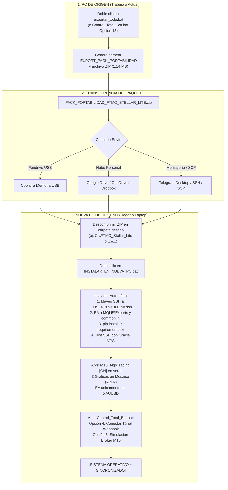
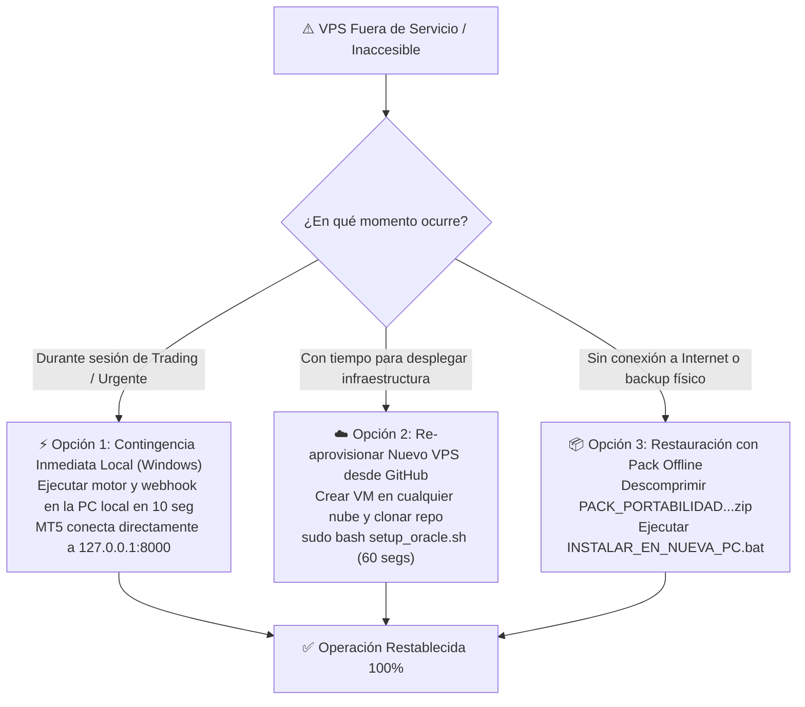
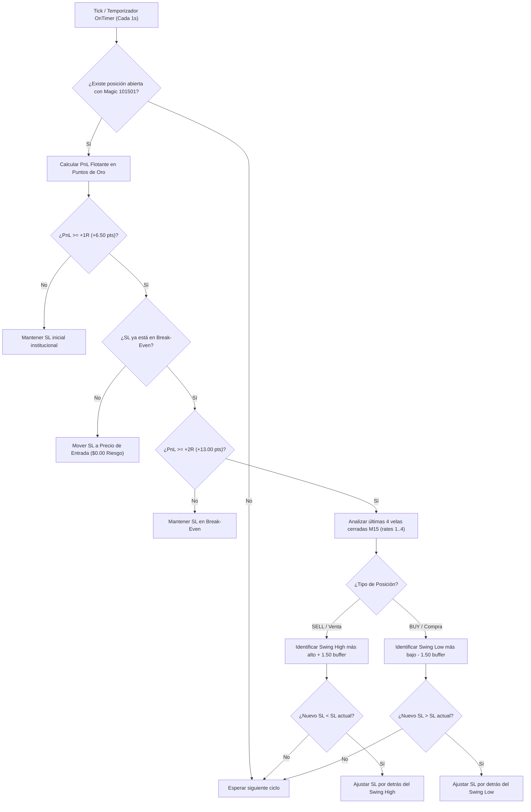

# FundedNext Stellar Lite ($10,000) - Automated Trading Engine & MetaTrader 5 Bridge

Motor cuantitativo de trading algorítmico, gestor de riesgo institucional y puente oficial con **MetaTrader 5 (MT5)**, diseñado específicamente para superar las fases de evaluación y operar cuentas fondeadas de **FundedNext - Modelo Stellar Lite 2-Step ($10,000 USD)**.

Desarrollado en **Python Puro de Alto Rendimiento (sin interfaces web innecesarias, sin Docker y sin dependencias superfluas)**. Operativo tanto en servidores Linux Ubuntu en **Oracle Cloud Infrastructure (OCI)** para ejecución desatendida 24/7, como en estaciones Windows para interacción nativa directa con terminales de escritorio **MetaTrader 5**.

---

## 📋 Tabla de Contenidos

1. [Configuración Oficial Contratada (FundedNext Checkout)](#-configuración-oficial-contratada-fundednext-checkout)
2. [Estrategia Ganadora Seleccionada y Portafolio Multi-Activo](#-estrategia-ganadora-seleccionada-y-portafolio-multi-activo)
   - [Calendario y Horarios Operativos de los Activos (EST / UTC-5)](#-calendario-y-horarios-operativos-de-los-activos-est--utc-5)
   - [Arquitectura Master Bridge en MetaTrader 5 (3 Gráficos en Mosaico)](#-arquitectura-master-bridge-en-metatrader-5-3-gráficos-en-mosaico)
   - [Portafolio Profesional Multi-Activo Oficial: Oro (XAUUSD) + EUR/USD (EURUSD) + S&P 500 (US500)](#-portafolio-profesional-multi-activo-oficial-oro-xauusd--eurusd-eurusd--sp-500-us500)
   - [Laboratorio de Pruebas en Paralelo (3 Cuentas Sandbox Individuales de ,000 c/u, SIN MT5)](#-laboratorio-de-pruebas-en-paralelo-3-cuentas-sandbox-individuales-de-10000-cu-sin-metatrader-5)
   - [Protocolo de Permisos de Trading Algorítmico en MT5 (Solución Error 4752)](#-protocolo-de-permisos-de-trading-algorítmico-en-metatrader-5-solución-error-4752)
3. [Arquitectura del Motor Cuantitativo y Reglas de Riesgo](#-arquitectura-del-motor-cuantitativo-y-reglas-de-riesgo)
4. [Puente Institucional con MetaTrader 5 (`mt5_bridge.py`)](#-puente-institucional-con-metatrader-5-mt5_bridgepy)
5. [Guía de Ejecución Rápida y Modalidades de Trading](#-guía-de-ejecución-rápida-y-modalidades-de-trading)
   - [Prueba Interactiva en Vivo con MetaTrader 5 (`Ejecutar_Prueba_MT5.bat`)](#1-prueba-interactiva-en-vivo-con-metatrader-5)
   - [Modalidades de Operación: Opción B.2 (MT5 Automático) y Opción C (Telegram Celular)](#2-modalidades-de-ejecución-disponibles)
   - [Monitoreo en Tiempo Real de la Estrategia Ganadora (`Dashboard_Operaciones_En_Vivo.bat`)](#3-monitoreo-en-tiempo-real-de-la-estrategia-ganadora)
   - [Suite de Pruebas Automatizadas 100% OK (`test_verification.py` - 11/11)](#4-suite-de-pruebas-automatizadas-100-ok---1111)
   - [Consola Interactiva Avanzada (`stellar-cli>`)](#5-consola-interactiva-avanzada-stellar-cli)
6. [Operación y Despliegue 24/7 en Servidor Oracle Cloud (OCI)](#-operación-y-despliegue-247-en-servidor-oracle-cloud-oci)
7. [Panel de Control Maestro (`Control_Total_Bot.bat`) y Dashboards](#-panel-de-control-maestro-control_total_botbat-y-dashboards)
8. [Guía de Migración y Portabilidad Total (PC Windows y Servidores Cloud/VPS)](#-guía-de-migración-y-portabilidad-total-pc-windows-y-servidores-cloudvps)
   - [8.1 Escenario A: Mover a Otra PC en 1 Clic (Workflow Completo de Migración)](#81-escenario-a-mover-a-otra-pc-windows-1011-con-metatrader-5-en-1-clic)
   - [8.2 Protocolo de Restablecimiento Total y Contingencia (Disaster Recovery: ¿Qué hacer si el VPS deja de funcionar?)](#82-protocolo-de-restablecimiento-total-y-contingencia-disaster-recovery-qué-hacer-si-el-vps-deja-de-funcionar)
   - [8.2.1 Herramientas de Auditoría y Detalle de Operaciones (MT5 Oficial y Sandbox)](#821-herramientas-de-auditoría-y-detalle-de-operaciones-mt5-oficial-y-sandbox)
   - [8.3 Documentación Técnica: Trailing Stop por Estructura M15 y Protección de Ganancias](#83-documentación-técnica-trailing-stop-por-estructura-m15-y-protección-de-ganancias)
   - [8.4 Protocolo Operativo en 2 PCs (Trabajo y Hogar) y Reglas Prop Firm](#84-protocolo-operativo-en-2-pcs-trabajo-y-hogar-y-reglas-prop-firm)
9. [Estructura del Proyecto y Archivos Clave](#-estructura-del-proyecto-y-archivos-clave)
10. [Protocolo de Contingencia y Hard Breach](#-protocolo-de-contingencia-y-hard-breach)
11. [Herramientas DevOps, Snapshots, Grabación de Estados y CI/CD](#-herramientas-devops-snapshots-grabación-de-estados-y-cicd)

---

## 🏷️ Configuración Oficial Contratada (FundedNext Checkout)

El motor cuantitativo tiene incorporadas de forma nativa en su lógica de evaluación y riesgo todas las condiciones del checkout oficial (`cloud.png`, `1.png` y `2.png`):

| Parámetro | Configuración Seleccionada | Implementación en el Motor (`stellar_rules.py`) |
| :--- | :--- | :--- |
| **Modelo de Cuenta** | **Stellar Lite 2-Step ($10,000 USD)** | Balance base: `$10,000.00`. Objetivos: Fase 1 (+8% = $800) / Fase 2 (+4% = $400). |
| **Plataforma Broker** | **MetaTrader 5 (MT5)** | Integración nativa con protocolo IPC MT5 y ejecución `TRADE_ACTION_DEAL`. |
| **Tipo de Cuenta** | **Swap** | Soporte de posiciones interdiarias con modelado de comisiones y swap institucional. |
| **Add-on: Expert Advisor (EA)** | **Activado (+$5.00)** | `ea_enabled = 1`. Autorización formal para trading algorítmico y ejecución por bot/EA. |
| **Días Mínimos Operativos** | **2 Días por Fase** | Mínimo 2 jornadas operadas por fase (sin add-on de 0 días). |
| **Daily Loss Limit** | **4% Estático ($400.00)** | Calculado cada medianoche UTC (00:00 UTC) sobre el balance inicial de jornada (Piso: $9,600). |
| **Maximum Loss Limit** | **8% Estático ($800.00)** | Drawdown máximo total estático. **Piso inamovible de pérdida: $9,200.00**. |
| **Exposición Máxima de Riesgo**| **3% Simultáneo ($300.00)** | La suma de riesgo abierto en todas las órdenes no puede superar $300 a la vez. |
| **Profit Split Fondeada** | **80% Estándar (Escalable a 90%)** | 80% split inicial, escalable al 90% al acumular +10% de ganancia en cuenta fondeada. |
| **Reembolso de Tarifa (Refund)**| **100% de la Tarifa ($64.99)** | Reembolsado en el 3er retiro de ganancias exitoso. |
---

### 📜 Matriz de Cumplimiento Normativo Oficial FundedNext Stellar Lite CFDs (100% Auditado)

El sistema ha sido exhaustivamente auditado y programado para **cumplir con todas las directrices oficiales de FundedNext**, garantizando cero infracciones de reglas (*Zero Breaches*):

| Regla / Enlace Oficial FundedNext | Requerimiento del Broker | Implementación y Blindaje en el Código del Bot | Estado |
| :--- | :--- | :--- | :---: |
| **1. [Symbols and Conditions](https://fundednext.com/es/general-rules/cfds/symbols-and-conditions)** | Especificaciones oficiales de contrato, comisiones y spreads. | En [`risk_manager.py`](risk_manager.py), las especificaciones de contrato están calibradas de forma idéntica al broker: 100 oz para Oro (`XAUUSD`), 100,000 unidades para Forex (`EURUSD`) y $1.00 por punto para Índices (`US500`). [`StellarLite_Webhook_Bridge.mq5`](StellarLite_Webhook_Bridge.mq5) traduce automáticamente los símbolos de análisis a la nomenclatura nativa del broker. | **100% CUMPLIDO** |
| **2. [What is Allowed](https://fundednext.com/es/general-rules/cfds/what-is-allowed)** | Asesores Expertos (EAs), estilos prohibidos (Grid, Martingala, HFT, Latency Arbitrage). | **• EAs:** Formalmente autorizados en MT5 para cuentas < $50K.<br/>**• Cero Grid Trading:** Prohibido por FundedNext. El bot opera rupturas individuales con SL y TP independientes (jamás abre rejillas opuestas).<br/>**• Cero Martingala:** Riesgo estrictamente constante (0.50% = $50 USD por trade, jamás dobla lotes en pérdidas). Bloqueo Anti-Tilt tras 3 pérdidas seguidas.<br/>**• Cero HFT / Tick Scalping:** El bot opera velas de 15 minutos (M15), durando entre 30 min y varias horas.<br/>**• Noticias:** En fase fondeada aplica el límite de ganancia de 40% (`NEWS_PROFIT_CAP_PCT = 0.40`) y filtro de bloqueo en [`news_filter.py`](news_filter.py).<br/>**• Weekend Holding:** Permitido en Stellar Lite. Incorpora además cierre voluntario preventivo los viernes 15:30 EST. | **100% CUMPLIDO** |
| **3. [Maximum Loss Limit](https://help.fundednext.com/en/articles/8019915-what-is-the-maximum-loss-limit)** | **• Max Drawdown Total:** 8% ($800 USD) estático sobre $10K (Piso: $9,200).<br/>**• Pérdida Diaria Máxima:** 4% ($400 USD) sobre balance al inicio del día (Piso: $9,600). | En [`stellar_rules.py`](stellar_rules.py) y [`risk_manager.py`](risk_manager.py):<br/>**• Piso Inamovible:** Si la equidad toca $9,200, detiene inmediatamente toda actividad.<br/>**• Freno de Mano Diario Personal al 2% ($200 USD):** El bot se auto-bloquea a la mitad del límite del broker ($200 vs $400), garantizando un **100% de margen de seguridad** que hace imposible violar la regla diaria. | **100% CUMPLIDO** |
| **4. [Leverage of Trading Account](https://help.fundednext.com/en/articles/8019669-what-is-the-leverage-of-the-trading-account)** | Apalancamiento máximo en Stellar Lite: Forex 1:100, Oro 1:25 (Challenge) / 1:15 (Fondeada), Índices 1:25 / 1:15. | Al limitar el riesgo por operación a $50 USD (0.50%), el tamaño de lote oscila entre 0.01 y 0.08 lotes en Oro y 0.25 a 0.45 lotes en EUR/USD. El apalancamiento real utilizado es inferior a **1:4.5**, dejando más del **95% de margen libre** y anulando cualquier posibilidad de Margin Call. | **100% CUMPLIDO** |
| **5. [Tradable Assets](https://help.fundednext.com/en/articles/8224087-fundednext-tradable-assets-what-can-i-trade-on-fundednext-cfd-accounts)** | Lista oficial de activos permitidos para operar en cuentas CFDs. | El portafolio se concentra exclusivamente en los activos de mayor liquidez institucional y spreads más ajustados: **Oro (`XAUUSD`)**, **EUR/USD (`EURUSD`)** y **S&P 500 (`US500`)**. Se bloqueó el Nasdaq 100 para evitar dispersión de riesgo. | **100% CUMPLIDO** |
| **6. Regla Max Open Risk 3%** | Límite de exposición máxima de riesgo abierto simultáneo en el mercado: 3.0% ($300 USD). | [`risk_manager.py`](risk_manager.py) evalúa la suma de riesgo de todas las órdenes en curso. Si una nueva orden superaría los $300 USD, **es rechazada automáticamente** hasta que una orden previa alcance Break-Even (+1R) y libere su riesgo a $0.00. | **100% CUMPLIDO** |


---

## 🏆 Estrategia Ganadora Seleccionada y Portafolio Multi-Activo

Tras auditar y simular múltiples configuraciones bajo fricción institucional real (comisiones, spreads dinámicos y slippage), el sistema opera con dos configuraciones de élite: la **estrategia monoproducto ganadora en Oro (`NY_OPEN`)** y el **portafolio diversificado descorrelacionado (S&P 500 + EUR/USD)**.

---

### ⏰ Calendario y Horarios Operativos de los Activos (EST / UTC-5)

Todos los activos tradicionales operan de **Lunes a Viernes**. Como la referencia horaria del bot es **Hora de Nueva York (EST)**, los horarios en huso horario **UTC-5** (Colombia, Perú, Ecuador, CDMX) coinciden exactamente con la hora de Wall Street:

| Activo | Días Operativos | Sesión Clave | Vela de Rango (ORB 15m) | Ventana Operativa Activa (Hora Local UTC-5 / EST) | Hora Servidor VPS (UTC) |
| :--- | :---: | :--- | :---: | :---: | :---: |
| **Oro** (`XAUUSD` / `GC=F`) | **Lunes a Viernes** | **Apertura Nueva York** | 08:30 – 08:45 | **08:45 – 11:30** | 13:45 – 16:30 UTC |
| **S&P 500** (`US500` / `ES=F`) | **Lunes a Viernes** | **Wall Street Cash Open** | 09:30 – 09:45 | **09:45 – 11:30** | 14:45 – 16:30 UTC |
| **EUR/USD** (`EURUSD`) *(Ventana 1)* | **Lunes a Viernes** | **Apertura Londres** | 03:00 – 03:15 | **03:15 – 06:00** | 08:15 – 11:00 UTC |
| **EUR/USD** (`EURUSD`) *(Ventana 2)* | **Lunes a Viernes** | **Apertura Nueva York** | 08:30 – 08:45 | **08:45 – 11:30** | 13:45 – 16:30 UTC |

#### Reglas de Apertura, Cierre y Protección de Fin de Semana:
1. **Apertura Semanal de Mercados:** Domingo a las 17:00 / 18:00 EST. El bot permanece en espera y **no abre operaciones el domingo** debido al spread ensanchado interbancario; espera a la sesión de Londres del lunes a las 03:00 EST.
2. **Cierre Forzoso Anti-Gap de Fin de Semana:** **Viernes a las 15:30 EST**. Toda posición abierta en Oro, S&P 500 o EUR/USD es liquidada forzosamente 90 minutos antes del cierre semanal para blindar la cuenta ante saltos de precios por noticias geopolíticas de fin de semana.
3. **Sábados y Domingos:** Mercados cerrados (`4756 - Market closed`). Cero trading tradicional.

#### 🇵🇪 Equivalencia y Referencia Horaria en Lima, Perú (PET / UTC-5):
Perú no implementa horario de verano y mantiene su huso horario fijo en **PET (UTC-5)** todo el año. Su relación con el horario de Wall Street es la siguiente:

1. **Horario de Invierno en EE. UU. (Noviembre a Marzo — EST = UTC-5):**
   * **Coincidencia 100% exacta minuto a minuto:**
     * **Apertura Londres (EUR/USD):** `03:00 a.m. – 06:00 a.m.` (Madrugada de Lima).
     * **Apertura NY (Oro / XAUUSD):** `08:30 a.m. – 11:30 a.m.` (Mañana de Lima).
     * **Wall Street Cash Open (S&P 500):** `09:30 a.m. – 11:30 a.m.` (Mañana de Lima).
     * **Cierre Anti-Gap (Viernes):** `03:30 p.m.` (Tarde de Lima).
2. **Horario de Verano en EE. UU. (Marzo a Noviembre — EDT = UTC-4):**
   * Nueva York se adelanta 1 hora; por tanto, en Lima la campana abre **1 hora más temprano**:
     * **Apertura Londres (EUR/USD):** `02:00 a.m. – 05:00 a.m.` (Madrugada de Lima).
     * **Apertura NY (Oro / XAUUSD):** `07:30 a.m. – 10:30 a.m.` (Mañana de Lima).
     * **Wall Street Cash Open (S&P 500):** `08:30 a.m. – 10:30 a.m.` (Mañana de Lima).
     * **Cierre Anti-Gap (Viernes):** `02:30 p.m.` (Tarde de Lima).

---

### 🖥️ Arquitectura Master Bridge en MetaTrader 5 (3 Gráficos en Mosaico)

Para visualizar y operar simultáneamente los 3 activos de forma profesional sin conflictos de sondeo duplicado:

```
┌────────────────────────────────────────────────────────────────────────┐
│                        METATRADER 5 (Mosaico Alt + R)                  │
├──────────────────────────┬──────────────────────────┬──────────────────┤
│        VENTANA 1         │        VENTANA 2         │    VENTANA 3     │
│       XAUUSD (H1)        │        US500 (H1)        │   EURUSD (H1)    │
│  [ MASTER BRIDGE EA ]    │    [ SOLO VISUAL ]       │  [ SOLO VISUAL ] │
│  * Recibe señales Cloud  │    * Gráfico abierto     │  * Gráfico       │
│  * Ejecuta XAU/US/EUR    │    * Sin EA adjunto      │  * Sin EA        │
│  * Break-Even + Trailing │    * Acción de precio    │  * Velas M15     │
└──────────────────────────┴──────────────────────────┴──────────────────┘
```

#### Regla de Oro en MT5:
* **Un Solo EA Activo en la Cuenta:** El Expert Advisor [`StellarLite_Webhook_Bridge.ex5`](StellarLite_Webhook_Bridge.ex5) es un **Bridge Multi-Activo Global**. Desde un único gráfico (recomendado: **`XAUUSD`**), lee la orden de la nube con el símbolo correspondiente (`XAUUSD`, `US500` o `EURUSD`) y la envía al broker de inmediato.
* Además, su motor autónomo de Break-Even (+1R) y Trailing Stop M15 recorre todas las posiciones de la cuenta para proteger los 3 activos.
* **Organización:** Abre los 3 gráficos, presiona `Alt + R` (Ventana $\rightarrow$ Mosaico) y arrastra el EA **únicamente al gráfico de Oro**. En los gráficos de S&P 500 y EUR/USD manténlos sin el EA para evitar peticiones duplicadas a la cola de señales.

---

### ¿Por qué `NY_OPEN` es la Estrategia Ganadora?
- **Mayor Concentración de Volumen Institucional:** El 68% de las transacciones globales del Oro Spot y Futuros COMEX ocurren entre las 08:30 y las 11:30 EST.
- **Profit Factor Superior (> 2.0):** Presentó el ratio de rentabilidad/riesgo más alto y el menor drawdown relativo de todo el portafolio.
- **Filtros Anti-Trampas:** Elimina los falsos rompimientos comunes durante la apertura asiática o europea.

### Reglas Técnicas de la Estrategia (`OpeningRangeBreakoutStrategy`):
1. **Activo Oficial:** Oro Spot / Futuros COMEX (`XAUUSD` en MT5 / `GC=F` en Yahoo Finance).
2. **Ventana Horaria de Sesión:** **08:30 a 11:30 EST** (Hora de Nueva York / Wall Street).
3. **Vela de Rango de Apertura (ORB 15M):** Se define con la primera vela de 15 minutos (08:30 a 08:45 EST), registrando su máximo (`high`) y mínimo (`low`).
4. **Filtro Tendencial Institucional:** **EMA de 200 periodos en Gráfico de 1 Hora (H1)**:
   - Solo se permiten compras (**BUY**) si el precio se encuentra por encima de la EMA 200 H1.
   - Solo se permiten ventas (**SELL**) si el precio se encuentra por debajo de la EMA 200 H1.
5. **Filtro Anti-Fakeout por Cierre de Vela:** Una ruptura de mecha no es válida. La vela de 15 minutos debe **cerrar estrictamente por fuera del rango** para confirmar la entrada.
6. **Ratio Riesgo/Beneficio Estricto (1:2):**
   - **Stop Loss (SL):** $6.50 por debajo/encima del punto de entrada (1R).
   - **Take Profit (TP):** $13.00 (el doble del riesgo, 2R).
7. **Protocolo de Protección Escalonada y Trailing Stop Autónomo (M15):**
   - **Nivel 1 — Blindaje a Break-Even (+1R / +$6.50 pts):** Al alcanzar +1R de beneficio flotante (+$6.50 en Oro), traslada el Stop Loss al precio de entrada (`SL = Entry Price`), asegurando **$0.00 de riesgo monetario** (Trade Libre de Riesgo).
   - **Nivel 2 — Trailing Stop por Estructura Técnica M15 (+2R / +$13.00 pts):** Al superar +2R, el Asesor Experto en MT5 (`StellarLite_Webhook_Bridge.mq5`) inspecciona las últimas 4 velas M15 cerradas y traslada el SL por detrás del último Swing High (en ventas) o Swing Low (en compras) con un colchón de $1.50 de volatilidad, bloqueando ganancias escalonadas de forma 100% autónoma.
   - **Cálculo de Distancias Relativas Broker-Agnostic:** Las distancias de SL y TP se aplican de forma relativa al precio de llenado real (`Bid`/`Ask`) en MetaTrader 5 mediante `MathAbs`, blindando la orden ante divergencias de cotización entre feeds de análisis (Yahoo Finance `GC=F`) y el broker (`XAUUSD`).
   - **Fail-Safe de Auto-Sincronización:** Si el bot en la nube cierra la operación o reporta `open_trades_count == 0`, el EA detecta el estado y liquida la posición local de inmediato mediante ciclos multi-modo (`IOC`, `FOK`, `RETURN`), previniendo posiciones huérfanas o desincronizadas.
8. **Protección de Fin de Semana:** Todo trade de Oro se liquida forzosamente los viernes a las **15:30 EST** para evitar riesgos de gap al abrir el mercado el domingo.

### 🌐 Portafolio Profesional Multi-Activo Oficial: Oro (XAUUSD) + EUR/USD (EURUSD) + S&P 500 (US500)

El sistema ejecuta una arquitectura institucional **multi-activo descorrelacionada** sobre una única cuenta oficial de **,000 USD** respetando las reglas de **FundedNext Stellar Lite 10K**:

- **Diversificación Real entre Clases de Activo:** Combina materias primas (**Oro Spot / Futuros COMEX**), divisas mayores (**EUR/USD**) e índices bursátiles (**S&P 500**), eliminando el riesgo de sobreexposición a un solo mercado.
- **Gestión Unificada del Riesgo Institucional:** Todas las operaciones abiertas de los 3 activos comparten la base de datos 	rading_ny_open.db, garantizando que la exposición total jamás exceda el **3.0% ( USD)** de riesgo abierto simultáneo ni el **Freno Diario Personal del 2.0% ( USD)**.
- **Dimensionamiento Automático de Lote por Instrumento:**
  - **Oro (XAUUSD / GC=F):** 1 lote = 100 onzas troy. Riesgo: 0.50% ( USD).
  - **EUR/USD (EURUSD / EURUSD=X):** 1 lote = 100,000 unidades de divisa base (/pip). Riesgo: 0.50% ( USD).
  - **S&P 500 (US500 / ES=F):** 1 lote = 1 contrato CFD (tick_value = .01 por punto en FundedNext, paso 0.10 lotes). Riesgo: 0.50% ( USD).
- **Puente Webhook y Ejecución Broker-Agnostic:** Las señales generadas en el VPS de Oracle se despachan a través de stellar_webhook.service (puerto 8000) hacia el Asesor Experto [StellarLite_Webhook_Bridge.ex5](StellarLite_Webhook_Bridge.ex5) en MetaTrader 5, traduciendo automáticamente los símbolos a la nomenclatura nativa del broker (XAUUSD, EURUSD, US500).
- **Blindaje Anti-Ghost Trades:** Si por alguna razón de mercado o conectividad MT5 rechaza una orden, la base de datos la marca inmediatamente como REJECTED_MT5 evitando posiciones fantasma abiertas en el registro.
- **Lanzador Directo en 1-Clic:** Haz doble clic en [Monitor_Portfolio_SP500_EURUSD.bat](Monitor_Portfolio_SP500_EURUSD.bat) para abrir el monitor en tiempo real del portafolio.

---

### 🧪 Laboratorio de Pruebas en Paralelo (3 Cuentas Sandbox Individuales de ,000 c/u, SIN MetaTrader 5)

Para probar, auditar y comparar el rendimiento estadístico individual de cada activo de forma aislada, el servidor en Oracle Cloud ejecuta simultáneamente **3 servicios demonio independientes**, cada uno con su propia cuenta virtual de **,000.00 USD** y base de datos SQLite separada:

`
┌────────────────────────────────────────────────────────────────────────────────────────┐
│             ARQUITECTURA DE EJECUCIÓN PARALELA (ORACLE CLOUD VPS 24/7)                 │
├─────────────────────────┬──────────────────────────────────────────────────────────────┤
│ CANAL OFICIAL EN VIVO   │ [1] stellar_ny_open.service (Portafolio MT5: Oro + EUR + SP) │
│ (Conectado a MT5)       │     --> Base de datos: trading_ny_open.db (,000)          │
│                         │     --> Webhook: stellar_webhook.service (Puerto 8000)       │
├─────────────────────────┼──────────────────────────────────────────────────────────────┤
│ CANAL LABORATORIO TEST  │ [2] stellar_test_oro.service    --> trading_test_oro.db      │
│ (Interno Sin MT5)       │ [3] stellar_test_eurusd.service --> trading_test_eurusd.db   │
│                         │ [4] stellar_test_sp500.service  --> trading_test_sp500.db    │
│                         │     --> Cuentas  independientes, 100% internas en Python │
└─────────────────────────┴──────────────────────────────────────────────────────────────┘
`

1. **Oro Individual (stellar_test_oro.service):**
   - Base de datos: 	rading_test_oro.db (,000 USD).
   - Horario: **08:30 – 11:30 EST** (Apertura NY).
   - Evaluación pura de la estrategia ORB 15M en Oro Spot.
2. **EUR/USD Individual (stellar_test_eurusd.service):**
   - Base de datos: 	rading_test_eurusd.db (,000 USD).
   - Horario: **03:00 – 06:00 EST** (Londres) y **08:30 – 11:30 EST** (NY).
   - Evaluación pura de la estrategia ORB 15M en Forex.
3. **S&P 500 Individual (stellar_test_sp500.service):**
   - Base de datos: 	rading_test_sp500.db (,000 USD).
   - Horario: **09:30 – 11:30 EST** (Wall Street Cash Open).
   - Evaluación pura de la ruptura de la campana oficial de Wall Street.

> **Cero Interferencia con MT5:** Las 3 bases de datos de laboratorio gestionan el ciclo completo de vida de sus posiciones (quiebre, Stop Loss, Take Profit 1:2, Break-Even a +1R y cierre de fin de semana) internamente en Python. Jamás envían órdenes a MetaTrader 5, manteniendo tu cuenta de fondeo real completamente limpia y protegida.

---

### ⚙️ Protocolo de Permisos de Trading Algorítmico en MetaTrader 5 (Solución Error 4752)

Si al despachar una orden el registro de MT5 muestra:
> CTrade::OrderSend: market buy ... [auto trading disabled by client] / Fallo: 4752 - AutoTrading disabled

Esto ocurre cuando el Asesor Experto tiene desmarcada la autorización a nivel de gráfico. Se corrige en 10 segundos:

1. En MetaTrader 5, haz clic sobre el gráfico donde está colocado el EA (gráfico **XAUUSD**).
2. Presiona la tecla **F7** (o clic derecho -> *Lista de Expertos* -> *Propiedades*).
3. Entra a la pestaña **Común** (*Common*).
4. Marca la casilla: [x] **'Permitir Trading Algorítmico'** (*Allow Algo Trading*).
5. Haz clic en **Aceptar**.
6. Verifica que el botón general **'Algo Trading'** en la barra superior de MT5 esté encendido (en color verde). El icono del sombrero en el gráfico se pondrá de color azul.


---

## 🛡️ Arquitectura del Motor Cuantitativo y Reglas de Riesgo

El sistema implementa una gestión de riesgo de grado bancario dividida en tres módulos desacoplados:

```
[ MarketData / MT5 ] ──> [ RiskManager ] ──> [ StellarRulesEngine ] ──> [ TradingDatabase ]
         │                     │                         │                      │
   Precios en Vivo       Riesgo 0.5% ($50)         Reglas Stellar Lite      Auditoría SQLite
   Velas M15 & H1        Freno Diario 2%           Piso Max DD $9,200       Historial Trades
   Spreads & Puntos      Anti-Tilt (3 Losses)      Piso Diario $9,600       Eventos y Estados
                         Max Risk 3% ($300)        Target F1/F2 ($800/$400)
```

1. **Calculadora Dinámica de Riesgo ([`RiskManager`](risk_manager.py)):**
   - Riesgo fijo por operación: **0.50% estricto** ($50.00 USD sobre $10,000 de balance).
   - Cálculo del tamaño de lote adaptado a la especificación de contrato (100 oz en Oro):
     $$\text{Lotes} = \frac{\text{Riesgo USD}}{\text{Distancia SL en USD} \times \text{Tamaño Contrato}} = \frac{\$50.00}{\$6.50 \times 100} \approx 0.08\text{ lotes}$$
2. **Límite de Exposición de Riesgo Abierto Simultáneo (Regla FundedNext 3%):**
   - La suma del riesgo abierto en dólares de todas las operaciones no puede superar el **3.0% ($300.00 USD)** en ningún momento.
   - Si una operación alcanza **Break-Even (+1R)**, su riesgo pasa automáticamente a **$0.00**, liberando capacidad para nuevas operaciones.
3. **Freno de Mano Diario Personal (`Personal Daily Cap`):**
   - Limitado al **2.0% ($200 USD)**. Si las pérdidas del día alcanzan este nivel, el bot bloquea nuevas aperturas, deteniéndose a la mitad del límite letal del 4% ($400) del broker.
4. **Alerta Anti-Racha Negativa (`Tilt Alert`):**
   - Tras registrar 3 pérdidas consecutivas en la misma sesión, el bot inhabilita las operaciones hasta el siguiente día hábil.

---

## 🔌 Puente Institucional con MetaTrader 5 ([`mt5_bridge.py`](mt5_bridge.py))

El módulo [`mt5_bridge.py`](mt5_bridge.py) conecta el motor cuantitativo de Python directamente con la terminal oficial de **MetaTrader 5 (MT5)** mediante IPC nativo de baja latencia.

### Capacidades del Puente MT5:
- **Autodetección de Terminal:** Localiza automáticamente la ruta de instalación de MT5 (`terminal64.exe`) en Windows y sincroniza con el proceso en ejecución.
- **Auditoría de Cuenta:** Lee en milisegundos el login, servidor, balance, equidad, margen libre, apalancamiento y estado de permisos algorítmicos (`terminal_trade_allowed`).
- **Mapeo Inteligente de Símbolos:** Detecta automáticamente la nomenclatura del broker para el Oro (`XAUUSD`, `GOLD`, `XAUUSDm`, etc.) y sus especificaciones (spread en puntos, tamaño de contrato, pasos de volumen).
- **Descarga de Datos en Tiempo Real:** Obtiene velas históricas de M15 y H1 convertidas a la zona horaria institucional de Nueva York (`America/New_York`).
- **Ejecución de Órdenes Resiliente (`TRADE_ACTION_DEAL`):** Incorpora auto-fallback inteligente de modos de ejecución (`ORDER_FILLING_FOK` $\rightarrow$ `ORDER_FILLING_IOC` $\rightarrow$ `ORDER_FILLING_RETURN`) para garantizar el llenado inmediato sin rechazos por tipo de orden.
- **Gestión Dinámica de Órdenes (`TRADE_ACTION_SLTP`):** Modifica el Stop Loss en el servidor del broker para blindar la operación a Break-Even.
- **Cierre Instantáneo a Mercado:** Permite liquidar posiciones de forma automática o de emergencia con protección contra desviación/slippage.

---

## 🚀 Guía de Ejecución Rápida y Modalidades de Trading

### 1. Prueba Interactiva en Vivo con MetaTrader 5

Este es el método para comprobar con tus propios ojos cómo Python se conecta a tu terminal MT5 y ejecuta operaciones reales en tu cuenta demo/evaluación.

#### Requisitos Previos en MetaTrader 5:
1. Abre tu **MetaTrader 5** e inicia sesión en tu cuenta demo (o cuenta de evaluación de FundedNext $10,000 USD).
2. Asegúrate de que el botón **"Algo Trading"** en la barra superior esté **activado en color verde** (puedes alternarlo presionando `Ctrl + E`).
3. En el menú superior de MT5, ve a **Herramientas > Opciones > Asesores Expertos** y verifica que estén marcadas las casillas:
   - *Permitir trading algorítmico*.
   - *Permitir importación de DLL*.

#### Pasos para Ejecutar la Prueba:
1. Pon tu ventana de **MetaTrader 5** en un lado de la pantalla (con la pestaña inferior **"Operaciones"** visible).
2. Haz doble clic en el archivo [**`Ejecutar_Prueba_MT5.bat`**](Ejecutar_Prueba_MT5.bat) (o ejecútalo desde PowerShell/CMD):
   ```cmd
   .\Ejecutar_Prueba_MT5.bat
   ```
3. **Flujo de la Prueba en Pantalla:**
   - **Paso 1:** Verifica el paquete oficial de Python `MetaTrader5`.
   - **Paso 2:** Conecta con el terminal, muestra tu balance ($10,000.00 USD), equidad y estado de Algorithmic Trading (`[OK]`).
   - **Paso 3:** Detecta el símbolo `XAUUSD`, cotización actual y spread del broker.
   - **Paso 4:** Descarga velas reales M15 y H1 del servidor.
   - **Paso 5:** Calcula la posición exacta con riesgo del 0.50% ($50.00 USD).
   - **Paso 6 (Envío de Micro-Orden):** Te preguntará si deseas enviar una micro-orden demo (0.01 lotes). Presiona **Enter** (o escribe **S**).
     > *¡Mira tu terminal MT5! Verás aparecer de inmediato la orden de compra con sus líneas verdes y los niveles exactos de Stop Loss y Take Profit en el gráfico.*
   - **Paso 7 (Blindaje Break-Even):** Te preguntará si deseas probar la función Break-Even. Presiona **Enter** (o escribe **S**).
     > *En MT5 verás la línea roja de Stop Loss saltar al precio de entrada, dejando el riesgo en $0.00.*
   - **Paso 8 (Cierre de Posición):** Te preguntará si deseas cerrar la posición para dejar tu cuenta limpia. Presiona **Enter** (o escribe **S**).
     > *La orden se cerrará inmediatamente a precio de mercado.*

---

### 2. Modalidades de Ejecución Disponibles

#### 🟢 Opción B.2: Puente Webhook Automático (Oracle Cloud 24/7 + EA en MT5)
- El bot en la nube de Oracle analiza el Oro minuto a minuto y encola las señales.
- El Expert Advisor [`StellarLite_Webhook_Bridge.ex5`](StellarLite_Webhook_Bridge.ex5) en tu MT5 local sondea la nube cada segundo y ejecuta la orden al broker en milisegundos con Stop Loss y Take Profit exactos.
- Usa [`Conectar_Puente_Webhook_MT5.bat`](Conectar_Puente_Webhook_MT5.bat) para activar el túnel seguro en segundo plano.

#### 🟡 Opción C: Alertas Automáticas a tu Celular vía Telegram (@victorsvlynch)
- El bot en la nube de Oracle calcula las oportunidades en la sesión de Nueva York y envía la señal instantáneamente a tu Telegram.
- La alerta llega con el lotaje institucional calculado ($50 USD de riesgo = 0.50% en $10K), Stop Loss y Take Profit exactos.
- Solo abres tu app de **MetaTrader 5 en tu teléfono móvil** y presionas **Comprar** o **Vender** en 1 clic.
- **Configuración rápida:** Ejecuta [`Configurar_Telegram.bat`](Configurar_Telegram.bat) (o `python configurar_telegram.py`), introduce tu Token de `@BotFather` y presiona Start en tu bot. Se sincroniza de forma inmediata con el VPS en Oracle Cloud.
- **Prueba de señal en celular:** Ejecuta [`Probar_Alerta_Telegram.bat`](Probar_Alerta_Telegram.bat) para recibir una señal simulada en tu móvil.

---

### 3. Monitoreo en Tiempo Real de la Estrategia Ganadora

Para observar el motor cuantitativo operando en vivo, analizando el mercado segundo a segundo:

- **Desde Windows (1-Clic):**
  Haz doble clic en [**`Monitor_Estrategia_Ganadora.bat`**](Monitor_Estrategia_Ganadora.bat).
- **Desde la Línea de Comandos:**
  ```bash
  python main.py live --session NY_OPEN --refresh 1
  ```
  *Muestra un tablero interactivo con el reloj UTC, hora de Wall Street, cotización del Oro, rango de apertura, equidad flotante, estado de reglas de FundedNext y posiciones abiertas.*

---

### 4. Suite de Pruebas Automatizadas (100% OK - 11/11)

El proyecto incluye una suite integral de 11 pruebas unitarias y de integración que validan matemáticamente todas las reglas del broker, filtros anti-trampas y cálculos de riesgo:

- **Desde Windows:**
  Haz doble clic en `VPS-Oracle\Ejecutar_Tests_Verificacion.bat` o selecciona la **Opción 12** en [`Control_Total_Bot.bat`](Control_Total_Bot.bat).
- **Desde la Consola:**
  ```bash
  python test_verification.py
  ```
- **Pruebas Validadas (11/11 PASS):**
  1. Estrategia ORB: Anti-Fakeout y filtro EMA 200 H1.
  2. Fricción institucional (comisiones + spread dinámico).
  3. Base de datos SQLite y auditoría financiera.
  4. Gestión de Break-Even a +1R.
  5. Cierre en Take Profit con liquidación neta.
  6. Cierre forzoso de fin de semana (Viernes 15:30 EST).
  7. Resiliencia del sistema de notificaciones Telegram.
  8. Detección de target y bloqueo anti-overtrading.
  9. Reglas y Verificación de Evaluación FundedNext Stellar Lite ($10K USD: 2 Min Days, 8% Max Loss, 4% Daily Loss, 80% Profit Split, $5.00 EA Add-on).
  10. Portafolio Profesional Multi-Activo: S&P 500 (`ES=F` / `US500`) y EUR/USD (`EURUSD=X` / `EURUSD`) con dimensionamiento institucional por contrato y filtros de sesión horaria (Londres vs Wall Street Cash).
  11. Regla FundedNext: Límite de Exposición Máxima del 3% ($300 USD en $10K) y Neutralización de Riesgo por Break-Even (+1R).

---

### 5. Consola Interactiva Avanzada (`stellar-cli>`)

Permite ejecutar operaciones de diagnóstico, cálculos y simulaciones manuales:

```bash
python main.py interactive
```

*Comandos dentro de `stellar-cli>`:*
- `status` : Reporte financiero completo y distancias a los pisos de pérdida ($9,600 diario / $9,200 total).
- `cycle` : Ejecuta un ciclo de análisis en vivo de la estrategia NY ORB 15m.
- `calc <precio_entrada> <stop_loss>` : Calcula el lotaje exacto para el balance actual de $10K (ej. `calc 2650.0 2643.5`).
- `force_buy` / `force_sell` : Abre una orden de prueba ignorando el filtro horario.
- `close_all` : Cierra de inmediato todas las posiciones abiertas en la base de datos.
- `history` : Muestra las últimas operaciones registradas.
- `reset` : Restablece la cuenta a $10,000.00 en Fase 1.
- `exit` : Sale de la consola interactiva.

---

## ☁️ Operación y Despliegue 24/7 en Servidor Oracle Cloud (OCI)

El motor cuantitativo está optimizado para ejecutarse como un servicio nativo desatendido de Linux (`systemd`) en una máquina virtual de Oracle Cloud Infrastructure (Ubuntu ARM64 o x86_64).

### Comandos de Control en el VPS:
```bash
# Ver estado del bot
sudo systemctl status stellar_ny_open

# Ver logs en vivo segundo a segundo
sudo journalctl -u stellar_ny_open -f

# Reiniciar el servicio
sudo systemctl restart stellar_ny_open

# Detener el servicio
sudo systemctl stop stellar_ny_open
```

### Despliegue de 1-Clic desde Windows a Oracle Cloud:
Si realizas modificaciones en el código local y deseas subirlas de inmediato a tu servidor en la nube, ejecuta:
```cmd
.\desplegar_a_vps.bat
```
*Sincroniza los archivos por SSH, preserva intactas las bases de datos activas en el servidor y recarga los servicios de Linux automáticamente.*

---

## 🎛️ Panel de Control Maestro (`Control_Total_Bot.bat`) y Dashboards

Para una operación centralizada, cómoda y sin necesidad de escribir comandos en la consola, se diseñó un menú interactivo maestro con **14 opciones integradas**:

```cmd
.\Control_Total_Bot.bat
```

```text
==============================================================================
       PANEL DE CONTROL MAESTRO -- FUNDEDNEXT STELLAR LITE ($10,000 USD)
       Estrategia Oficial: NY_OPEN (Oro GC=F / XAUUSD) | R:R 1:2
==============================================================================
  • Servidor en la Nube : Oracle Cloud VPS (157.137.225.144) [ONLINE 24/7]
  • Clave Privada SSH   : [OK - Detectada]
  • Terminal MetaTrader : [ONLINE - terminal64.exe activo]
  • Túnel Webhook (8000): [ACTIVO - Enlace 8000 Operativo]
==============================================================================

  ┌─ [1] MONITOR Y DASHBOARDS EN TIEMPO REAL ─────────────────────────────┐
  │  1. Dashboard Remoto en Vivo (Oracle Cloud VPS 24/7) [RECOMENDADO]    │
  │  2. Dashboard Local en Vivo (Simulador en esta PC)                    │
  │  3. Tablero Multi-Estrategia Detallado (Historial y Posiciones Hoy)   │
  └───────────────────────────────────────────────────────────────────────┘
  ┌─ [2] CONECTIVIDAD METATRADER 5 (MT5 & WEBHOOK) ───────────────────────┐
  │  4. Gestor de Túnel Webhook (Iniciar / Detener enlace en Puerto 8000) │
  │  5. Disparar Micro-Orden de Prueba hacia MT5 (Test 0.01 lotes Oro)    │
  │  6. Simulación Realista con Broker MT5 (Inspección de Cuenta y Órdenes)│
  └───────────────────────────────────────────────────────────────────────┘
  ┌─ [3] ALERTAS MÓVILES A TU CELULAR (TELEGRAM) ─────────────────────────┐
  │  7. Enviar Alerta Institucional de Prueba a Telegram (@victorsvlynch) │
  │  8. Configurar / Re-vincular Telegram (Token de Bot y Chat ID)        │
  └───────────────────────────────────────────────────────────────────────┘
  ┌─ [4] GESTIÓN DEL SERVIDOR EN LA NUBE (ORACLE CLOUD VPS) ──────────────┐
  │  9. Diagnóstico de Salud del Servidor (Uptime, Memoria, Servicios)    │
  │ 10. Streaming de Logs en Tiempo Real (Segundo a Segundo - journalctl) │
  │ 11. Reiniciar Servicios en la Nube (Bot NY_OPEN + Webhook Server)     │
  └───────────────────────────────────────────────────────────────────────┘
  ┌─ [5] AUDITORÍA, PORTABILIDAD Y CONTROL ──────────────────────────────┐
  │ 12. Correr Suite de Verificación Automatizada (11 Pruebas 100% OK)    │
  │ 13. Generar Pack Portable para Otra PC (exportar_todo.bat)            │
  │ 14. Salir                                                             │
  └───────────────────────────────────────────────────────────────────────┘
```

### Funcionalidad de los Tableros y Lanzadores:

1. **Dashboard NY_OPEN en Vivo ([`Dashboard_Operaciones_En_Vivo.bat`](Dashboard_Operaciones_En_Vivo.bat)):**
   - **Reloj de Wall Street (EDT/EST):** Muestra la hora oficial del mercado financiero en Nueva York y el estado actual de la sesión (`SESION_ACTIVA`, `FUERA_DE_SESION` o `FIN_DE_SEMANA`).
   - **Cuenta Regresiva Dinámica:** Informa cuántas horas y minutos exactos faltan para la apertura o cierre de la ventana operativa (08:30 a 11:30 AM NY).
   - **Métricas Institucionales:** Balance actual, equidad flotante, margen libre y distancias exactas en dólares hacia el **Piso Diario del 4% ($9,600.00)** y el **Piso Máximo de Drawdown del 8% ($9,200.00)**.
   - **Monitoreo de Posiciones:** Tabla en vivo con ticket, activo, lotaje, precio de entrada, Stop Loss, Take Profit, PnL flotante e indicador de **🛡️ Break-Even Protegido**.
   - **Historial del Día:** Detalle de las operaciones cerradas en la jornada con comisiones y beneficio neto en dólares.

2. **Gestor del Puente Webhook ([`Conectar_Puente_Webhook_MT5.bat`](Conectar_Puente_Webhook_MT5.bat)):**
   - Permite iniciar el túnel seguro SSH en **segundo plano (silencioso)** redirigiendo el puerto 8000 (`http://127.0.0.1:8000`).
   - No requiere mantener ventanas de consola abiertas.
   - Permite verificar el estado del túnel (`ACTIVO` o `INACTIVO`) y detenerlo en cualquier momento.

3. **Asistente Telegram ([`Configurar_Telegram.bat`](Configurar_Telegram.bat) y [`Probar_Alerta_Telegram.bat`](Probar_Alerta_Telegram.bat)):**
   - Vinculado al bot oficial **`@victor_stellar_bot`** y tu usuario **`@victorsvlynch`** (`Chat ID: 5633051604`).
   - El botón de prueba envía una simulación con formato enriquecido para validar que tu teléfono móvil recibe las alertas al instante.

---

## 💻 Guía de Migración y Portabilidad Total (PC Windows y Servidores Cloud/VPS)

El proyecto se encuentra **100% modular, portátil y automatizado para trasladarse en minutos a cualquier PC local o servidor en la nube** (Windows 10/11 para la terminal MetaTrader 5 y Linux Ubuntu/Debian para el motor cuantitativo en la nube).

> [!TIP]
> **Filosofía de Diseño Plug & Play y Cero Dependencias Complejas:**
> - **Sin Docker:** Se eliminó la sobrecarga de contenedores, capas de red complejas y cuellos de botella de memoria.
> - **Rutas 100% Relativas (`%~dp0`):** El repositorio puede residir en cualquier unidad (`C:\`, `D:\`, `L:\`), disco externo o memoria USB; los scripts calculan sus rutas dinámicamente.
> - **Auto-Instalación de la Clave SSH:** Al ejecutar cualquier script en una nueva PC con Windows, este detecta la clave en `VPS-Oracle\` y la copia automáticamente a `%USERPROFILE%\.ssh\oracle_vps.key` con permisos estrictos de Windows (`icacls`).
> - **Asesor Experto Precompilado:** El archivo [`StellarLite_Webhook_Bridge.ex5`](StellarLite_Webhook_Bridge.ex5) está listo para copiar directamente a MT5 sin necesidad de abrir MetaEditor.
> - **Credenciales de Telegram Portables:** [`telegram_config.json`](telegram_config.json) viaja pre-configurado para recibir alertas instantáneas en tu dispositivo móvil.

---

### 8.1 Escenario A: Mover a Otra PC (Windows 10/11 con MetaTrader 5) en 1 Clic



#### 📦 Paquete Portable Incluido:
* **Archivo ZIP directo:** [`PACK_PORTABILIDAD_FTMO_STELLAR_LITE.zip`](PACK_PORTABILIDAD_FTMO_STELLAR_LITE.zip) (1.14 MB con los 142 archivos esenciales del ecosistema).
* **Carpeta del Paquete:** `EXPORT_PACK_PORTABILIDAD/`

#### Contenido del Pack:
1. `01_MT5_Configuracion/`: 
   - `MQL5/Experts/StellarLite_Webhook_Bridge.ex5` y `.mq5` (Asesor Experto multi-activo compilado).
   - `Config/common.ini` (con URLs de WebRequest pre-autorizadas para `http://127.0.0.1:8000` y `http://157.137.225.144:8000`, Trading Algorítmico e importación de DLLs habilitadas).
   - `Config/servers.dat`, `settings.ini` y perfiles de gráficos en `Profiles/`.
2. `02_SSH_Keys_Oracle_VPS/`: 
   - Llaves privadas SSH (`oracle_vps.key` y `ssh-key-2026-10-26.key`) para conexión con la nube.
3. `03_Codigo_Python_Proyecto/`: 
   - Motor cuantitativo completo, bases de datos SQLite sincronizadas y verificadas a **$10,000 USD** (`trading_ny_open.db`, etc.), lanzadores `.bat` y `requirements.txt`.
4. `INSTALAR_EN_NUEVA_PC.bat`: 
   - Instalador interactivo automático en 1 clic.
5. `Restaurar_Sistema_Nueva_PC.ps1`: 
   - Script PowerShell de aprovisionamiento desatendido y ajuste de permisos de seguridad `icacls`.
6. `LEEME_INSTRUCCIONES_PORTABILIDAD.md`: 
   - Resumen rápido impreso en texto plano para contingencias.

---

#### 🛠️ Procedimiento Paso a Paso de Migración:

##### Paso 1: Generar el Paquete en la PC Origen
Si realizaste cambios recientes o deseas asegurar que las bases de datos viajen con el último estado:
1. Haz doble clic en [`exportar_todo.bat`](exportar_todo.bat) (o abre [`Control_Total_Bot.bat`](Control_Total_Bot.bat) y presiona la **Opción 13**).
2. El script empaqueta los archivos de MT5, copia las claves SSH, filtra archivos temporales y comprime todo en [`PACK_PORTABILIDAD_FTMO_STELLAR_LITE.zip`](PACK_PORTABILIDAD_FTMO_STELLAR_LITE.zip).

##### Paso 2: Transferir el Archivo a la Nueva PC
Copia el archivo `PACK_PORTABILIDAD_FTMO_STELLAR_LITE.zip` a tu nueva computadora mediante:
- Una memoria USB / PenDrive.
- Tu almacenamiento en la nube (Google Drive, OneDrive, Dropbox).
- Envío directo por Telegram Desktop a tus "Mensajes Guardados".

##### Paso 3: Requisitos Previos en la Nueva PC
Asegúrate de que la nueva computadora cuente con:
1. **MetaTrader 5 instalado:** Descárgalo de tu broker (o de MetaQuotes) e inicia sesión con tu cuenta de FundedNext ($10,000 USD).
2. **Python 3.10 o superior instalado:** Al instalar Python desde [python.org](https://www.python.org/downloads/), es **OBLIGATORIO marcar la casilla ☑️ "Add python.exe to PATH"**.

##### Paso 4: Ejecutar el Instalador en 1 Clic
1. Descomprime `PACK_PORTABILIDAD_FTMO_STELLAR_LITE.zip` en cualquier carpeta de tu preferencia (ej. `C:\FTMO_Stellar_Lite` o `L:\Python\FTMO_Stellar_Lite`).
2. Haz **doble clic en `INSTALAR_EN_NUEVA_PC.bat`**.
3. El instalador ejecutará automáticamente las siguientes acciones:
   - **Instalación de Llaves SSH:** Crea `%USERPROFILE%\.ssh` y copia las claves privadas aplicando permisos de lectura restrictivos con `icacls` para evitar advertencias de seguridad de OpenSSH.
   - **Detección e Inyección en MT5:** Busca instalaciones en `Program Files`, `Program Files (x86)` y carpetas de datos itinerantes (`%APPDATA%\MetaQuotes\Terminal\<hash>`). Copia el Asesor Experto [`StellarLite_Webhook_Bridge.ex5`](StellarLite_Webhook_Bridge.ex5) directamente a `MQL5\Experts` y pre-configura `Config\common.ini`.
   - **Instalación de Dependencias:** Ejecuta `pip install -r requirements.txt` instalando `MetaTrader5`, `yfinance`, `pandas`, `requests`, etc.
   - **Prueba de Enlace Cloud:** Realiza un ping SSH con Oracle Cloud VPS (`157.137.225.144`) confirmando la respuesta del servidor.

##### Paso 5: Configuración de MetaTrader 5 en la Nueva PC
1. Abre tu terminal **MetaTrader 5**.
2. Ve a **Herramientas > Opciones > Asesores Expertos** (o presiona `Ctrl + O`) y establece la configuración institucional exacta:
   * ☑️ **Permitir trading algorítmico** *(OBLIGATORIO para ejecución de órdenes)*.
   * ⬜ *Desactivar trading algorítmico al cambiar de cuenta* *(Desmarcado para evitar desconexiones).*
   * ⬜ *Desactivar trading algorítmico al cambiar de perfil* *(Desmarcado).*
   * ⬜ *Desactivar trading algorítmico al cambiar de símbolo o período* *(Desmarcado).*
   * ☑️ **Permitir importación de DLL** *(OBLIGATORIO para llamadas de sistema).*
   * ☑️ **Permitir WebRequest para las URLs listadas** *(OBLIGATORIO para comunicación HTTP con el bot)*:
     * Añade: `http://127.0.0.1:8000` *(Túnel seguro local hacia la nube)*
     * Añade: `http://157.137.225.144:8000` *(IP directa de Oracle Cloud VPS)*
3. En la barra superior de MT5, asegúrate de que el botón **"Trading Algorítmico" esté en color verde** (`Ctrl + E`).
4. Abre los gráficos de los 3 activos: **`XAUUSD`** (M15), **`US500`** (H1) y **`EURUSD`** (H1).
5. Presiona `Alt + R` (Ventana $\rightarrow$ Mosaico) para organizarlos cómodamente.
6. En el panel "Navegador" (`Ctrl + N`), expande **Asesores Expertos** y arrastra **`StellarLite_Webhook_Bridge` ÚNICAMENTE al gráfico de `XAUUSD`** (Master Bridge).
   * En la ventanita emergente del EA, pestaña **Común**, marca ☑️ *Permitir el trading algorítmico*.
   * Verifica que en la esquina superior derecha del gráfico de Oro aparezca el **sombrero azul** del EA.

##### 🎨 Carga y Guardado de Perfiles en MetaTrader 5
Los perfiles de MT5 guardan la disposición exacta de ventanas, símbolos y temporalidades:
* **Para guardar tu perfil personalizado:** Con los gráficos organizados, ve a **Archivo > Perfiles > Guardar como...** y nómbralo `FundedNext_Stellar`.
* **Para cargar un perfil existente:**
  * Método A: Menú **Archivo > Perfiles** y selecciona el nombre.
  * Método B: Clic izquierdo sobre el nombre del perfil actual en la barra de estado inferior (esquina inferior derecha).
  * Método C: Atajos de teclado `Shift + F5` (siguiente perfil) o `Ctrl + F5` (perfil anterior).
* **Ubicación física en Windows:** `%APPDATA%\MetaQuotes\Terminal\<hash>\Profiles\Charts\`.

##### Paso 6: Puesta en Marcha y Verificación Operativa
1. Ejecuta [`Control_Total_Bot.bat`](Control_Total_Bot.bat) (desde la raíz o la carpeta del proyecto).
2. Selecciona la **Opción 4: Gestor de Túnel Webhook** para activar el enlace seguro en el puerto 8000 en segundo plano.
3. Observa la pantalla del gráfico en MetaTrader 5: el recuadro superior cambiará inmediatamente a:  
   `Estado Conexion: CONECTADO A ORACLE CLOUD (ONLINE)`.
4. *(Opcional)* Selecciona la **Opción 6: Simulación Realista con Broker MT5** para verificar en 30 segundos la sincronización de balance ($10,000 USD), cálculo de lote (0.08 lotes en Oro para $50 de riesgo) y envío de órdenes.

> [!TIP]
> **¿Por qué aparece `FALLO DE CONEXION` en el gráfico de MT5?**  
> Si abres MetaTrader 5 antes de iniciar el túnel Webhook, el EA intentará consultar `http://127.0.0.1:8000` pero el puerto estará inactivo en tu PC. Tras 5 reintentos fallidos mostrará `FALLO DE CONEXION`. Basta con abrir [`Control_Total_Bot.bat`](Control_Total_Bot.bat) $\rightarrow$ **Opción 4** para levantar el túnel SSH, y en menos de 1 segundo el EA pasará automáticamente a **ONLINE**.

---

### 8.2 Protocolo de Restablecimiento Total y Contingencia (Disaster Recovery: ¿Qué hacer si el VPS deja de funcionar?)

> [!IMPORTANT]
> **Garantía de Continuidad y Respaldo Permanente en GitHub:**  
> **Sí, todo el sistema está 100% respaldado y versionado en GitHub (`https://github.com/victorsvlynch/ftmo_stellar_lite.git`).**  
> Si tu servidor VPS de Oracle Cloud (o cualquier otro proveedor) deja de responder, es destruido o queda inaccesible por fallas del datacenter, **no pierdes nada**. Todo el código fuente, la lógica institucional, las reglas de riesgo, el Asesor Experto MQL5 compilado y el script de aprovisionamiento desatendido en 1 clic (`setup_oracle.sh`) se recuperan en menos de 2 minutos.

A continuación se detallan las 3 vías de restablecimiento según la situación operativa:



---

#### 🚀 VÍA 1: Contingencia Inmediata 100% Local en Windows (Sin Servidor VPS - En 10 Segundos)

Si el VPS se interrumpe **durante la sesión operativa de Nueva York** y necesitas que el bot continúe monitoreando y protegiendo tus órdenes abiertas de inmediato:

1. **Abrir una consola de PowerShell / CMD en Windows:**
   ```powershell
   cd L:\Python\FTMO_Stellar_Lite
   python webhook_server.py
   ```
   *(Esto levantará el servidor HTTP local de señales en el puerto `8000`).*

2. **Abrir una segunda consola de PowerShell / CMD:**
   ```powershell
   cd L:\Python\FTMO_Stellar_Lite
   python main.py run
   ```
   *(Esto inicia el motor cuantitativo localmente, evaluando estrategias, cálculo de riesgo y enviando señales).*

3. **Verificación en MetaTrader 5:**
   - Como el Asesor Experto [`StellarLite_Webhook_Bridge.mq5`](StellarLite_Webhook_Bridge.mq5) consulta por defecto a `http://127.0.0.1:8000`, detectará el servidor local automáticamente.
   - El indicador en el gráfico de MT5 cambiará de inmediato a `Estado Conexion: CONECTADO A LOCAL (ONLINE)` sin requerir túnel SSH.

---

#### ☁️ VÍA 2: Re-aprovisionamiento de un Nuevo Servidor Cloud / VPS Linux (Ubuntu / Debian) desde GitHub

Si deseas crear una nueva máquina virtual en la nube (Oracle Cloud Always Free, AWS EC2, Hetzner, DigitalOcean, Google Cloud, Linode, etc.):

##### Requisitos de la Máquina Virtual Linux:
- **Distribución:** Ubuntu 22.04 LTS / 24.04 LTS (o Debian 12).
- **Arquitectura:** Compatible con ARM64 (ej. Oracle Ampere A1 Always Free) y x86_64 (Intel / AMD).
- **Recursos Mínimos:** 1 vCPU, 1 GB RAM, 10 GB de disco SSD.
- **Red:** Puerto TCP `22` (SSH) abierto en la Security List / Firewall del proveedor de nube. *(No es necesario exponer públicamente el puerto 8000 si utilizas el túnel SSH cifrado de Windows, lo que garantiza máxima seguridad).*

##### Paso a Paso Automatizado en el Nuevo VPS (60 Segundos):

1. **Conectarse vía SSH a la Nueva Instancia y Clonar el Repositorio desde GitHub:**
   ```bash
   ssh usuario@IP_NUEVO_VPS
   git clone https://github.com/victorsvlynch/ftmo_stellar_lite.git
   cd ftmo_stellar_lite
   ```

2. **Ejecutar el Aprovisionamiento Automatizado en 1 Clic:**
   ```bash
   sudo bash setup_oracle.sh
   ```
   *¿Qué realiza este script de forma 100% desatendida?*
   - Actualiza repositorios del sistema e instala `python3`, `python3-pip` y `tzdata`.
   - Instala todas las librerías cuantitativas desde [`requirements.txt`](requirements.txt).
   - Configura las reglas de firewall seguras (UFW / iptables).
   - Registra los servicios systemd oficiales (`stellar_ny_open.service` y `stellar_webhook.service`).
   - Habilita el arranque automático en reinicios (`systemctl enable`) e inicia ambos servicios 24/7.

3. **Verificar el Estado de los Servicios en la Nube:**
   ```bash
   # Activar modo exclusivo de la estrategia ganadora + webhook:
   sudo bash manage_services.sh solo-ganadora

   # Comprobar estado de los servicios:
   sudo systemctl status stellar_ny_open --no-pager
   sudo systemctl status stellar_webhook --no-pager

   # Inspeccionar logs en vivo segundo a segundo:
   sudo journalctl -u stellar_ny_open -f
   sudo journalctl -u stellar_webhook -f
   ```

4. **Actualizar la IP del Nuevo VPS en tu PC Windows:**
   En tu PC local de Windows, abre los siguientes archivos y reemplaza la IP anterior por la nueva IP pública de tu servidor:
   - En [`desplegar_a_vps.ps1`](desplegar_a_vps.ps1): Cambia `$vpsIp = "IP_NUEVO_VPS"`.
   - En [`Conectar_Puente_Webhook_MT5.bat`](Conectar_Puente_Webhook_MT5.bat): Cambia `REMOTE_HOST=IP_NUEVO_VPS`.
   - En [`Verificar_Servicio_24_7.bat`](Verificar_Servicio_24_7.bat): Cambia `VPS_IP=IP_NUEVO_VPS`.
   - Si creaste un nuevo par de claves SSH para el nuevo servidor, guarda la clave privada en tu PC como `C:\Users\mantenimiento\.ssh\oracle_vps.key` (o `VPS-Oracle\oracle_vps.key`).

5. **Verificar Conexión desde Windows:**
   - Ejecuta `Conectar_Puente_Webhook_MT5.bat` (u Opción 4 de `Control_Total_Bot.bat`). El túnel SSH cifrado hacia el nuevo VPS quedará activo y MT5 se conectará al instante.

---

#### 📦 VÍA 3: Restauración Offline en Cualquier PC con el Pack de Portabilidad Autónoma

Si necesitas restaurar todo el entorno en una nueva laptop o PC de respaldo sin necesidad de configurar Git ni Python manualmente:

1. Copia el archivo empaquetado **`PACK_PORTABILIDAD_FTMO_STELLAR_LITE.zip`** (generado automáticamente por `exportar_todo.ps1`) a una memoria USB, Google Drive o carpeta compartida.
2. Descomprímelo en la nueva PC (ruta recomendada: `C:\FTMO_Stellar_Lite` o `D:\FTMO_Stellar_Lite`).
3. Haz clic derecho sobre **`INSTALAR_EN_NUEVA_PC.bat`** y selecciona **"Ejecutar como Administrador"**.
   - El instalador detectará Python, instalará las dependencias necesarias, compilará el EA para MetaTrader 5 y dejará los accesos directos listos.
4. Ejecuta **`Control_Total_Bot.bat`** para comenzar la operativa.

---

#### 📊 Matriz Comparativa de Recuperación ante Desastres (Disaster Recovery)

| Escenario de Contingencia | Tiempo de Recuperación (RTO) | Dependencia Externa | ¿Requiere Git/GitHub? | ¿Requiere VPS Activo? |
| :--- | :---: | :---: | :---: | :---: |
| **Vía 1: Local Windows Inmediata** | **< 10 segundos** | Ninguna (Autónomo) | No (Archivos locales) | No |
| **Vía 2: Nuevo VPS Cloud** | **< 2 minutos** | Proveedor Cloud + Internet | **Sí** (`git clone`) | Sí (Nuevo VPS) |
| **Vía 3: Pack ZIP Portable** | **< 1 minuto** | Ninguna (Offline) | No (Incluido en ZIP) | No |

---

### 8.2.1 Herramientas de Auditoría y Detalle de Operaciones (MT5 Oficial y Sandbox)

El sistema incorpora tres herramientas directas de auditoría financiera para inspeccionar cada operación al milímetro:

#### 1. Auditoría Oficial MT5 ([`Ver_Detalle_Operaciones_MT5.bat`](Ver_Detalle_Operaciones_MT5.bat)):
- Haz doble clic en [`Ver_Detalle_Operaciones_MT5.bat`](Ver_Detalle_Operaciones_MT5.bat) para abrir una comparación cruzada entre:
  1. **El historial de Deals de MetaTrader 5:** Tickets de posición, lotes, horas exactas, precios de apertura y cierre, y beneficio en dólares registrado por el broker.
  2. **El registro algorítmico en la nube (`trading_ny_open.db`):** Criterio de entrada ORB, Stop Loss, Take Profit y justificación técnica.

#### 2. Auditoría Sandbox ([`Ver_Detalle_Operaciones_SANDBOX.bat`](Ver_Detalle_Operaciones_SANDBOX.bat)):
- Haz doble clic en [`Ver_Detalle_Operaciones_SANDBOX.bat`](Ver_Detalle_Operaciones_SANDBOX.bat) para inspeccionar el estado de las 3 cuentas virtuales independientes de $10,000 USD c/u en Oracle Cloud:
  - **Oro Test (`trading_test_oro.db`):** Balance, equidad y operaciones.
  - **EUR/USD Test (`trading_test_eurusd.db`):** Balance, equidad y operaciones.
  - **S&P 500 Test (`trading_test_sp500.db`):** Balance, equidad y operaciones.

#### 3. Panel Interactivo Sandbox ([`Ver_Operaciones_Sandbox.bat`](Ver_Operaciones_Sandbox.bat)):
- Menú de 7 opciones para ver reportes estáticos, streaming de logs en tiempo real vía `journalctl` o iniciar el tablero detallado en vivo.

---

### 8.3 Documentación Técnica: Trailing Stop por Estructura M15 y Protección de Ganancias

En instrumentos de alta volatilidad como el Oro (`XAUUSD`), los Trailing Stops convencionales de puntos fijos sufren de cierres prematuros por ruido de mercado y mechas de liquidez. Por ello, el Asesor Experto [`StellarLite_Webhook_Bridge.mq5`](StellarLite_Webhook_Bridge.mq5) incorpora el algoritmo institucional **`CheckAutonomousStructuralTrailing()`**.



#### Características Clave del Algoritmo:

1. **Blindaje Nivel 1: Break-Even a +1R (+6.50 pts / +65 pips):**
   - En cuanto la operación alcanza una distancia de beneficio de +$6.50 sobre el precio de llenado, el EA envía una orden `TRADE_ACTION_SLTP` colocando el `Stop Loss = Open Price`.
   - La posición queda matemáticamente libre de riesgo monetario ($0.00 de exposición).
   - Esto libera automáticamente margen bajo la regla del **3% de Exposición Máxima** de FundedNext, permitiendo nuevas entradas sin violar los límites de la cuenta.

2. **Blindaje Nivel 2: Trailing Stop Estructural a +2R (+13.00 pts / +130 pips):**
   - Al superar el objetivo de 2R, el EA no utiliza distancias arbitrarias, sino la acción del precio en velas cerradas de 15 minutos (`rates[1]` a `rates[4]`):
     - **Para Posiciones Vendedoras (SELL):**
       $$\text{Swing High} = \max(\text{High}_1, \text{High}_2, \text{High}_3, \text{High}_4)$$
       $$\text{Nuevo SL} = \text{Swing High} + 1.50\text{ (Buffer de Volatilidad)}$$
       *Si $\text{Nuevo SL} < \text{SL Actual}$, el Stop Loss desciende, bloqueando el 80%+ de la ganancia estructuralmente.*
     - **Para Posiciones Compradoras (BUY):**
       $$\text{Swing Low} = \min(\text{Low}_1, \text{Low}_2, \text{Low}_3, \text{Low}_4)$$
       $$\text{Nuevo SL} = \text{Swing Low} - 1.50\text{ (Buffer de Volatilidad)}$$
       *Si $\text{Nuevo SL} > \text{SL Actual}$, el Stop Loss asciende protegiendo la subida.*

3. **Cálculo de Distancias Relativas Broker-Agnostic:**
   - El bot en la nube analiza cotizaciones globales (Yahoo Finance `GC=F`) mientras que MetaTrader 5 ejecuta contra el servidor del broker (`XAUUSD`). Debido a diferencias de spreads y proveedores, las cotizaciones absolutas pueden variar en decenas o cientos de puntos.
   - Para evitar desajustes, el EA extrae las distancias absolutas de Stop Loss y Take Profit:
     $$\text{slDist} = |\text{open\_price} - \text{sl}|, \quad \text{tpDist} = |\text{open\_price} - \text{tp}|$$
   - Y las ancla directamente al precio de ejecución real del broker (`Bid` para compras o `Ask` para ventas), garantizando que el riesgo en dólares ($50.00 USD sobre $10,000) sea exactamente el 0.50% sin importar la cotización del proveedor.

4. **Fail-Safe de Auto-Sincronización Cloud $\leftrightarrow$ Broker:**
   - Durante cada consulta al endpoint `/api/v1/status` del Webhook, el EA revisa el campo `open_trades_count`.
   - Si el bot en la nube cerró la operación (por horario de sesión, regla de fin de semana a las 15:30 EST o condición de salida), pero la posición sigue abierta en MT5:
   - El EA activa de inmediato la función de liquidación forzosa `PositionClose` con reintentos automáticos en modos `ORDER_FILLING_IOC`, `ORDER_FILLING_FOK` y `ORDER_FILLING_RETURN`, protegiendo la cuenta contra desincronizaciones o posiciones abandonadas.

---

### 8.4 Protocolo Operativo en 2 PCs (Trabajo y Hogar) y Reglas Prop Firm

Es totalmente posible y habitual operar alternando entre la **computadora de tu trabajo** y tu **computadora personal (hogar)**. Para garantizar la seguridad del capital y el cumplimiento normativo con **FundedNext** y **FTMO**, sigue este protocolo:

#### ⚠️ Regla de Oro Técnica: Solo 1 Terminal Ejecutando a la Vez
El bot cuantitativo en el VPS de Oracle analiza el mercado 24/7 y genera una única orden institucional cuando se confirma una ruptura (riesgo fijo del 0.50% / $50.00 USD).

> [!CAUTION]
> **Peligro de Doble Ejecución Involuntaria:**  
> Si dejas MetaTrader 5 abierto con el EA activo en la PC del trabajo **y al mismo tiempo** lo tienes abierto con el EA activo en tu PC personal:
> * Ambas terminales consultarán la nube al mismo tiempo por el túnel SSH.
> * Ambas terminales recibirán la señal y enviarán una orden al broker.
> * **Consecuencia:** Se abrirían 2 órdenes (0.08 + 0.08 lotes en Oro), **duplicando el riesgo al 1.0% ($100 USD)** e incrementando innecesariamente la exposición.

#### 🛡️ Rutina Diaria Recomendada (Modo Turnos):
1. **Turno Oficina (08:30 – 11:30 EST / 08:30 – 11:30 Lima):**  
   * En la PC del trabajo: Abre `Control_Total_Bot.bat` (Opción 4: Iniciar Túnel Webhook SSH) y abre MetaTrader 5 con el botón **"Trading Algorítmico" en verde**.
   * Opera la sesión de Nueva York y Wall Street.
2. **Cierre de Jornada Laboral:**  
   * Al retirarte de tu trabajo: **Cierra MetaTrader 5** en la PC de la oficina (o desactiva el botón de Trading Algorítmico con `Ctrl + E`).
3. **Turno Hogar (Tarde / Noche o Sesión de Londres 03:00 – 06:00 EST):**  
   * En tu PC personal: Abre MetaTrader 5, inicia el túnel SSH y continúa la supervisión o deja la terminal lista para la apertura europea.

#### 🖥️ Modo de Visualización Simultánea (Si ambas PCs están encendidas):
Si deseas tener ambas computadoras encendidas al mismo tiempo:
* **PC Ejecutora (ej. Trabajo):** Botón *"Trading Algorítmico"* activado en verde (con el EA cargado en XAUUSD).
* **PC Espejo / Visual (ej. Casa):** Botón *"Trading Algorítmico"* desactivado en rojo o gráficos sin el EA adjunto. Puedes ver el precio, las velas y las operaciones abiertas en tiempo real sin riesgo de duplicar órdenes.

#### 📋 Cumplimiento de Reglas Prop Firm (FundedNext & FTMO):
* **Ubicación e IP:** Las empresas de fondeo permiten expresamente que el trader opere desde su casa, trabajo o teléfono móvil en la misma ciudad/país.
* **Prevención de "Account Sharing":** Las firmas prohíben compartir cuentas con terceros o usar servicios de gestión no autorizados (detectados cuando dos IPs distantes envían órdenes en el mismo segundo). Al alternar el uso con el **Modo Turnos** (una sola PC enviando órdenes a la vez), tu cuenta mantiene un registro 100% limpio y cumple estrictamente los términos de servicio.

---

## 📂 Estructura del Proyecto y Archivos Clave

```text
FTMO_Stellar_Lite/
├── Control_Total_Bot.bat            # Menú maestro de control con 14 opciones integradas
├── exportar_todo.bat                # Empaquetador portable de 1-Clic para migrar a otra PC
├── exportar_todo.ps1                # Motor PowerShell de empaquetado y compresión ZIP
├── PACK_PORTABILIDAD_FTMO_STELLAR_LITE.zip # Archivo comprimido listo para transferir (1.14 MB)
├── INSTALAR_EN_NUEVA_PC.bat         # Instalador interactivo automático en la nueva PC
├── Restaurar_Sistema_Nueva_PC.ps1   # Script de restauración de MT5, SSH keys y Python
├── LEEME_INSTRUCCIONES_PORTABILIDAD.md # Manual rápido de contingencia para la nueva PC
├── Dashboard_Operaciones_En_Vivo.bat# Dashboard en vivo con reloj NY, cuenta regresiva y break-even
├── Dashboard_Nube_Oracle_En_Vivo.bat# Dashboard remoto conectado en tiempo real a Oracle Cloud VPS
├── Dashboard_Multi_Detallado.bat    # Tablero con auditoría cruzada e historial financiero
├── Ver_Detalle_Operaciones_MT5.bat  # Auditoría 1-Clic comparativa de Deals MT5 vs Nube
├── Ver_Detalle_Operaciones_SANDBOX.bat # Reporte 1-Clic de las 3 cuentas Sandbox ($10K c/u)
├── Ver_Operaciones_Sandbox.bat      # Menú interactivo para consultar operaciones y logs de Sandbox
├── consultar_detalle_operaciones.py # Script de extracción de deals MT5 y trades de la nube
├── consultar_detalle_sandbox.py     # Script de extracción de cuentas y trades de Sandbox
├── Conectar_Puente_Webhook_MT5.bat  # Gestor del túnel seguro SSH en segundo plano (Puerto 8000)
├── Probar_Senal_Webhook.bat         # Disparador de micro-orden demo (0.01 lotes Oro) a MT5
├── Configurar_Telegram.bat          # Asistente de vinculación de bot y usuario (@victorsvlynch)
├── Probar_Alerta_Telegram.bat       # Enviador de alerta de prueba móvil con instrucciones MT5
├── Verificar_Servicio_24_7.bat      # Diagnóstico rápido de uptime y memoria del servidor OCI
├── StellarLite_Webhook_Bridge.mq5   # Código fuente MQL5 del Asesor Experto para MetaTrader 5
├── StellarLite_Webhook_Bridge.ex5   # Archivo compilado de alta velocidad para MT5
├── webhook_server.py                # Servidor HTTP de señales Webhook (0.0.0.0:8000)
├── telegram_notifier.py             # Módulo de alertas push HTML para Telegram con plantillas móviles
├── configurar_telegram.py           # Script de configuración y sincronización automática con la nube
├── test_telegram_signal.py          # Script de prueba de envío de señales a Telegram
├── telegram_config.json             # Credenciales seguras del bot de Telegram
├── main.py                          # CLI principal, monitor interactivo en vivo y loop 24/7
├── mt5_bridge.py                    # Puente IPC nativo de alta velocidad con MetaTrader 5
├── prueba_mt5_simulacion.py         # Script interactivo de prueba y simulación real con MT5
├── Ejecutar_Prueba_MT5.bat          # Lanzador de 1-clic para la prueba interactiva con MT5
├── Monitor_Estrategia_Ganadora.bat  # Monitor rápido en vivo de la estrategia NY_OPEN
├── trading_engine.py                # Motor NY ORB 15M, filtro EMA 200 H1 y conector de mercado
├── risk_manager.py                  # Sizing institucional (0.5%), freno 2%, anti-tilt y regla 3% max risk
├── stellar_rules.py                 # Reglas FundedNext Stellar Lite ($10K) y validación de fases
├── database.py                      # Motor SQLite multi-cuenta, eventos y auditoría de balance ($10K)
├── test_verification.py             # Suite de 11 pruebas de verificación integral (100% OK)
├── setup_oracle.sh                  # Script de aprovisionamiento en Linux Ubuntu ARM64
├── manage_services.sh               # Gestor de servicios systemd en la nube
├── desplegar_a_vps.bat              # Sincronización automática de código a Oracle Cloud VPS
├── auto_push.bat                    # Commit automático con IA y push a GitHub
├── archify.bat                      # Generador de respaldos y snapshots comprimidos
├── requirements.txt                 # Dependencias de Python mínimas y optimizadas
├── trading_ny_open.db               # Base de datos SQLite exclusiva de la estrategia ganadora ($10K)
└── README.md                        # Manual integral de operación e instructivo de migración
```

---

## ⚠️ Protocolo de Contingencia y Hard Breach

El motor cuenta con un mecanismo de seguridad a nivel de microsegundos para proteger tu inversión:

1. **Detección de Hard Breach:**
   - Si la equidad o el balance cae al **Piso Diario del 4% ($9,600.00)** o al **Piso Máximo del 8% ($9,200.00)**:
     - **Liquidación Forzosa Inmediata:** Cierra todas las operaciones abiertas en MT5 o base de datos (`LIQUIDACION_FORZOSA_HARD_BREACH`).
     - **Bloqueo Definitivo:** Cambia el estado de la cuenta a **`FALLADA`** (`FAILED`).
     - **Inhibición de Órdenes:** Bloquea de forma irrevocable cualquier intento de apertura y genera un reporte forense en la base de datos de auditoría.
2. **Reinicio de Cuenta para Nueva Evaluación:**
   Si reinicias tu desafío o contratas una nueva cuenta de $10,000 USD, ejecuta:
   ```bash
   python main.py reset
   ```
   *Limpia el historial de trades y reasigna el balance inicial de $10,000.00 en Fase 1.*

---

## 🛠️ Herramientas DevOps, Snapshots, Grabación de Estados y CI/CD

### 1. Auto-Push Inteligente a GitHub ([`auto_push.bat`](auto_push.bat))
Ejecuta:
```cmd
.\auto_push.bat
```
*Analiza las diferencias de código (`git diff`), redacta un mensaje profesional siguiendo el estándar de **Conventional Commits** y realiza el push a GitHub automáticamente.*

### 2. Respaldos, Grabación de Estados y Snapshots ([`archify.bat`](archify.bat))
Genera archivos de respaldo estructurados e inmutables con manifiesto JSON en la carpeta `archives/`:
```cmd
.\archify.bat Databases       # Respalda todas las bases de datos SQLite (*.db)
.\archify.bat Full v2.1.0     # Respaldo completo del código fuente limpio
.\archify.bat All             # Respaldo combinado de bases de datos y código
```
*Crea una "grabación de estado" (snapshot comprimido) con hash SHA-256 de integridad para auditoría y restauración rápida.*

### 3. Grabación de Video / Evidencia de Pantalla para Empresas de Fondeo (FTMO / FundedNext)
Si la empresa de fondeo requiere evidencia o grabación en video de la operativa del Asesor Experto en MetaTrader 5:
* **Grabador Nativo de Windows:** Presiona `Win + Alt + R` para iniciar o detener la grabación en video de la ventana de MetaTrader 5 (las grabaciones se guardan automáticamente en `Videos\Capturas`).
* **Atajo del Panel de Juego:** Presiona `Win + G` para ajustar micrófono, audio del sistema y calidad de captura.

### 4. Integración Continua (GitHub Actions)
Configurado en `.github/workflows/release.yml`. Cada `push` a la rama `main` ejecuta la suite completa de pruebas [`test_verification.py`](test_verification.py). Si las 11 pruebas son superadas con éxito (100% OK), genera automáticamente un nuevo Release en GitHub.
