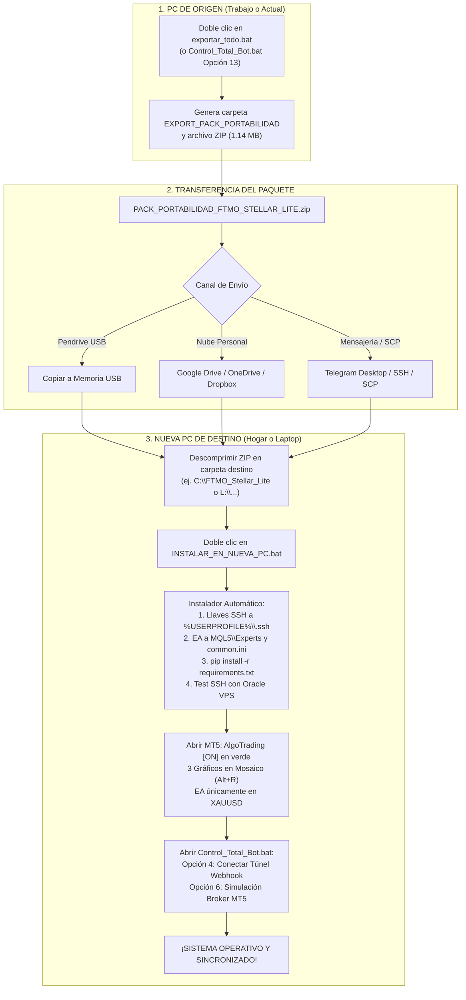
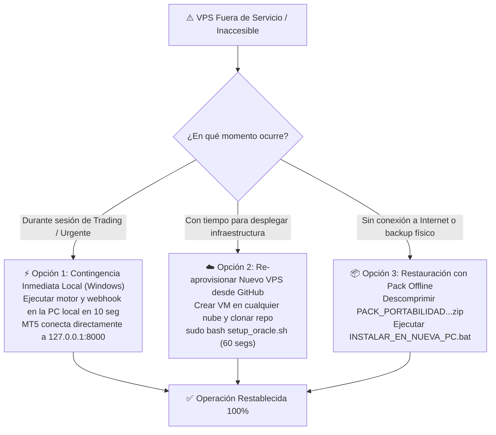
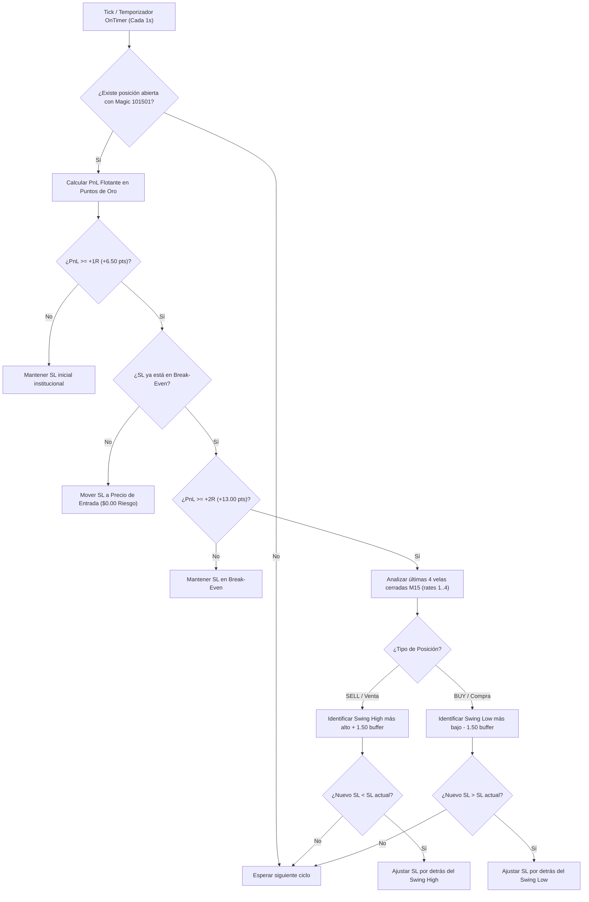
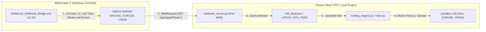
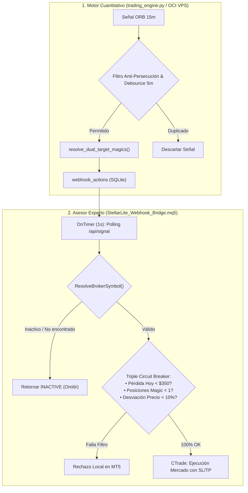

# Multi-Firm Quantitative Engine: FundedNext (Stellar 10K / 6K) & FTMO Challenge (10K) - MetaTrader 5 Bridge

Motor cuantitativo de trading algorítmico, gestor de riesgo institucional y puente oficial con **MetaTrader 5 (MT5)**, diseñado específicamente para superar evaluaciones y operar cuentas de fondeo profesionales, compatible de forma simultánea con **FundedNext (Stellar Lite 10K 2-Step y Free Trial 6K)** y **FTMO (Challenge 10K 2-Step)**.

Desarrollado en **Python Puro de Alto Rendimiento con Arquitectura Multiperfil Aislada (sin interfaces web innecesarias, sin Docker y sin dependencias superfluas)**. Operativo tanto en servidores Linux Ubuntu en **Oracle Cloud Infrastructure (OCI)** para ejecución desatendida 24/7, como en estaciones Windows para interacción nativa directa con terminales de escritorio **MetaTrader 5**.

---

## 📋 Tabla de Contenidos

1. [Arquitectura Multiperfil y Configuración Oficial FundedNext](#-arquitectura-multiperfil-y-configuración-oficial-fundednext)
   - [Comparativa Técnica de Perfiles Oficiales (10K Demo vs. 6K Trial)](#-comparativa-técnica-de-perfiles-oficiales)
   - [Aislamiento Total de Datos y Coexistencia](#-aislamiento-total-de-datos-y-coexistencia-de-perfiles)
   - [Herramientas de Administración de Perfiles](#-herramientas-de-administración-de-perfiles)
2. [Estrategia Ganadora Seleccionada y Portafolio Multi-Activo](#-estrategia-ganadora-seleccionada-y-portafolio-multi-activo)
   - [Calendario y Horarios Operativos de los Activos (EST / UTC-5)](#-calendario-y-horarios-operativos-de-los-activos-est--utc-5)
   - [Arquitectura Master Bridge en MetaTrader 5 (3 Gráficos en Mosaico)](#-arquitectura-master-bridge-en-metatrader-5-3-gráficos-en-mosaico)
   - [Portafolio Profesional Multi-Activo Oficial: Oro (XAUUSD), Plata (XAGUSD), Dow Jones (US30), S&P 500 (US500) y USD/JPY](#-portafolio-profesional-multi-activo-oficial)
   - [Laboratorio de Pruebas en Paralelo (Cuentas Sandbox Individuales de $10,000 c/u, SIN MT5)](#-laboratorio-de-pruebas-en-paralelo-cuentas-sandbox-individuales-de-10000-cu-sin-metatrader-5)
   - [Protocolo de Permisos de Trading Algorítmico en MT5 (Solución Error 4752)](#-protocolo-de-permisos-de-trading-algorítmico-en-metatrader-5-solución-error-4752)
3. [Arquitectura del Motor Cuantitativo y Reglas de Riesgo](#-arquitectura-del-motor-cuantitativo-y-reglas-de-riesgo)
4. [Puente Institucional con MetaTrader 5 (`mt5_bridge.py`)](#-puente-institucional-con-metatrader-5-mt5_bridgepy)
5. [Guía de Ejecución Rápida y Modalidades de Trading](#-guía-de-ejecución-rápida-y-modalidades-de-trading)
   - [Prueba Interactiva en Vivo con MetaTrader 5 (`Ejecutar_Prueba_MT5.bat`)](#1-prueba-interactiva-en-vivo-con-metatrader-5)
   - [Modalidades de Operación: Opción B.2 (MT5 Automático) y Opción C (Telegram Celular)](#2-modalidades-de-ejecución-disponibles)
   - [Monitoreo en Tiempo Real de la Estrategia Ganadora (`Dashboard_Operaciones_En_Vivo.bat`)](#3-monitoreo-en-tiempo-real-de-la-estrategia-ganadora)
   - [Suite de Pruebas Automatizadas 100% OK (`test_verification.py` - 13/13)](#4-suite-de-pruebas-automatizadas-100-ok---1313)
   - [Consola Interactiva Avanzada (`stellar-cli>`)](#5-consola-interactiva-avanzada-stellar-cli)
6. [Operación y Despliegue 24/7 en Servidor Oracle Cloud (OCI)](#-operación-y-despliegue-247-en-servidor-oracle-cloud-oci)
7. [Panel de Control Maestro (`Control_Total_Bot.bat`) y Dashboards](#-panel-de-control-maestro-control_total_botbat-y-dashboards)
8. [Guía de Migración y Portabilidad Total (PC Windows y Servidores Cloud/VPS)](#-guía-de-migración-y-portabilidad-total-pc-windows-y-servidores-cloudvps)
   - [8.1 Escenario A: Mover a Otra PC en 1 Clic (Workflow Completo de Migración)](#81-escenario-a-mover-a-otra-pc-windows-1011-con-metatrader-5-en-1-clic)
   - [8.2 Protocolo de Restablecimiento Total y Contingencia (Disaster Recovery: ¿Qué hacer si el VPS deja de funcionar?)](#82-protocolo-de-restablecimiento-total-y-contingencia-disaster-recovery-qué-hacer-si-el-vps-deja-de-funcionar)
   - [8.2.1 Herramientas de Auditoría y Detalle de Operaciones (MT5 Oficial y Sandbox)](#821-herramientas-de-auditoría-y-detalle-de-operaciones-mt5-oficial-y-sandbox)
   - [8.3 Documentación Técnica: Trailing Stop por Estructura M15 y Protección de Ganancias](#83-documentación-técnica-trailing-stop-por-estructura-m15-y-protección-de-ganancias)
   - [8.4 Protocolo Operativo en 2 PCs (Trabajo y Hogar) y Reglas Prop Firm](#84-protocolo-operativo-en-2-pcs-trabajo-y-hogar-y-reglas-prop-firm)
9. [Estructura del Proyecto y Archivos Clave](#-estructura-del-proyecto-y-archivos-clave)
10. [Protocolo de Contingencia y Hard Breach](#-protocolo-de-contingencia-y-hard-breach)
11. [Herramientas DevOps, Snapshots, Grabación de Estados y CI/CD](#-herramientas-devops-snapshots-grabación-de-estados-y-cicd)

---

## 🏷️ Arquitectura Multiperfil y Configuración Oficial FundedNext

El motor cuantitativo incorpora un sistema de **Gestión Multiperfil desacoplado** ([`profiles.py`](profiles.py) y [`profiles.json`](profiles.json)), permitiendo la administración simultánea e independiente de distintas cuentas de evaluación y desafíos sin riesgo de mezcla de trades ni sobreescritura de balances:

### 📊 Comparativa Técnica de Perfiles Oficiales

| Parámetro Institucional | Perfil: Stellar 10K Real (`Plan 10K FUNDEDNEXT.png`) | Perfil: Stellar 10K Demo (`cloud.png`) | Perfil: Stellar 6K Trial (`1-trial.png`) | Perfil: FTMO 10K Challenge (`Plan 10K FTMO.png`) |
| :--- | :--- | :--- | :--- | :--- |
| **Identificador Interno** | `stellar_10k_real` | `stellar_10k_demo` | `stellar_6k_trial` | `ftmo_10k_challenge` |
| **Firma / Modelo** | **FundedNext Stellar Lite 2-Step (Add-ons)** | **FundedNext Stellar Lite 2-Step** | **FundedNext Free Trial (CFDs)** | **FTMO Challenge 2-Step (Estándar)** |
| **Instancia MT5 en PC** | **Terminal Oficial MT5** | **Terminal 2 (`MetaTrader 5 - 2`)** | *Terminal de Pruebas* | **Terminal 1 (`MetaTrader 5`)** |
| **Magic Number EA** | **`505003`** | **`505002`** | `505003` | **`505001`** |
| **Portafolio de Activos** | **Oro (`XAUUSD`), S&P 500 (`US500`), USD/JPY (`USDJPY`)** | Oro (`XAUUSD`), Plata (`XAGUSD`), USD/JPY | Oro, Plata, USD/JPY | Oro (`XAUUSD`), Dow Jones (`US30`), S&P 500 (`US500`) |
| **Capital Base** | **$10,000.00 USD** | **$10,000.00 USD** | **$6,000.00 USD** | **$10,000.00 USD** |
| **Plataforma / Modo** | MetaTrader 5 (Swap-Free +10%) | MetaTrader 5 (MT5 - SWAP) | MetaTrader 5 (MT5 - SWAP) | MetaTrader 5 (MT5 - SWAP) |
| **Objetivo Fase 1 / Reto** | **+8.0% ($800.00)** $\rightarrow$ $10,800.00 | **+8.0% ($800.00)** $\rightarrow$ $10,800.00 | **+5.0% ($300.00)** $\rightarrow$ $6,300.00 | **+10.0% ($1,000.00)** $\rightarrow$ $11,000.00 |
| **Objetivo Fase 2** | **+4.0% ($400.00)** $\rightarrow$ $10,400.00 | **+4.0% ($400.00)** $\rightarrow$ $10,400.00 | *No aplica (1 sola fase)* | **+5.0% ($500.00)** $\rightarrow$ $10,500.00 |
| **Días Mínimos Operativos** | **2 Días por Fase** | **2 Días por Fase** | **3 Días Mínimos** | **4 Días Mínimos por Fase** |
| **Límite Pérdida Diaria** | **-4.0% ($400.00)** (sobre balance día) | **-4.0% ($400.00)** (sobre balance día) | **-5.0% ($300.00)** (sobre balance día) | **-5.0% ($500.00)** (sobre balance día) |
| **Límite Drawdown Máximo** | **-10.0% ($1,000.00)** $\rightarrow$ **Piso: $9,000.00** | **-8.0% ($800.00)** $\rightarrow$ **Piso: $9,200.00** | **-10.0% ($600.00)** $\rightarrow$ **Piso: $5,400.00** | **-10.0% ($1,000.00)** $\rightarrow$ **Trailing DD Dinámico** |
| **Regla Max Open Risk** | **1.5% ($150.00 USD)** conservador | **3.0% ($300.00 USD)** máx. simultáneo | **3.0% ($180.00 USD)** máx. simultáneo | **3.0% ($300.00 USD)** máx. simultáneo |
| **Riesgo por Trade (0.5%)** | **0.50% ($50.00 USD)** por operación | **0.50% ($50.00 USD)** por operación | **0.50% ($30.00 USD)** por operación | **0.50% ($50.00 USD)** por operación |
| **Freno Personal Diario** | **-2.0% ($200.00 USD)** (Margen 100%) | **-2.0% ($200.00 USD)** (Margen 100%) | **-2.5% ($150.00 USD)** (Margen 100%) | **-2.5% ($250.00 USD)** (Margen 100%) |
| **Profit Split Fondeada** | **95% De Por Vida** (*Lifetime Reward 95%*) | 80% inicial (escalable a 90%) | 80% inicial (escalable a 90%) | 80% inicial (escalable a 90%) |
| **Permiso de EAs en MT5** | **Add-on EA Habilitado** | Add-on requerido | Habilitado | **Autorizado sin Add-on extra** |
| **Base de Datos SQLite** | [`trading_stellar_10k_real.db`](trading_stellar_10k_real.db) | [`trading_history.db`](trading_history.db) | [`trading_stellar_6k_trial.db`](trading_stellar_6k_trial.db) | [`trading_ftmo_10k.db`](trading_ftmo_10k.db) |
| **Estado de Cuenta** | `FASE_1` $\rightarrow$ `FASE_2` $\rightarrow$ `FUNDED` | `FASE_1` $\rightarrow$ `FASE_2` $\rightarrow$ `FUNDED` | `CHALLENGE` $\rightarrow$ `SUPERADA` | `FASE_1` $\rightarrow$ `FASE_2` $\rightarrow$ `FUNDED` |

---

### 🛡️ Aislamiento Total de Datos y Coexistencia de Perfiles

1. **Persistencia Física Aislada:** Cada perfil opera sobre un archivo de base de datos SQLite exclusivo. Las operaciones, métricas de balance, días mínimos y curvas de equidad se registran de forma totalmente independiente.
2. **Esquema de Migración Automática:** [`database.py`](database.py) garantiza que la estructura de tablas incorpore `profile_id`, `daily_loss_limit_pct`, `profit_target_pct`, `is_trial` y `account_login`.
3. **Persistencia del Perfil Activo:** [`profiles.json`](profiles.json) conserva la selección activa (`active_profile_id`). Todo script, batch o monitor toma el perfil activo sin requerir reconfiguración manual.

---

### 🎛️ Herramientas de Administración de Perfiles

#### 1. Menú Interactivo Dedicado ([`Administrar_Perfiles.bat`](Administrar_Perfiles.bat)):
Permite gestionar la arquitectura dual en 1 clic desde Windows:
- **Detección Automática de Procesos:** Identifica en tiempo real si `MT1 (FTMO)` y `MT2 (FundedNext)` están `[ONLINE]`.
- **[1] Activar Perfil:** FTMO 10K Challenge (MT1: Oro, US30, S&P 500 | Magic `505001`).
- **[2] Activar Perfil:** Stellar 10K Demo (MT2: Oro, Plata, USD/JPY | Magic `505002`).
- **[3] Activar Perfil:** Stellar 6K Trial (Free Trial Challenge $6,000 USD | Magic `505003`).
- **[4] Ver Tablero Comparativo DUAL Completo:** Despliega una tabla comparativa lado a lado con todas las reglas, metas y parámetros técnicos.
- **[5] Ver Ficha Técnica Completa del Perfil Activo:** Resumen financiero detallado de reglas y límites en SQLite.
- **[6] Configurar Número de Cuenta / Login MT5:** Vincula el login de MetaTrader 5 (ej. `#1515193448`).
- **[7] Sincronizar Balance y Equidad en Vivo:** Lee saldo y equidad real de MT5 y actualiza la base de datos local.
- **[8] Reiniciar Cuenta del Perfil Activo (Reset):** Restablece el ciclo archivando operaciones previas en `archived_trades`.
- **[9] Lanzar Monitor DUAL en Vivo:** Abre dos ventanas independientes ([`Monitor_Dual_En_Vivo.bat`](Monitor_Dual_En_Vivo.bat)) para monitorear ambas terminales en simultáneo.
- **[0] Volver al Menú Principal.**

#### 2. Acceso desde el Panel Maestro ([`Control_Total_Bot.bat`](Control_Total_Bot.bat)):
- Presiona la opción **`[P]`** en cualquier momento para conmutar perfiles directamente desde el menú principal. El encabezado del panel muestra en tiempo real el perfil activo y su login MT5.

#### 3. Control por Línea de Comandos (`main.py`):
```bash
# Listar todos los perfiles registrados y ver el activo
python main.py --list-profiles

# Conmutar de inmediato al perfil Stellar 6K Trial
python main.py --switch-profile stellar_6k_trial

# Conmutar al perfil Stellar 10K Demo
python main.py --switch-profile stellar_10k_demo

# Consultar ficha técnica completa del perfil activo
python main.py --show-profile

# Asignar login de MetaTrader 5 al perfil activo
python main.py --set-login 35338849
```

#### 4. Control desde la Consola Interactiva (`stellar-cli>`):
```text
stellar-cli> profile list
stellar-cli> profile switch stellar_6k_trial
stellar-cli> profile show
stellar-cli> status
```

---

## 🏷️ Configuración Oficial Contratada (FundedNext Checkout)

El motor cuantitativo tiene incorporadas de forma nativa en su lógica de evaluación y riesgo todas las condiciones del checkout oficial (`cloud.png`, `1.png` y `2.png`):

| Parámetro | Configuración Seleccionada | Implementación en el Motor (`stellar_rules.py`) |
| :--- | :--- | :--- |
| **Modelo de Cuenta** | **Stellar Lite 2-Step ($10,000 USD)** | Balance base: `$10,000.00`. Objetivos: Fase 1 (+8% = $800) / Fase 2 (+4% = $400). |
| **Plataforma Broker** | **MetaTrader 5 (MT5)** | Integración nativa con protocolo IPC MT5 y ejecución `TRADE_ACTION_DEAL`. |
| **Tipo de Cuenta** | **Swap** | Soporte de posiciones interdiarias con modelado de comisiones y swap institucional. |
| **Add-on: Expert Advisor (EA)** | **Activado (+$5.00)** | `ea_enabled = 1`. Autorización formal para trading algorítmico y ejecución por bot/EA. |
| **Días Mínimos Operativos** | **2 Días por Fase** | Mínimo 2 jornadas operadas por fase (sin add-on de 0 días). |
| **Daily Loss Limit** | **4% Estático ($400.00)** | Calculado cada medianoche UTC (00:00 UTC) sobre el balance inicial de jornada (Piso: $9,600). |
| **Maximum Loss Limit** | **8% Estático ($800.00)** | Drawdown máximo total estático. **Piso inamovible de pérdida: $9,200.00**. |
| **Exposición Máxima de Riesgo**| **3% Simultáneo ($300.00)** | La suma de riesgo abierto en todas las órdenes no puede superar $300 a la vez. |
| **Profit Split Fondeada** | **80% Estándar (Escalable a 90%)** | 80% split inicial, escalable al 90% al acumular +10% de ganancia en cuenta fondeada. |
| **Reembolso de Tarifa (Refund)**| **100% de la Tarifa ($64.99)** | Reembolsado en el 3er retiro de ganancias exitoso. |
---

### 📜 Matriz de Cumplimiento Normativo Oficial FundedNext Stellar Lite CFDs (100% Auditado)

El sistema ha sido exhaustivamente auditado y programado para **cumplir con todas las directrices oficiales de FundedNext**, garantizando cero infracciones de reglas (*Zero Breaches*):

| Regla / Enlace Oficial FundedNext | Requerimiento del Broker | Implementación y Blindaje en el Código del Bot | Estado |
| :--- | :--- | :--- | :---: |
| **1. [Symbols and Conditions](https://fundednext.com/es/general-rules/cfds/symbols-and-conditions)** | Especificaciones oficiales de contrato, comisiones y spreads. | En [`risk_manager.py`](risk_manager.py), las especificaciones de contrato están calibradas de forma idéntica al broker: 100 oz para Oro (`XAUUSD`), 100,000 unidades para Forex (`EURUSD`) y $1.00 por punto para Índices (`US500`). [`StellarLite_Webhook_Bridge.mq5`](StellarLite_Webhook_Bridge.mq5) traduce automáticamente los símbolos de análisis a la nomenclatura nativa del broker. | **100% CUMPLIDO** |
| **2. [What is Allowed](https://fundednext.com/es/general-rules/cfds/what-is-allowed)** | Asesores Expertos (EAs), estilos prohibidos (Grid, Martingala, HFT, Latency Arbitrage). | **• EAs:** Formalmente autorizados en MT5 para cuentas < $50K.<br/>**• Cero Grid Trading:** Prohibido por FundedNext. El bot opera rupturas individuales con SL y TP independientes (jamás abre rejillas opuestas).<br/>**• Cero Martingala:** Riesgo estrictamente constante (0.50% = $50 USD por trade, jamás dobla lotes en pérdidas). Bloqueo Anti-Tilt tras 3 pérdidas seguidas.<br/>**• Cero HFT / Tick Scalping:** El bot opera velas de 15 minutos (M15), durando entre 30 min y varias horas.<br/>**• Noticias:** En fase fondeada aplica el límite de ganancia de 40% (`NEWS_PROFIT_CAP_PCT = 0.40`) y filtro de bloqueo en [`news_filter.py`](news_filter.py).<br/>**• Weekend Holding:** Permitido en Stellar Lite. Incorpora además cierre voluntario preventivo los viernes 15:30 EST. | **100% CUMPLIDO** |
| **3. [Maximum Loss Limit](https://help.fundednext.com/en/articles/8019915-what-is-the-maximum-loss-limit)** | **• Max Drawdown Total:** 8% ($800 USD) estático sobre $10K (Piso: $9,200).<br/>**• Pérdida Diaria Máxima:** 4% ($400 USD) sobre balance al inicio del día (Piso: $9,600). | En [`stellar_rules.py`](stellar_rules.py) y [`risk_manager.py`](risk_manager.py):<br/>**• Piso Inamovible:** Si la equidad toca $9,200, detiene inmediatamente toda actividad.<br/>**• Freno de Mano Diario Personal al 2% ($200 USD):** El bot se auto-bloquea a la mitad del límite del broker ($200 vs $400), garantizando un **100% de margen de seguridad** que hace imposible violar la regla diaria. | **100% CUMPLIDO** |
| **4. [Leverage of Trading Account](https://help.fundednext.com/en/articles/8019669-what-is-the-leverage-of-the-trading-account)** | Apalancamiento máximo en Stellar Lite: Forex 1:100, Oro 1:25 (Challenge) / 1:15 (Fondeada), Índices 1:25 / 1:15. | Al limitar el riesgo por operación a $50 USD (0.50%), el tamaño de lote oscila entre 0.01 y 0.08 lotes en Oro y 0.25 a 0.45 lotes en EUR/USD. El apalancamiento real utilizado es inferior a **1:4.5**, dejando más del **95% de margen libre** y anulando cualquier posibilidad de Margin Call. | **100% CUMPLIDO** |
| **5. [Tradable Assets](https://help.fundednext.com/en/articles/8224087-fundednext-tradable-assets-what-can-i-trade-on-fundednext-cfd-accounts)** | Lista oficial de activos permitidos para operar en cuentas CFDs. | El portafolio se concentra exclusivamente en los activos de mayor liquidez institucional y spreads más ajustados: **Oro (`XAUUSD`)**, **EUR/USD (`EURUSD`)** y **USD/JPY (`USDJPY`)** (con **S&P 500** y **AUD/USD** en Standby). Se bloqueó el Nasdaq 100 para evitar dispersión de riesgo. | **100% CUMPLIDO** |
| **6. Regla Max Open Risk 3%** | Límite de exposición máxima de riesgo abierto simultáneo en el mercado: 3.0% ($300 USD). | [`risk_manager.py`](risk_manager.py) evalúa la suma de riesgo de todas las órdenes en curso. Si una nueva orden superaría los $300 USD, **es rechazada automáticamente** hasta que una orden previa alcance Break-Even (+1R) y libere su riesgo a $0.00. | **100% CUMPLIDO** |
| **7. [Minimum Trading Days](https://help.fundednext.com/en/articles/8019623-what-is-the-minimum-trading-days-rule) y Modo Micro-Lote** | Mínimo 2 días de trading por fase. Un día computa abriendo cualquier posición con P&L en MT5. | Al alcanzar el Target (+8% F1 / +4% F2) en el Día 1, el bot activa el candado anti-overtrading para proteger el capital ganado. Al día siguiente (00:00 UTC), opera en **Modo Micro-Lote de Seguridad** (`0.01 lotes`, riesgo de centavos ~0.01%), registrando el 2.º día obligatorio sin poner en riesgo la meta alcanzada. | **100% CUMPLIDO** |


---

## 🏆 Estrategia Ganadora Seleccionada y Portafolio Multi-Activo

Tras auditar y simular múltiples configuraciones bajo fricción institucional real (comisiones, spreads dinámicos y slippage), el sistema opera con dos portafolios de élite desacoplados según las reglas específicas de cada firma de fondeo:
- **Portafolio FundedNext Stellar Lite 10K (`stellar_10k_demo`):** **Oro (`XAUUSD`)**, **Plata (`XAGUSD`)** y **USD/JPY (`USDJPY`)**.
- **Portafolio FTMO 10K Challenge (`ftmo_10k_challenge`):** **Oro (`XAUUSD`)**, **Dow Jones 30 (`US30`)** y **S&P 500 (`US500`)**.

---

### ⏰ Calendario y Horarios Operativos de los Activos (EST / UTC-5)

Todos los activos tradicionales operan de **Lunes a Viernes**. Como la referencia horaria del bot es **Hora de Nueva York (EST)**, los horarios en huso horario **UTC-5** (Colombia, Perú, Ecuador, CDMX) coinciden exactamente con la hora de Wall Street:

| Estado | Activo | Perfil Asignado | Días Operativos | Sesión Clave | Vela ORB 15m | Ventana Operativa Activa (Hora Lima / EST UTC-5) | Hora Servidor VPS (UTC) |
| :---: | :--- | :---: | :---: | :--- | :---: | :---: | :---: |
| 🟢 **ACTIVO** | **Oro** (`XAUUSD` / `GC=F`) | Dual (FTMO & Stellar) | **Lunes a Viernes** | **Apertura Nueva York** | 08:30 – 08:45 | **08:45 – 11:30 a.m.** | 13:45 – 16:30 UTC |
| 🟢 **ACTIVO** | **Plata** (`XAGUSD` / `SI=F`) | Stellar Lite 10K | **Lunes a Viernes** | **Metales NY Open** | 08:30 – 08:45 | **08:45 – 11:30 a.m.** | 13:45 – 16:30 UTC |
| 🟢 **ACTIVO** | **Dow Jones 30** (`US30` / `YM=F`) | FTMO 10K Challenge | **Lunes a Viernes** | **Wall Street Cash Open** | 09:30 – 09:45 | **09:45 – 11:30 a.m.** | 14:45 – 16:30 UTC |
| 🟢 **ACTIVO** | **S&P 500** (`US500.cash` / `ES=F`) | FTMO 10K Challenge | **Lunes a Viernes** | **Wall Street Cash Open** | 09:30 – 09:45 | **09:45 – 11:30 a.m.** | 14:45 – 16:30 UTC |
| 🟢 **ACTIVO** | **USD/JPY** (`USDJPY`) | Stellar Lite 10K | **Lunes a Viernes** | **Londres / NY Overlap** | 03:00 / 08:30 | **03:15–06:00 & 08:45–11:30** | 08:15–11:00 & 13:45–16:30 |
| 🔴 **INACTIVO** | **EUR/USD** (`EURUSD`) | *Reemplazado* | **Inactivo** | --- | *Reemplazado por Plata (Stellar) y US30 (FTMO)* | --- |
| 🔴 **INACTIVO** | **AUD/USD** (`AUDUSD`) | *Desactivado* | **Inactivo en portafolio** | --- | *Desactivado por baja volatilidad* | --- |
| 🔴 **INACTIVO** | **Nasdaq 100** (`US100` / `NAS100`) | *Bloqueado* | **Política de Riesgo** | --- | *Bloqueado permanente por volatilidad* | --- |
| 🔴 **INACTIVO** | **Criptoactivos** (`BTC`, `ETH`, `SOL`) | *Desactivado* | **Inactivo en sesión regular** | --- | *Desactivado en portafolio oficial* | --- |

#### Reglas de Apertura, Cierre y Protección de Fin de Semana:
1. **Apertura Semanal de Mercados:** Domingo a las 17:00 / 18:00 EST. El bot permanece en espera y **no abre operaciones el domingo** debido al spread ensanchado interbancario; espera a la sesión de Londres del lunes a las 03:00 EST.
2. **Cierre Forzoso Anti-Gap de Fin de Semana:** **Viernes a las 15:30 EST**. Toda posición abierta en Oro, Plata, US30, S&P 500 o USD/JPY es liquidada forzosamente 90 minutos antes del cierre semanal para blindar la cuenta ante saltos de precios por noticias geopolíticas de fin de semana.
3. **Sábados y Domingos:** Mercados cerrados (`4756 - Market closed`). Cero trading tradicional.

#### 🇵🇪 Equivalencia y Referencia Horaria en Lima, Perú (PET / UTC-5):
Perú no implementa horario de verano y mantiene su huso horario fijo en **PET (UTC-5)** todo el año. Su relación con el horario de Wall Street es la siguiente:

1. **Horario de Invierno en EE. UU. (Noviembre a Marzo — EST = UTC-5):**
   * **Coincidencia 100% exacta minuto a minuto:**
     * **Apertura Londres (USD/JPY):** `03:00 a.m. – 06:00 a.m.` (Madrugada de Lima).
     * **Apertura NY (Oro y Plata):** `08:30 a.m. – 11:30 a.m.` (Mañana de Lima).
     * **Wall Street Cash Open (Dow Jones 30 y S&P 500):** `09:30 a.m. – 11:30 a.m.` (Mañana de Lima).
     * **Cierre Anti-Gap (Viernes):** `03:30 p.m.` (Tarde de Lima).
2. **Horario de Verano en EE. UU. (Marzo a Noviembre — EDT = UTC-4):**
   * Nueva York se adelanta 1 hora; por tanto, en Lima la campana abre **1 hora más temprano**:
     * **Apertura Londres (USD/JPY):** `02:00 a.m. – 05:00 a.m.` (Madrugada de Lima).
     * **Apertura NY (Oro y Plata):** `07:30 a.m. – 10:30 a.m.` (Mañana de Lima).
     * **Wall Street Cash Open (Dow Jones 30 y S&P 500):** `08:30 a.m. – 10:30 a.m.` (Mañana de Lima).
     * **Cierre Anti-Gap (Viernes):** `02:30 p.m.` (Tarde de Lima).

---

---

### 🛡️ Escalera Automática Institucional de Break-Even & Candados de Ganancia (4 Niveles)

Todos los activos activos (**Oro**, **Plata**, **Dow Jones 30**, **S&P 500** y **USD/JPY**) cuentan con una arquitectura de protección en tiempo real de **4 Niveles Progresivos**, gestionada de forma autónoma por [`trading_engine.py`](trading_engine.py) y reflejada en MetaTrader 5:

```
[ENTRADA (0.0R)] ──► [NIVEL 1: Break-Even+] ──► [NIVEL 2: Candado 1] ──► [NIVEL 3: Candado 2] ──► [NIVEL 4: Pre-Rollover] ──► [TAKE PROFIT (+2.0R)]
```

| Nivel de Protección | Oro (`XAUUSD` / `GC=F`) | Plata (`XAGUSD` / `SI=F`) | Dow Jones (`US30` / `YM=F`) | S&P 500 (`US500` / `ES=F`) | USD/JPY (`USDJPY` / `USDJPY=X`) | Objetivo Estratégico |
| :--- | :--- | :--- | :--- | :--- | :--- | :--- |
| **Nivel 1: Break-Even Plus** | Se activa a **+1.00R**.<br/>SL a **Entrada + $0.80/oz**. | Se activa a **+1.00R**.<br/>SL a **Entrada + $0.04/oz**. | Se activa a **+0.95R**.<br/>SL a **Entrada + 12 pts**. | Se activa a **+1.00R**.<br/>SL a **Entrada + 1.0 pt**. | Se activa a **+0.95R**.<br/>SL a **Entrada + 1.5 pips**. | **Elimina todo riesgo financiero ($0.00).** Cubre spread y comisiones del broker. |
| **Nivel 2: Candado 1** | Se activa a **+1.40R**.<br/>Asegura **+0.60R** neto. | Se activa a **+1.40R**.<br/>Asegura **+0.60R** neto. | Se activa a **+1.35R**.<br/>Asegura **+0.60R** neto. | Se activa a **+1.35R**.<br/>Asegura **+0.60R** neto. | Se activa a **+1.35R**.<br/>Asegura **+0.55R** neto. | **Garantiza beneficio neto positivo** ante retrocesos en zonas intermedias. |
| **Nivel 3: Candado 2** | Se activa a **+1.75R**.<br/>Asegura **+1.10R** neto. | Se activa a **+1.75R**.<br/>Asegura **+1.10R** neto. | Se activa a **+1.70R**.<br/>Asegura **+1.15R** neto. | Se activa a **+1.70R**.<br/>Asegura **+1.15R** neto. | Se activa a **+1.70R**.<br/>Asegura **+1.15R** neto. | **Protege el trade a milímetros del TP** impidiendo devoluciones bruscas. |
| **Nivel 4: Trailing M15** | Estructura M15 persistente.<br/>Asegura **+1.35R** mínimo. | Estructura M15 persistente.<br/>Asegura **+1.35R** mínimo. | Estructura M15 persistente.<br/>Asegura **+1.35R** mínimo. | Estructura M15 persistente.<br/>Asegura **+1.35R** mínimo. | Estructura M15 persistente.<br/>Asegura **+1.20R** mínimo. | **Rastreo tendencial dinámico** y escudo anti-spread pre-rollover. |

---

### 🖥️ Arquitectura de Doble Instancia MetaTrader 5 en Paralelo (FTMO 10K & FundedNext Stellar 10K)

El sistema soporta y ejecuta simultáneamente **dos instancias completas e independientes de MetaTrader 5 en la misma PC**, operando perfiles de evaluación distintos sin colisiones ni cruce de órdenes:

```
┌────────────────────────────────────────────────────────────────────────────────────────┐
│               ARQUITECTURA DUAL MT5 EN PARALELO (UNA SOLA PC WINDOWS)                  │
├───────────────────────────────────────────┬────────────────────────────────────────────┤
│   TERMINAL 1: C:\Program Files\MetaTrader 5│  TERMINAL 2: C:\Program Files\MetaTrader 5 - 2  │
│   • Perfil: FTMO 10K Challenge            │  • Perfil: FundedNext Stellar Lite 10K     │
│   • Magic Number EA: 505001               │  • Magic Number EA: 505002                │
│   • Base de Datos: trading_ftmo_10k.db    │  • Base de Datos: trading_history.db       │
│   • Activos: Oro (XAUUSD), US30, US500    │  • Activos: Oro (XAUUSD), XAGUSD, USDJPY   │
│   • InpEnableUS30: true                   │  • InpEnableUS30: false                    │
│   • InpEnableSP500: true                  │  • InpEnableSP500: false                   │
│   • InpEnableSilver: false                │  • InpEnableSilver: true                   │
│   • InpEnableUSDJPY: false                │  • InpEnableUSDJPY: true                   │
│   • Target F1/F2: +10% ($1K) / +5% ($500) │  • Target F1/F2: +8% ($800) / +4% ($400)   │
│   • Pérdida Diaria: -5% ($500)            │  • Pérdida Diaria: -4% ($400)              │
│   • Drawdown Máximo: Trailing DD Dinámico │  • Drawdown Máximo: -8% Estático ($9,200)  │
│   • Regla Consistencia: 50% Obligatorio   │  • Regla Consistencia: Sin regla           │
│   • Cierre Nocturno: 16:55 EST (Oblig.)   │  • Cierre Nocturno: Permitido (Overnight)  │
└───────────────────────────────────────────┴────────────────────────────────────────────┘
                                     │
                                     ▼
        ┌───────────────────────────────────────────────────────────┐
        │  PUERTO LOCAL 8000 (Túnel SSH a Oracle Cloud VPS 24/7)    │
        │  • GET /api/signal?magic=505001  ──► Despacha a Term. 1   │
        │  • GET /api/signal?magic=505002  ──► Despacha a Term. 2   │
        └───────────────────────────────────────────────────────────┘
```

#### Reglas de Cumplimiento Institucional (100% Legal en Ambas Firmas):
1. **Misma PC y Misma IP Residencial:** Tanto FTMO como FundedNext autorizan operar múltiples cuentas simultáneas desde el mismo ordenador y dirección IP del titular.
2. **Cero Reverse Trading (Anti-Hedging):** Ambas instancias operan la misma dirección institucional dictada por la EMA 200 en H1 (nunca toman posiciones opuestas).
3. **Portafolios Desacoplados:** S&P 500 es exclusivo de FTMO; USD/JPY es exclusivo de FundedNext.
4. **Aislamiento por Magic Number:** `505001` jamás toca o altera posiciones de `505002`, garantizando trazabilidad y registro limpio.

---

### 🖥️ Arquitectura Master Bridge en MetaTrader 5 (3 Gráficos en Mosaico)

Para visualizar y operar simultáneamente los 3 activos de forma profesional sin conflictos de sondeo duplicado:

```
┌────────────────────────────────────────────────────────────────────────┐
│                        METATRADER 5 (Mosaico Alt + R)                  │
├──────────────────────────┬──────────────────────────┬──────────────────┤
│        VENTANA 1         │        VENTANA 2         │    VENTANA 3     │
│       XAUUSD (H1)        │        US500 (H1)        │   EURUSD (H1)    │
│  [ MASTER BRIDGE EA ]    │    [ SOLO VISUAL ]       │  [ SOLO VISUAL ] │
│  * Recibe señales Cloud  │    * Gráfico abierto     │  * Gráfico       │
│  * Ejecuta XAU/US/EUR    │    * Sin EA adjunto      │  * Sin EA        │
│  * Break-Even + Trailing │    * Acción de precio    │  * Velas M15     │
└──────────────────────────┴──────────────────────────┴──────────────────┘
```

#### Regla de Oro en MT5:
* **Un Solo EA Activo en la Cuenta:** El Expert Advisor [`StellarLite_Webhook_Bridge.ex5`](StellarLite_Webhook_Bridge.ex5) es un **Bridge Multi-Activo Global**. Desde un único gráfico (recomendado: **`XAUUSD`**), lee la orden de la nube con el símbolo correspondiente (`XAUUSD`, `US500` o `EURUSD`) y la envía al broker de inmediato.
* Además, su motor autónomo de Break-Even (+1R) y Trailing Stop M15 recorre todas las posiciones de la cuenta para proteger los 3 activos.
* **Organización:** Abre los 3 gráficos, presiona `Alt + R` (Ventana $\rightarrow$ Mosaico) y arrastra el EA **únicamente al gráfico de Oro**. En los gráficos de S&P 500 y EUR/USD manténlos sin el EA para evitar peticiones duplicadas a la cola de señales.

---

### ¿Por qué `NY_OPEN` es la Estrategia Ganadora?
- **Mayor Concentración de Volumen Institucional:** El 68% de las transacciones globales del Oro Spot y Futuros COMEX ocurren entre las 08:30 y las 11:30 EST.
- **Profit Factor Superior (> 2.0):** Presentó el ratio de rentabilidad/riesgo más alto y el menor drawdown relativo de todo el portafolio.
- **Filtros Anti-Trampas:** Elimina los falsos rompimientos comunes durante la apertura asiática o europea.

### Reglas Técnicas de la Estrategia (`OpeningRangeBreakoutStrategy`):
1. **Activo Oficial:** Oro Spot / Futuros COMEX (`XAUUSD` en MT5 / `GC=F` en Yahoo Finance).
2. **Ventana Horaria de Sesión:** **08:30 a 11:30 EST** (Hora de Nueva York / Wall Street).
3. **Vela de Rango de Apertura (ORB 15M):** Se define con la primera vela de 15 minutos (08:30 a 08:45 EST), registrando su máximo (`high`) y mínimo (`low`).
4. **Filtro Tendencial Institucional:** **EMA de 200 periodos en Gráfico de 1 Hora (H1)**:
   - Solo se permiten compras (**BUY**) si el precio se encuentra por encima de la EMA 200 H1.
   - Solo se permiten ventas (**SELL**) si el precio se encuentra por debajo de la EMA 200 H1.
5. **Filtro Anti-Fakeout por Cierre de Vela:** Una ruptura de mecha no es válida. La vela de 15 minutos debe **cerrar estrictamente por fuera del rango** para confirmar la entrada.
6. **Ratio Riesgo/Beneficio Estricto (1:2):**
   - **Stop Loss (SL):** $6.50 por debajo/encima del punto de entrada (1R).
   - **Take Profit (TP):** $13.00 (el doble del riesgo, 2R).
7. **Protocolo de Protección Escalonada y Trailing Stop Autónomo (M15):**
   - **Nivel 1 — Blindaje a Break-Even (+1R / +$6.50 pts):** Al alcanzar +1R de beneficio flotante (+$6.50 en Oro), traslada el Stop Loss al precio de entrada (`SL = Entry Price`), asegurando **$0.00 de riesgo monetario** (Trade Libre de Riesgo).
   - **Nivel 2 — Trailing Stop por Estructura Técnica M15 (+2R / +$13.00 pts):** Al superar +2R, el Asesor Experto en MT5 (`StellarLite_Webhook_Bridge.mq5`) inspecciona las últimas 4 velas M15 cerradas y traslada el SL por detrás del último Swing High (en ventas) o Swing Low (en compras) con un colchón de $1.50 de volatilidad, bloqueando ganancias escalonadas de forma 100% autónoma.
   - **Cálculo de Distancias Relativas Broker-Agnostic:** Las distancias de SL y TP se aplican de forma relativa al precio de llenado real (`Bid`/`Ask`) en MetaTrader 5 mediante `MathAbs`, blindando la orden ante divergencias de cotización entre feeds de análisis (Yahoo Finance `GC=F`) y el broker (`XAUUSD`).
   - **Fail-Safe de Auto-Sincronizaci?n Robusto con Filtro Anti-Falso Cierre y Debounce (4 Ciclos / 20s):**
     Para prevenir que microcortes temporales de red, latencias de t?nel o respuestas HTTP parciales provoquen cierres prematuros accidentales, el Asesor Experto en MT5 implementa una triple verificaci?n:
     1. **Existencia Expl?cita de Clave (`JsonHasKey`):** El EA comprueba que `"open_trades_count"` exista de manera inequ?voca en el cuerpo JSON (`JsonExtractDouble` devuelve `-1.0` si falta la clave, evitando falsos ceros por cadenas vac?as).
     2. **Filtro de Debounce Persistente (4 Ciclos Consecutivos):** Requiere que el reporte de cero trades se sostenga por al menos 4 sondeos seguidos (~20 segundos ininterrumpidos). Cualquier respuesta con acci?n o trades activos resetea el contador inmediatamente a 0.
     3. **Margen de Madurez de Posici?n (> 30s):** Solo liquida posiciones que lleven m?s de 30 segundos abiertas, protegiendo trades reci?n ejecutados y garantizando una liquidaci?n 100% limpia y sincronizada con la nube.
8. **Protección de Fin de Semana:** Todo trade de Oro se liquida forzosamente los viernes a las **15:30 EST** para evitar riesgos de gap al abrir el mercado el domingo.

### 🌐 Portafolio Profesional Multi-Activo Oficial

El sistema ejecuta una arquitectura institucional **multi-activo descorrelacionada** sobre dos cuentas oficiales de **$10,000 USD** respetando las reglas de **FundedNext Stellar Lite 10K** y **FTMO 10K Challenge**:

- **Diversificación Real entre Clases de Activo:** Combina materias primas (**Oro Spot / Futuros COMEX** y **Plata Spot**), índices bursátiles de Wall Street (**Dow Jones 30** y **S&P 500**) y divisas mayores de política monetaria (**USD/JPY**), eliminando el riesgo de sobreexposición a un solo mercado.
- **Gestión Unificada del Riesgo Institucional:** Todas las operaciones abiertas comparten la base de datos de su perfil respectivo, garantizando que la exposición total jamás exceda el **3.0% ($300.00 USD)** de riesgo abierto simultáneo ni el **Freno Diario Personal del 2.0% ($200.00 USD)**.
- **Dimensionamiento Automático de Lote por Instrumento:**
  - **Oro (`XAUUSD` / `GC=F`):** 1 lote = 100 onzas troy. Riesgo: 0.50% ($50.00 USD).
  - **Plata (`XAGUSD` / `SI=F`):** 1 lote = 5,000 onzas troy. Riesgo: 0.50% ($50.00 USD). Pip = $0.01.
  - **Dow Jones 30 (`US30` / `YM=F`):** 1 lote CFD = $1.00 USD por punto. Riesgo: 0.50% ($50.00 USD).
  - **S&P 500 (`US500` / `ES=F`):** 1 lote CFD = $1.00 USD por punto. Riesgo: 0.50% ($50.00 USD).
  - **USD/JPY (`USDJPY` / `USDJPY=X`):** 1 lote = 100,000 unidades. Riesgo: 0.50% ($50.00 USD). Pip = 0.01 JPY.
- **Puente Webhook y Ejecución Broker-Agnostic:** Las señales generadas en el VPS de Oracle se despachan a través de `stellar_webhook.service` (puerto 8000) hacia el Asesor Experto [`StellarLite_Webhook_Bridge.ex5`](StellarLite_Webhook_Bridge.ex5) en MetaTrader 5, traduciendo automáticamente los símbolos a la nomenclatura nativa de cada broker (`XAUUSD`, `XAGUSD`, `US30.cash`, `US500.cash`, `USDJPY`).
- **Sincronización Automática Cerrada (Closed-Loop Master Sync):** Motor maestro de reconciliación en [`mt5_bridge.py`](mt5_bridge.py) que audita los deals cerrados de MT5, actualiza comisiones, swaps, precios reales de salida y PnL neto en SQLite, eliminando cualquier discrepancia entre el bot y MetaTrader.
- **Blindaje Anti-Ghost Trades:** Si por alguna razón de mercado o conectividad MT5 rechaza una orden, la base de datos la marca inmediatamente como `REJECTED_MT5` evitando posiciones fantasma abiertas en el registro.

---

### 🧪 Laboratorio de Pruebas en Paralelo (Cuentas Sandbox Individuales de $10,000 c/u, SIN MetaTrader 5)

Para probar, auditar y comparar el rendimiento estadístico individual de cada activo de forma aislada, el servidor en Oracle Cloud ejecuta simultáneamente servicios demonio independientes, cada uno con su propia cuenta virtual de **$10,000.00 USD** y base de datos SQLite separada:

```
┌────────────────────────────────────────────────────────────────────────────────────────┐
│             ARQUITECTURA DE EJECUCIÓN PARALELA (ORACLE CLOUD VPS 24/7)                 │
├─────────────────────────┬──────────────────────────────────────────────────────────────┤
│ CANAL OFICIAL EN VIVO   │ [1] stellar_ny_open.service (Portafolio MT5: Oro + Plata + JPY)│
│ (Conectado a MT5)       │     --> Base de datos: trading_ny_open.db ($10,000)          │
│                         │     --> Webhook: stellar_webhook.service (Puerto 8000)       │
├─────────────────────────┼──────────────────────────────────────────────────────────────┤
│ CANAL LABORATORIO TEST  │ [2] stellar_test_oro.service    --> trading_test_oro.db      │
│ (Interno Sin MT5)       │ [3] stellar_test_plata.service  --> trading_test_plata.db    │
│                         │ [4] stellar_test_usdjpy.service --> trading_test_usdjpy.db   │
│                         │ [5] stellar_test_us30.service   --> trading_test_us30.db     │
│                         │ [6] stellar_test_sp500.service  --> trading_test_sp500.db    │
│                         │     --> Cuentas $10K independientes, 100% internas en Python │
└─────────────────────────┴──────────────────────────────────────────────────────────────┘
```

1. **Oro Individual (stellar_test_oro.service):**
   - Base de datos: 	rading_test_oro.db (,000 USD).
   - Horario: **08:30 – 11:30 EST** (Apertura NY).
   - Evaluación pura de la estrategia ORB 15M en Oro Spot.
2. **EUR/USD Individual (stellar_test_eurusd.service):**
   - Base de datos: 	rading_test_eurusd.db (,000 USD).
   - Horario: **03:00 – 06:00 EST** (Londres) y **08:30 – 11:30 EST** (NY).
   - Evaluación pura de la estrategia ORB 15M en Forex.
3. **S&P 500 Individual (stellar_test_sp500.service):**
   - Base de datos: 	rading_test_sp500.db (,000 USD).
   - Horario: **09:30 – 11:30 EST** (Wall Street Cash Open).
   - Evaluación pura de la ruptura de la campana oficial de Wall Street.

> **Cero Interferencia con MT5:** Las 3 bases de datos de laboratorio gestionan el ciclo completo de vida de sus posiciones (quiebre, Stop Loss, Take Profit 1:2, Break-Even a +1R y cierre de fin de semana) internamente en Python. Jamás envían órdenes a MetaTrader 5, manteniendo tu cuenta de fondeo real completamente limpia y protegida.

---

### ⚙️ Protocolo de Permisos de Trading Algorítmico en MetaTrader 5 (Solución Error 4752)

Si al despachar una orden el registro de MT5 muestra:
> CTrade::OrderSend: market buy ... [auto trading disabled by client] / Fallo: 4752 - AutoTrading disabled

Esto ocurre cuando el Asesor Experto tiene desmarcada la autorización a nivel de gráfico. Se corrige en 10 segundos:

1. En MetaTrader 5, haz clic sobre el gráfico donde está colocado el EA (gráfico **XAUUSD**).
2. Presiona la tecla **F7** (o clic derecho -> *Lista de Expertos* -> *Propiedades*).
3. Entra a la pestaña **Común** (*Common*).
4. Marca la casilla: [x] **'Permitir Trading Algorítmico'** (*Allow Algo Trading*).
5. Haz clic en **Aceptar**.
6. Verifica que el botón general **'Algo Trading'** en la barra superior de MT5 esté encendido (en color verde). El icono del sombrero en el gráfico se pondrá de color azul.


---

## 🛡️ Arquitectura del Motor Cuantitativo y Reglas de Riesgo

El sistema implementa una gestión de riesgo de grado bancario dividida en tres módulos desacoplados:

```
[ MarketData / MT5 ] ──> [ RiskManager ] ──> [ StellarRulesEngine ] ──> [ TradingDatabase ]
         │                     │                         │                      │
   Precios en Vivo       Riesgo 0.5% ($50)         Reglas Stellar Lite      Auditoría SQLite
   Velas M15 & H1        Freno Diario 2%           Piso Max DD $9,200       Historial Trades
   Spreads & Puntos      Anti-Tilt (3 Losses)      Piso Diario $9,600       Eventos y Estados
                         Max Risk 3% ($300)        Target F1/F2 ($800/$400)
```

1. **Calculadora Dinámica de Riesgo ([`RiskManager`](risk_manager.py)):**
   - Riesgo fijo por operación: **0.50% estricto** ($50.00 USD sobre $10,000 de balance).
   - Cálculo del tamaño de lote adaptado a la especificación de contrato (100 oz en Oro):
     $$\text{Lotes} = \frac{\text{Riesgo USD}}{\text{Distancia SL en USD} \times \text{Tamaño Contrato}} = \frac{\$50.00}{\$6.50 \times 100} \approx 0.08\text{ lotes}$$
2. **Límite de Exposición de Riesgo Abierto Simultáneo (Regla FundedNext 3%):**
   - La suma del riesgo abierto en dólares de todas las operaciones no puede superar el **3.0% ($300.00 USD)** en ningún momento.
   - Si una operación alcanza **Break-Even (+1R)**, su riesgo pasa automáticamente a **$0.00**, liberando capacidad para nuevas operaciones.
3. **Freno de Mano Diario Personal (`Personal Daily Cap`):**
   - Limitado al **2.0% ($200 USD)**. Si las pérdidas del día alcanzan este nivel, el bot bloquea nuevas aperturas, deteniéndose a la mitad del límite letal del 4% ($400) del broker.
4. **Alerta Anti-Racha Negativa (`Tilt Alert`):**
   - Tras registrar 3 pérdidas consecutivas en la misma sesión, el bot inhabilita las operaciones hasta el siguiente día hábil.

### ??? Las 5 Capas de Protecci?n Institucional ante P?rdidas y Rachas Negativas

Para garantizar que sea matem?ticamente imposible quemar la cuenta o incurrir en un *Hard Breach* de FundedNext, el motor implementa cinco niveles sucesivos de contenci?n:

```
[ Trade Individual: 0.5% ] ??> [ Anti-Racha: 3 P?rdidas ] ??> [ Freno Diario: -2.0% ] ??> [ Piso Broker: -4.0% ] ??> [ Max DD: -8.0% ]
      ($50.00 USD)                  (Tilt Lock)                 ($200.00 USD)             ($400.00 USD)             ($800.00 USD)
```

1. **Capa 1 ? Riesgo Fijo por Operaci?n (0.50% / $50.00 USD):**
   - Ninguna operaci?n arriesga m?s del 0.50% del balance. Jam?s se env?a una orden a mercado sin Stop Loss precalculado.
   - Si el broker rechaza el SL en la orden directa, el EA ejecuta un `PositionModify` de emergencia en <150 ms.
   - El lotaje se calibra din?micamente seg?n la volatilidad (si el SL es m?s amplio, el lote se reduce autom?ticamente).

2. **Capa 2 ? Filtro Anti-Racha Negativa (*Tilt Alert / Bloqueo Anti-Venganza*):**
   - Tras acumular **3 p?rdidas consecutivas** en una misma jornada, se activa el candado `TILT_LOCK`.
   - El sistema se congela autom?ticamente y proh?be abrir cualquier nueva operaci?n hasta el reseteo de medianoche (00:00 UTC), eliminando por completo el *revenge trading* en d?as de mercado err?tico.

3. **Capa 3 ? Freno de Mano Diario Personal (*Personal Daily Cap -2.0%* / $200.00 USD):**
   - El l?mite de p?rdida diaria de FundedNext es del **-4.0% ($400 USD)**.
   - Nuestro motor corta operaciones preventivamente a la **mitad exacta (-2.0%)**, dejando un colch?n de seguridad intocable de otros $200 USD antes de acercarse al piso letal del broker.

4. **Capa 4 ? Control de Exposici?n Abierta Total (*Regla Oficial 3% At Any Time*):**
   - La suma del riesgo abierto en d?lares de todas las posiciones vivas jam?s excede el **3.0% ($300.00 USD)**.
   - Cuando una posici?n alcanza **Break-Even (+1R)**, su riesgo pasa a $0.00 y reci?n ah? se autorizan nuevas oportunidades.

5. **Capa 5 ? Pisos Fijos de Equidad (*Hard Breach Circuit Breakers*):**
   - **Piso de P?rdida Diaria (4% Est?tico):** Fijado a las 00:00 UTC en `$9,600.00 USD`.
   - **Piso de Drawdown M?ximo Total (8% Est?tico):** Fijado permanentemente en `$9,200.00 USD`.
   - `stellar_rules.py` audita la equidad tick a tick; ante cualquier anomal?a extrema, liquida preventivamente a mercado antes de la intervenci?n del broker.


5. **Protocolo de Target Alcanzado y Modo Micro-Lote de Seguridad (`MIN_LOT_SAFETY_DAY_REGISTRATION`):**
   - **Blindaje Anti-Overtrading (`TARGET_REACHED_TODAY_SECURED`):** En cuanto la cuenta toca el objetivo (+8% en Fase 1 o +4% en Fase 2), el bot congela inmediatamente nuevas operaciones durante el resto de la jornada, protegiendo las ganancias y eliminando la posibilidad de devolver el beneficio por sobre-operar.
   - **Registro Seguro del Día Obligatorio:** Si aún falta cumplir el requisito de 2 días mínimos de FundedNext, al inicio del siguiente día UTC (00:00 UTC) el motor conmuta automáticamente a modo micro-lote: abre una única posición con el tamaño mínimo del broker (`0.01 lotes`, riesgo de apenas ~$1.00-$2.00 USD / ~0.01%), validando la jornada reglamentaria en el servidor de MT5 sin poner en riesgo el capital ganado.
   - **Cumplimiento Normativo 100%:** No infringe la regla de *Quick Strike* (30 segundos) porque opera sobre velas M15 y SL/TP técnicos, no altera ratios de consistencia y garantiza que el 100% del balance ganado permanezca protegido hasta la promoción a la siguiente fase o a cuenta fondeada.

---

## 🔌 Puente Institucional con MetaTrader 5 ([`mt5_bridge.py`](mt5_bridge.py))

El módulo [`mt5_bridge.py`](mt5_bridge.py) conecta el motor cuantitativo de Python directamente con la terminal oficial de **MetaTrader 5 (MT5)** mediante IPC nativo de baja latencia.

### Capacidades del Puente MT5:
- **Autodetección de Terminal:** Localiza automáticamente la ruta de instalación de MT5 (`terminal64.exe`) en Windows y sincroniza con el proceso en ejecución.
- **Auditoría de Cuenta:** Lee en milisegundos el login, servidor, balance, equidad, margen libre, apalancamiento y estado de permisos algorítmicos (`terminal_trade_allowed`).
- **Mapeo Inteligente de Símbolos:** Detecta automáticamente la nomenclatura del broker para el Oro (`XAUUSD`, `GOLD`, `XAUUSDm`, etc.) y sus especificaciones (spread en puntos, tamaño de contrato, pasos de volumen).
- **Descarga de Datos en Tiempo Real:** Obtiene velas históricas de M15 y H1 convertidas a la zona horaria institucional de Nueva York (`America/New_York`).
- **Ejecución de Órdenes Resiliente (`TRADE_ACTION_DEAL`):** Incorpora auto-fallback inteligente de modos de ejecución (`ORDER_FILLING_FOK` $\rightarrow$ `ORDER_FILLING_IOC` $\rightarrow$ `ORDER_FILLING_RETURN`) para garantizar el llenado inmediato sin rechazos por tipo de orden.
- **Gestión Dinámica de Órdenes (`TRADE_ACTION_SLTP`):** Modifica el Stop Loss en el servidor del broker para blindar la operación a Break-Even.
- **Cierre Instantáneo a Mercado:** Permite liquidar posiciones de forma automática o de emergencia con protección contra desviación/slippage.

---

## 🚀 Guía de Ejecución Rápida y Modalidades de Trading

### 1. Prueba Interactiva en Vivo con MetaTrader 5

Este es el método para comprobar con tus propios ojos cómo Python se conecta a tu terminal MT5 y ejecuta operaciones reales en tu cuenta demo/evaluación.

#### Requisitos Previos en MetaTrader 5:
1. Abre tu **MetaTrader 5** e inicia sesión en tu cuenta demo (o cuenta de evaluación de FundedNext $10,000 USD).
2. Asegúrate de que el botón **"Algo Trading"** en la barra superior esté **activado en color verde** (puedes alternarlo presionando `Ctrl + E`).
3. En el menú superior de MT5, ve a **Herramientas > Opciones > Asesores Expertos** y verifica que estén marcadas las casillas:
   - *Permitir trading algorítmico*.
   - *Permitir importación de DLL*.

#### Pasos para Ejecutar la Prueba:
1. Pon tu ventana de **MetaTrader 5** en un lado de la pantalla (con la pestaña inferior **"Operaciones"** visible).
2. Haz doble clic en el archivo [**`Ejecutar_Prueba_MT5.bat`**](Ejecutar_Prueba_MT5.bat) (o ejecútalo desde PowerShell/CMD):
   ```cmd
   .\Ejecutar_Prueba_MT5.bat
   ```
3. **Flujo de la Prueba en Pantalla:**
   - **Paso 1:** Verifica el paquete oficial de Python `MetaTrader5`.
   - **Paso 2:** Conecta con el terminal, muestra tu balance ($10,000.00 USD), equidad y estado de Algorithmic Trading (`[OK]`).
   - **Paso 3:** Detecta el símbolo `XAUUSD`, cotización actual y spread del broker.
   - **Paso 4:** Descarga velas reales M15 y H1 del servidor.
   - **Paso 5:** Calcula la posición exacta con riesgo del 0.50% ($50.00 USD).
   - **Paso 6 (Envío de Micro-Orden):** Te preguntará si deseas enviar una micro-orden demo (0.01 lotes). Presiona **Enter** (o escribe **S**).
     > *¡Mira tu terminal MT5! Verás aparecer de inmediato la orden de compra con sus líneas verdes y los niveles exactos de Stop Loss y Take Profit en el gráfico.*
   - **Paso 7 (Blindaje Break-Even):** Te preguntará si deseas probar la función Break-Even. Presiona **Enter** (o escribe **S**).
     > *En MT5 verás la línea roja de Stop Loss saltar al precio de entrada, dejando el riesgo en $0.00.*
   - **Paso 8 (Cierre de Posición):** Te preguntará si deseas cerrar la posición para dejar tu cuenta limpia. Presiona **Enter** (o escribe **S**).
     > *La orden se cerrará inmediatamente a precio de mercado.*

---

### 2. Modalidades de Ejecución Disponibles

#### 🟢 Opción B.2: Puente Webhook Automático (Oracle Cloud 24/7 + EA en MT5)
- El bot en la nube de Oracle analiza el Oro minuto a minuto y encola las señales.
- El Expert Advisor [`StellarLite_Webhook_Bridge.ex5`](StellarLite_Webhook_Bridge.ex5) en tu MT5 local sondea la nube cada segundo y ejecuta la orden al broker en milisegundos con Stop Loss y Take Profit exactos.
- Usa [`Conectar_Puente_Webhook_MT5.bat`](Conectar_Puente_Webhook_MT5.bat) para activar el túnel seguro en segundo plano.

#### 🟡 Opción C: Alertas Automáticas a tu Celular vía Telegram (@victorsvlynch)
- El bot en la nube de Oracle calcula las oportunidades en la sesión de Nueva York y envía la señal instantáneamente a tu Telegram.
- La alerta llega con el lotaje institucional calculado ($50 USD de riesgo = 0.50% en $10K), Stop Loss y Take Profit exactos.
- Solo abres tu app de **MetaTrader 5 en tu teléfono móvil** y presionas **Comprar** o **Vender** en 1 clic.
- **Configuración rápida:** Ejecuta [`Configurar_Telegram.bat`](Configurar_Telegram.bat) (o `python configurar_telegram.py`), introduce tu Token de `@BotFather` y presiona Start en tu bot. Se sincroniza de forma inmediata con el VPS en Oracle Cloud.
- **Prueba de señal en celular:** Ejecuta [`Probar_Alerta_Telegram.bat`](Probar_Alerta_Telegram.bat) para recibir una señal simulada en tu móvil.

---

### 3. Monitoreo en Tiempo Real y Centro de Mando Inteligente

Para observar el motor cuantitativo operando en vivo, analizando el mercado segundo a segundo:

- **🏛️ Centro de Mando Inteligente con Escudo Anti-Fakeouts (1-Clic):**
  Haz doble clic en [**`Centro_De_Mando_Inteligente.bat`**](Centro_De_Mando_Inteligente.bat).
  *Ejecuta el centinela predictivo ([`market_regime_sentinel.py`](market_regime_sentinel.py)), audita en vivo el balance en MT5, muestra el semáforo de activos (Oro, S&P 500, USDJPY) y activa el **Escudo de Cuarentena de 48 Horas** si detecta barridas de mecha consecutivas.*
- **Monitor Rápido de la Estrategia:**
  Haz doble clic en [**`Monitor_Estrategia_Ganadora.bat`**](Monitor_Estrategia_Ganadora.bat) o ejecuta:
  ```bash
  python main.py live --session NY_OPEN --refresh 1
  ```
  *Muestra un tablero interactivo con el reloj UTC, hora de Wall Street, cotización del Oro, rango de apertura, equidad flotante, estado de reglas de FundedNext y posiciones abiertas.*
- **🛡️ Cierre de Emergencia de Viernes (Anti-Gap Fin de Semana):**
  Haz doble clic en [**`Cierre_Emergencia_Viernes.bat`**](Cierre_Emergencia_Viernes.bat) o deja que el guardián autónomo ([`friday_guardian.py`](friday_guardian.py)) liquide preventivamente a las 15:30 EST.
- **📖 Manual Maestro Completo de la Estrategia:**
  Consulta la guía paso a paso con diagramas técnicos en [**`MANUAL_ESTRATEGIA_TRADING_PROFESIONAL.md`**](MANUAL_ESTRATEGIA_TRADING_PROFESIONAL.md).

---

### 4. Suite de Pruebas Automatizadas (100% OK - 13/13)

El proyecto incluye una suite integral de 13 pruebas unitarias y de integración que validan matemáticamente todas las reglas del broker, filtros anti-trampas, ambos perfiles y cálculos de riesgo institucional:

- **Desde Windows:**
  Haz doble clic en `VPS-Oracle\Ejecutar_Tests_Verificacion.bat` o selecciona la **Opción 12** en [`Control_Total_Bot.bat`](Control_Total_Bot.bat).
- **Desde la Consola:**
  ```bash
  python test_verification.py
  ```
- **Pruebas Validadas (13/13 PASS):**
  1. Estrategia ORB: Anti-Fakeout y filtro EMA 200 H1.
  2. Fricción institucional (comisiones + spread dinámico).
  3. Base de datos SQLite y auditoría financiera.
  4. Gestión de Break-Even a +1R.
  5. Cierre en Take Profit con liquidación neta.
  6. Cierre forzoso de fin de semana (Viernes 15:30 EST).
  7. Resiliencia del sistema de notificaciones Telegram.
  8. Detección de target y bloqueo anti-overtrading.
  9. Reglas y Verificación de Evaluación FundedNext Stellar Lite ($10K USD: 2 Min Days, 8% Max Loss, 4% Daily Loss, 80% Profit Split, $5.00 EA Add-on).
  10. Portafolio Profesional Multi-Activo: S&P 500 (`ES=F` / `US500`) y EUR/USD (`EURUSD=X` / `EURUSD`) con dimensionamiento institucional por contrato y filtros de sesión horaria (Londres vs Wall Street Cash).
  11. Regla FundedNext: Límite de Exposición Máxima del 3% ($300 USD en $10K) y Neutralización de Riesgo por Break-Even (+1R).
  12. Validación de Perfil y Reglas FundedNext Free Trial 6K Challenge ($6,000 Capital, Meta $300 [+5%], 3 Días Mínimos, Daily Loss $300 [5%], Max Loss $600 [10% -> Piso $5,400], Regla Max Risk 3% [$180] y Promoción a SUPERADA).
  13. Administración de Perfiles y Coexistencia Sin Conflicto (Conmutación instantánea entre `stellar_10k_demo` y `stellar_6k_trial` con aislamiento estricto de bases de datos).

---

### 5. Consola Interactiva Avanzada (`stellar-cli>`)

Permite ejecutar operaciones de diagnóstico, cálculos y simulaciones manuales:

```bash
python main.py interactive
```

*Comandos dentro de `stellar-cli>`:*
- `status` : Reporte financiero completo y distancias a los pisos de pérdida ($9,600 diario / $9,200 total).
- `cycle` : Ejecuta un ciclo de análisis en vivo de la estrategia NY ORB 15m.
- `calc <precio_entrada> <stop_loss>` : Calcula el lotaje exacto para el balance actual de $10K (ej. `calc 2650.0 2643.5`).
- `force_buy` / `force_sell` : Abre una orden de prueba ignorando el filtro horario.
- `close_all` : Cierra de inmediato todas las posiciones abiertas en la base de datos.
- `profile list` : Muestra todos los perfiles registrados y resalta el perfil activo.
- `profile switch <id>` : Conmuta al perfil indicado (`stellar_10k_demo` o `stellar_6k_trial`).
- `profile show` : Despliega la ficha técnica institucional del perfil activo.
- `history` : Muestra las últimas operaciones registradas.
- `reset` : Restablece la cuenta del perfil activo a su capital inicial.
- `exit` : Sale de la consola interactiva.

---

## ☁️ Operación y Despliegue 24/7 en Servidor Oracle Cloud (OCI)

El motor cuantitativo está optimizado para ejecutarse como un servicio nativo desatendido de Linux (`systemd`) en una máquina virtual de Oracle Cloud Infrastructure (Ubuntu ARM64 o x86_64).

### Comandos de Control en el VPS:
```bash
# Ver estado del bot
sudo systemctl status stellar_ny_open

# Ver logs en vivo segundo a segundo
sudo journalctl -u stellar_ny_open -f

# Reiniciar el servicio
sudo systemctl restart stellar_ny_open

# Detener el servicio
sudo systemctl stop stellar_ny_open
```

### Despliegue de 1-Clic desde Windows a Oracle Cloud:
Si realizas modificaciones en el código local y deseas subirlas de inmediato a tu servidor en la nube, ejecuta:
```cmd
.\desplegar_a_vps.bat
```
*Sincroniza los archivos por SSH, preserva intactas las bases de datos activas en el servidor y recarga los servicios de Linux automáticamente.*

---

## 🎛️ Panel de Control Maestro (`Control_Total_Bot.bat`) y Dashboards

Para una operación centralizada, cómoda y sin necesidad de escribir comandos en la consola, se diseñó un menú interactivo maestro con **soporte nativo para arquitectura multi-cuenta dual (MT1 + MT2) y 15 opciones integradas (1-14 y acceso directo P)**:

`cmd
.\Control_Total_Bot.bat
`

`	ext
============================================================================== 
       PANEL DE CONTROL MAESTRO -- ARQUITECTURA MULTI-CUENTA DUAL
       FTMO 10K Challenge (MT1)  &  FundedNext Stellar Lite 10K (MT2)
============================================================================== 
  • Perfil Activo       : FTMO 10K Challenge (,000 USD)
  • Servidor en la Nube : Oracle Cloud VPS (157.137.225.144) [ONLINE 24/7]
  • Clave Privada SSH   : [OK - Detectada]
  • Terminales MT5      : [DUAL ONLINE - Ambas Terminales Activas (FTMO + FundedNext)]
  • Túnel Webhook (8000): [ACTIVO - Enlace 8000 Operativo]
============================================================================== 

  ┌─ [0] ADMINISTRACIÓN DE PERFILES Y CUENTAS DUAL ────────────────────────┐
  │  P. Administrar Perfiles (FTMO 10K Challenge | Stellar 10K Demo)       │
  └────────────────────────────────────────────────────────────────────────┘
  ┌─ [1] MONITOR Y DASHBOARDS EN TIEMPO REAL ──────────────────────────────┐
  │  1. Dashboard Remoto en Vivo (Oracle Cloud VPS 24/7) [RECOMENDADO]     │
  │  2. Dashboard Local en Vivo (Simulador en esta PC - Perfil Activo)     │
  │  3. Monitor DUAL en Paralelo (Abre MT1 FTMO y MT2 Stellar a la vez)    │
  └────────────────────────────────────────────────────────────────────────┘
  ┌─ [2] CONECTIVIDAD METATRADER 5 (MT5 & WEBHOOK) ────────────────────────┐
  │  4. Gestor de Túnel Webhook (Iniciar / Detener enlace en Puerto 8000)  │
  │  5. Disparar Micro-Orden de Prueba hacia MT5 (Magic 505001 o 505002)   │
  │  6. Inspección de Cuentas, Posiciones y Deals MT5 en Tiempo Real       │
  └────────────────────────────────────────────────────────────────────────┘
  ┌─ [3] ALERTAS MÓVILES A TU CELULAR (TELEGRAM) ──────────────────────────┐
  │  7. Enviar Alerta Institucional de Prueba a Telegram (@victorsvlynch)  │
  │  8. Configurar / Re-vincular Telegram (Token de Bot y Chat ID)         │
  └────────────────────────────────────────────────────────────────────────┘
  ┌─ [4] GESTIÓN DEL SERVIDOR EN LA NUBE (ORACLE CLOUD VPS) ───────────────┐
  │  9. Diagnóstico de Salud del Servidor (Uptime, Memoria, Servicios)     │
  │ 10. Streaming de Logs en Tiempo Real (Segundo a Segundo - journalctl)  │
  │ 11. Reiniciar Servicios en la Nube (Bot NY_OPEN + Webhook Server)      │
  └────────────────────────────────────────────────────────────────────────┘
  ┌─ [5] AUDITORÍA, PORTABILIDAD Y CONTROL ────────────────────────────────┐
  │ 12. Correr Suite de Verificación Automatizada (13 Pruebas 100% OK)     │
  │ 13. Generar Pack Portable para Otra PC (exportar_todo.bat)             │
  │ 14. Salir                                                              │
  └────────────────────────────────────────────────────────────────────────┘
```

### Funcionalidad de los Tableros y Lanzadores:

1. **Dashboard NY_OPEN en Vivo ([`Dashboard_Operaciones_En_Vivo.bat`](Dashboard_Operaciones_En_Vivo.bat)):**
   - **Reloj de Wall Street (EDT/EST):** Muestra la hora oficial del mercado financiero en Nueva York y el estado actual de la sesión (`SESION_ACTIVA`, `FUERA_DE_SESION` o `FIN_DE_SEMANA`).
   - **Cuenta Regresiva Dinámica:** Informa cuántas horas y minutos exactos faltan para la apertura o cierre de la ventana operativa (08:30 a 11:30 AM NY).
   - **Métricas Institucionales:** Balance actual, equidad flotante, margen libre y distancias exactas en dólares hacia el **Piso Diario del 4% ($9,600.00)** y el **Piso Máximo de Drawdown del 8% ($9,200.00)**.
   - **Monitoreo de Posiciones:** Tabla en vivo con ticket, activo, lotaje, precio de entrada, Stop Loss, Take Profit, PnL flotante e indicador de **🛡️ Break-Even Protegido**.
   - **Historial del Día:** Detalle de las operaciones cerradas en la jornada con comisiones y beneficio neto en dólares.

2. **Gestor del Puente Webhook ([`Conectar_Puente_Webhook_MT5.bat`](Conectar_Puente_Webhook_MT5.bat)):**
   - Permite iniciar el túnel seguro SSH en **segundo plano (silencioso)** redirigiendo el puerto 8000 (`http://127.0.0.1:8000`).
   - No requiere mantener ventanas de consola abiertas.
   - Permite verificar el estado del túnel (`ACTIVO` o `INACTIVO`) y detenerlo en cualquier momento.

3. **Asistente Telegram ([`Configurar_Telegram.bat`](Configurar_Telegram.bat) y [`Probar_Alerta_Telegram.bat`](Probar_Alerta_Telegram.bat)):**
   - Vinculado al bot oficial **`@victor_stellar_bot`** y tu usuario **`@victorsvlynch`** (`Chat ID: 5633051604`).
   - El botón de prueba envía una simulación con formato enriquecido para validar que tu teléfono móvil recibe las alertas al instante.

---

## 💻 Guía de Migración y Portabilidad Total (PC Windows y Servidores Cloud/VPS)

El proyecto se encuentra **100% modular, portátil y automatizado para trasladarse en minutos a cualquier PC local o servidor en la nube** (Windows 10/11 para la terminal MetaTrader 5 y Linux Ubuntu/Debian para el motor cuantitativo en la nube).

> [!TIP]
> **Filosofía de Diseño Plug & Play y Cero Dependencias Complejas:**
> - **Sin Docker:** Se eliminó la sobrecarga de contenedores, capas de red complejas y cuellos de botella de memoria.
> - **Rutas 100% Relativas (`%~dp0`):** El repositorio puede residir en cualquier unidad (`C:\`, `D:\`, `L:\`), disco externo o memoria USB; los scripts calculan sus rutas dinámicamente.
> - **Auto-Instalación de la Clave SSH:** Al ejecutar cualquier script en una nueva PC con Windows, este detecta la clave en `VPS-Oracle\` y la copia automáticamente a `%USERPROFILE%\.ssh\oracle_vps.key` con permisos estrictos de Windows (`icacls`).
> - **Asesor Experto Precompilado:** El archivo [`StellarLite_Webhook_Bridge.ex5`](StellarLite_Webhook_Bridge.ex5) está listo para copiar directamente a MT5 sin necesidad de abrir MetaEditor.
> - **Credenciales de Telegram Portables:** [`telegram_config.json`](telegram_config.json) viaja pre-configurado para recibir alertas instantáneas en tu dispositivo móvil.

---

### 8.1 Escenario A: Mover a Otra PC (Windows 10/11 con MetaTrader 5) en 1 Clic



#### 📦 Paquete Portable Incluido:
* **Archivo ZIP directo:** [`PACK_PORTABILIDAD_FTMO_STELLAR_LITE.zip`](PACK_PORTABILIDAD_FTMO_STELLAR_LITE.zip) (1.14 MB con los 142 archivos esenciales del ecosistema).
* **Carpeta del Paquete:** `EXPORT_PACK_PORTABILIDAD/`

#### Contenido del Pack:
1. `01_MT5_Configuracion/`: 
   - `MQL5/Experts/StellarLite_Webhook_Bridge.ex5` y `.mq5` (Asesor Experto multi-activo compilado).
   - `Config/common.ini` (con URLs de WebRequest pre-autorizadas para `http://127.0.0.1:8000` y `http://157.137.225.144:8000`, Trading Algorítmico e importación de DLLs habilitadas).
   - `Config/servers.dat`, `settings.ini` y perfiles de gráficos en `Profiles/`.
2. `02_SSH_Keys_Oracle_VPS/`: 
   - Llaves privadas SSH (`oracle_vps.key` y `ssh-key-2026-10-26.key`) para conexión con la nube.
3. `03_Codigo_Python_Proyecto/`: 
   - Motor cuantitativo completo, bases de datos SQLite sincronizadas y verificadas a **$10,000 USD** (`trading_ny_open.db`, etc.), lanzadores `.bat` y `requirements.txt`.
4. `INSTALAR_EN_NUEVA_PC.bat`: 
   - Instalador interactivo automático en 1 clic.
5. `Restaurar_Sistema_Nueva_PC.ps1`: 
   - Script PowerShell de aprovisionamiento desatendido y ajuste de permisos de seguridad `icacls`.
6. `LEEME_INSTRUCCIONES_PORTABILIDAD.md`: 
   - Resumen rápido impreso en texto plano para contingencias.

---

#### 🛠️ Procedimiento Paso a Paso de Migración:

##### Paso 1: Generar el Paquete en la PC Origen
Si realizaste cambios recientes o deseas asegurar que las bases de datos viajen con el último estado:
1. Haz doble clic en [`exportar_todo.bat`](exportar_todo.bat) (o abre [`Control_Total_Bot.bat`](Control_Total_Bot.bat) y presiona la **Opción 13**).
2. El script empaqueta los archivos de MT5, copia las claves SSH, filtra archivos temporales y comprime todo en [`PACK_PORTABILIDAD_FTMO_STELLAR_LITE.zip`](PACK_PORTABILIDAD_FTMO_STELLAR_LITE.zip).

##### Paso 2: Transferir el Archivo a la Nueva PC
Copia el archivo `PACK_PORTABILIDAD_FTMO_STELLAR_LITE.zip` a tu nueva computadora mediante:
- Una memoria USB / PenDrive.
- Tu almacenamiento en la nube (Google Drive, OneDrive, Dropbox).
- Envío directo por Telegram Desktop a tus "Mensajes Guardados".

##### Paso 3: Requisitos Previos en la Nueva PC
Asegúrate de que la nueva computadora cuente con:
1. **MetaTrader 5 instalado:** Descárgalo de tu broker (o de MetaQuotes) e inicia sesión con tu cuenta de FundedNext ($10,000 USD).
2. **Python 3.10 o superior instalado:** Al instalar Python desde [python.org](https://www.python.org/downloads/), es **OBLIGATORIO marcar la casilla ☑️ "Add python.exe to PATH"**.

##### Paso 4: Ejecutar el Instalador en 1 Clic
1. Descomprime `PACK_PORTABILIDAD_FTMO_STELLAR_LITE.zip` en cualquier carpeta de tu preferencia (ej. `C:\FTMO_Stellar_Lite` o `L:\Python\FTMO_Stellar_Lite`).
2. Haz **doble clic en `INSTALAR_EN_NUEVA_PC.bat`**.
3. El instalador ejecutará automáticamente las siguientes acciones:
   - **Instalación de Llaves SSH:** Crea `%USERPROFILE%\.ssh` y copia las claves privadas aplicando permisos de lectura restrictivos con `icacls` para evitar advertencias de seguridad de OpenSSH.
   - **Detección e Inyección en MT5:** Busca instalaciones en `Program Files`, `Program Files (x86)` y carpetas de datos itinerantes (`%APPDATA%\MetaQuotes\Terminal\<hash>`). Copia el Asesor Experto [`StellarLite_Webhook_Bridge.ex5`](StellarLite_Webhook_Bridge.ex5) directamente a `MQL5\Experts` y pre-configura `Config\common.ini`.
   - **Instalación de Dependencias:** Ejecuta `pip install -r requirements.txt` instalando `MetaTrader5`, `yfinance`, `pandas`, `requests`, etc.
   - **Prueba de Enlace Cloud:** Realiza un ping SSH con Oracle Cloud VPS (`157.137.225.144`) confirmando la respuesta del servidor.

##### Paso 5: Configuración de MetaTrader 5 en la Nueva PC
1. Abre tu terminal **MetaTrader 5**.
2. Ve a **Herramientas > Opciones > Asesores Expertos** (o presiona `Ctrl + O`) y establece la configuración institucional exacta:
   * ☑️ **Permitir trading algorítmico** *(OBLIGATORIO para ejecución de órdenes)*.
   * ⬜ *Desactivar trading algorítmico al cambiar de cuenta* *(Desmarcado para evitar desconexiones).*
   * ⬜ *Desactivar trading algorítmico al cambiar de perfil* *(Desmarcado).*
   * ⬜ *Desactivar trading algorítmico al cambiar de símbolo o período* *(Desmarcado).*
   * ☑️ **Permitir importación de DLL** *(OBLIGATORIO para llamadas de sistema).*
   * ☑️ **Permitir WebRequest para las URLs listadas** *(OBLIGATORIO para comunicación HTTP con el bot)*:
     * Añade: `http://127.0.0.1:8000` *(Túnel seguro local hacia la nube)*
     * Añade: `http://157.137.225.144:8000` *(IP directa de Oracle Cloud VPS)*
3. En la barra superior de MT5, asegúrate de que el botón **"Trading Algorítmico" esté en color verde** (`Ctrl + E`).
4. Abre los gráficos de los 3 activos: **`XAUUSD`** (M15), **`US500`** (H1) y **`EURUSD`** (H1).
5. Presiona `Alt + R` (Ventana $\rightarrow$ Mosaico) para organizarlos cómodamente.
6. En el panel "Navegador" (`Ctrl + N`), expande **Asesores Expertos** y arrastra **`StellarLite_Webhook_Bridge` ÚNICAMENTE al gráfico de `XAUUSD`** (Master Bridge).
   * En la ventanita emergente del EA, pestaña **Común**, marca ☑️ *Permitir el trading algorítmico*.
   * Verifica que en la esquina superior derecha del gráfico de Oro aparezca el **sombrero azul** del EA.

##### 🎨 Carga y Guardado de Perfiles en MetaTrader 5
Los perfiles de MT5 guardan la disposición exacta de ventanas, símbolos y temporalidades:
* **Para guardar tu perfil personalizado:** Con los gráficos organizados, ve a **Archivo > Perfiles > Guardar como...** y nómbralo `FundedNext_Stellar`.
* **Para cargar un perfil existente:**
  * Método A: Menú **Archivo > Perfiles** y selecciona el nombre.
  * Método B: Clic izquierdo sobre el nombre del perfil actual en la barra de estado inferior (esquina inferior derecha).
  * Método C: Atajos de teclado `Shift + F5` (siguiente perfil) o `Ctrl + F5` (perfil anterior).
* **Ubicación física en Windows:** `%APPDATA%\MetaQuotes\Terminal\<hash>\Profiles\Charts\`.

##### Paso 6: Puesta en Marcha y Verificación Operativa
1. Ejecuta [`Control_Total_Bot.bat`](Control_Total_Bot.bat) (desde la raíz o la carpeta del proyecto).
2. Selecciona la **Opción 4: Gestor de Túnel Webhook** para activar el enlace seguro en el puerto 8000 en segundo plano.
3. Observa la pantalla del gráfico en MetaTrader 5: el recuadro superior cambiará inmediatamente a:  
   `Estado Conexion: CONECTADO A ORACLE CLOUD (ONLINE)`.
4. *(Opcional)* Selecciona la **Opción 6: Simulación Realista con Broker MT5** para verificar en 30 segundos la sincronización de balance ($10,000 USD), cálculo de lote (0.08 lotes en Oro para $50 de riesgo) y envío de órdenes.

> [!TIP]
> **¿Por qué aparece `FALLO DE CONEXION` en el gráfico de MT5?**  
> Si abres MetaTrader 5 antes de iniciar el túnel Webhook, el EA intentará consultar `http://127.0.0.1:8000` pero el puerto estará inactivo en tu PC. Tras 5 reintentos fallidos mostrará `FALLO DE CONEXION`. Basta con abrir [`Control_Total_Bot.bat`](Control_Total_Bot.bat) $\rightarrow$ **Opción 4** para levantar el túnel SSH, y en menos de 1 segundo el EA pasará automáticamente a **ONLINE**.

---

### 8.2 Protocolo de Restablecimiento Total y Contingencia (Disaster Recovery: ¿Qué hacer si el VPS deja de funcionar?)

> [!IMPORTANT]
> **Garantía de Continuidad y Respaldo Permanente en GitHub:**  
> **Sí, todo el sistema está 100% respaldado y versionado en GitHub (`https://github.com/victorsvlynch/ftmo_stellar_lite.git`).**  
> Si tu servidor VPS de Oracle Cloud (o cualquier otro proveedor) deja de responder, es destruido o queda inaccesible por fallas del datacenter, **no pierdes nada**. Todo el código fuente, la lógica institucional, las reglas de riesgo, el Asesor Experto MQL5 compilado y el script de aprovisionamiento desatendido en 1 clic (`setup_oracle.sh`) se recuperan en menos de 2 minutos.

A continuación se detallan las 3 vías de restablecimiento según la situación operativa:



---

#### 🛡️ Las 4 Capas de Respaldo e Independencia Total (Si el VPS deja de funcionar)

1. **Capa 1 — Autonomía Interna del EA dentro de MetaTrader 5 (Sin VPS y sin Python):**
   - Si tienes operaciones abiertas en MetaTrader 5 y en ese instante se corta el VPS o el túnel SSH, **tus operaciones NO quedan desprotegidas**.
   - El archivo compilado [`StellarLite_Webhook_Bridge.ex5`](StellarLite_Webhook_Bridge.ex5) ejecuta internamente en cada tick la función `CheckAutonomousStructuralTrailing()`, gestionando de forma 100% autónoma los **Niveles 1 (`BE+`), Nivel 2, Nivel 3, Nivel 4 (`Trailing M15`), el Detector Anti-Estancamiento y el Escudo Pre-Rollover** para `XAUUSD`, `EURUSD` y `USDJPY` (más `AUDUSD` y `US500` en Standby).
2. **Capa 2 — Modo Contingencia 100% Local en 1 Clic ([`Ejecutar_Modo_Local_Sin_VPS.bat`](Ejecutar_Modo_Local_Sin_VPS.bat)):**
   - Todo el motor que corre en el VPS está replicado idénticamente en tu carpeta local. Con un doble clic en [`Ejecutar_Modo_Local_Sin_VPS.bat`](Ejecutar_Modo_Local_Sin_VPS.bat), tu propia PC asume el rol del servidor en `127.0.0.1:8000` sin tocar nada en MetaTrader 5.
3. **Capa 3 — Respaldo Versionado en GitHub (`https://github.com/victorsvlynch/ftmo_stellar_lite.git`):**
   - Todo el código fuente, el EA compilado (`.mq5` y `.ex5`), los perfiles (`profiles.json`) y el aprovisionador `setup_oracle.sh` están respaldados en la nube de GitHub.
4. **Capa 4 — Paquete Portable Offline Todo-en-Uno ([`PACK_PORTABILIDAD_FTMO_STELLAR_LITE.zip`](PACK_PORTABILIDAD_FTMO_STELLAR_LITE.zip)):**
   - Incluye el código Python, bases de datos SQLite, configuraciones/plantillas de MT5, llaves SSH y el instalador [`INSTALAR_EN_NUEVA_PC.bat`](INSTALAR_EN_NUEVA_PC.bat).

---

#### 🔒 Blindaje Anti-Desconexión 24/7: Watchdog HTTP Activo (15s), Caducidad TTL (180s) y Regla 1-Disparo ORB

Para blindar la cuenta ante micro-cortes de internet, cambios de IP del router o túneles SSH congelados (*zombies*), el sistema incorpora tres candados automáticos:

1. **Guardián Activo `24/7` del Túnel SSH ([`watchdog_tunel_mt5.ps1`](watchdog_tunel_mt5.ps1) integrado en [`Conectar_Puente_Webhook_MT5.bat`](Conectar_Puente_Webhook_MT5.bat)):**
   - En lugar de solo verificar si existe el proceso `ssh.exe` en Windows, realiza una **petición HTTP real cada 15 segundos** a `http://127.0.0.1:8000/api/health` esperando `HTTP 200 OK` (`ONLINE`).
   - **Cobertura contra los 4 tipos de desconexión:**
     * *Cierre de `ssh.exe`:* Levanta automáticamente un nuevo túnel en segundos.
     * *Túnel "Zombie" o Congelado (micro-corte de router/Wi-Fi):* Al fallar 2 sondeos seguidos (`30s`), mata forzosamente el `ssh.exe` congelado (`Stop-Process -Force`), libera el puerto `8000` y reconstruye el túnel limpio.
     * *Caída del receptor en Linux:* Envía `sudo systemctl start stellar_webhook` al VPS antes de reconectar.
     * *Corte prolongado de Internet:* Reintenta cada 15 segundos indefinidamente hasta que vuelva la red, dejando bitácora en `watchdog_tunel.log`.
2. **Caducidad Automática Anti-Ráfaga (`ACTION_TTL_SECONDS = 180s` en [`webhook_server.py`](webhook_server.py)):**
   - Si el túnel o MetaTrader 5 estuvo desconectado más de **3 minutos (180 segundos)**, toda orden acumulada en estado `PENDING` expira automáticamente (`status = 'EXPIRED_STALE'` / `EXPIRED_OFFLINE`). **Jamás se ejecutarán órdenes atrasadas de golpe al reconectar el puente.**
3. **Regla Institucional Anti-Persecución (`1 Disparo por Vela ORB` en [`trading_engine.py`](trading_engine.py)):**
   - Una vez que un activo (`XAUUSD`, `EURUSD` o `USDJPY`) ejecuta su operación sobre una vela ORB específica (`03:00 EST` en Londres o `08:30 EST` en Nueva York), el motor bloquea re-entradas repetitivas sobre esa misma vela ORB tras cerrarse.

---

#### 🚀 VÍA 1: Contingencia Inmediata 100% Local en 1 Clic (`Ejecutar_Modo_Local_Sin_VPS.bat`)

Si el VPS se interrumpe **durante la sesión operativa** y deseas que tu PC Windows ejecute todo el sistema de forma autónoma:

1. **Ejecución en 1 Clic (Recomendado):**
   - Haz doble clic sobre **[`Ejecutar_Modo_Local_Sin_VPS.bat`](Ejecutar_Modo_Local_Sin_VPS.bat)**.
   - El script realiza automáticamente 3 pasos:
     1. Cierra cualquier túnel SSH previo colgado en el puerto `8000` (protección anti-duplicidad de órdenes).
     2. Inicia `webhook_server.py 8000` localmente en `http://127.0.0.1:8000`.
     3. Inicia el motor del portafolio oficial: `python main.py run --symbol GC=F,EURUSD=X,USDJPY=X --provider mt5 --risk 0.005 --personal-cap 0.02 --session PORTFOLIO_DUAL --db trading_ny_open.db --interval 60`.
2. **Verificación en MetaTrader 5:**
   - Como el EA [`StellarLite_Webhook_Bridge.mq5`](StellarLite_Webhook_Bridge.mq5) apunta a `http://127.0.0.1:8000`, se conecta automáticamente al servidor local sin cambiar un solo parámetro en MT5.

> [!NOTE]
> **Cumplimiento Normativo 100% con `stellar_10k_demo` (FundedNext Stellar Lite):**  
> Operar con [`Ejecutar_Modo_Local_Sin_VPS.bat`](Ejecutar_Modo_Local_Sin_VPS.bat) **está 100% permitido y no infringe ninguna regla de FundedNext**:
> * **Misma IP y mismo ejecutor ante el broker:** Tanto con VPS como en modo local, quien envía las órdenes al servidor de FundedNext es siempre tu terminal MetaTrader 5 en tu PC (con tu propia IP residencial/oficina y `Magic Number 505001`). FundedNext nunca ve al VPS ni a Python.
> * **Mismos candados institucionales:** Respeta exactamente el riesgo de `0.50% ($50 USD)` por trade, `Max Open Risk 3% ($300 USD)`, Freno Personal Diario (`-2%`), Piso Diario (`-4%`), Max Drawdown Estático (`-8%`), Filtro de Noticias (`Cap 40%`) y Cierre Forzoso de Viernes (`15:30 EST`).
> * **Lectura nativa de velas MT5:** Al correr en Windows con `--provider mt5`, lee las velas M15 y H1 directamente desde la memoria de MetaTrader 5 con `0 ms` de latencia.

---

#### ☁️ VÍA 2: Re-aprovisionamiento de un Nuevo Servidor Cloud / VPS Linux (Ubuntu / Debian) desde GitHub

Si deseas crear una nueva máquina virtual en la nube (Oracle Cloud Always Free, AWS EC2, Hetzner, DigitalOcean, Google Cloud, Linode, etc.):

##### Requisitos de la Máquina Virtual Linux:
- **Distribución:** Ubuntu 22.04 LTS / 24.04 LTS (o Debian 12).
- **Arquitectura:** Compatible con ARM64 (ej. Oracle Ampere A1 Always Free) y x86_64 (Intel / AMD).
- **Recursos Mínimos:** 1 vCPU, 1 GB RAM, 10 GB de disco SSD.
- **Red:** Puerto TCP `22` (SSH) abierto en la Security List / Firewall del proveedor de nube. *(No es necesario exponer públicamente el puerto 8000 si utilizas el túnel SSH cifrado de Windows, lo que garantiza máxima seguridad).*

##### Paso a Paso Automatizado en el Nuevo VPS (60 Segundos):

1. **Conectarse vía SSH a la Nueva Instancia y Clonar el Repositorio desde GitHub:**
   ```bash
   ssh usuario@IP_NUEVO_VPS
   git clone https://github.com/victorsvlynch/ftmo_stellar_lite.git
   cd ftmo_stellar_lite
   ```

2. **Ejecutar el Aprovisionamiento Automatizado en 1 Clic:**
   ```bash
   sudo bash setup_oracle.sh
   ```
   *¿Qué realiza este script de forma 100% desatendida?*
   - Actualiza repositorios del sistema e instala `python3`, `python3-pip` y `tzdata`.
   - Instala todas las librerías cuantitativas desde [`requirements.txt`](requirements.txt).
   - Configura las reglas de firewall seguras (UFW / iptables).
   - Registra los servicios systemd oficiales (`stellar_ny_open.service` y `stellar_webhook.service`).
   - Habilita el arranque automático en reinicios (`systemctl enable`) e inicia ambos servicios 24/7.

3. **Verificar el Estado de los Servicios en la Nube:**
   ```bash
   # Activar modo exclusivo de la estrategia ganadora + webhook:
   sudo bash manage_services.sh solo-ganadora

   # Comprobar estado de los servicios:
   sudo systemctl status stellar_ny_open --no-pager
   sudo systemctl status stellar_webhook --no-pager

   # Inspeccionar logs en vivo segundo a segundo:
   sudo journalctl -u stellar_ny_open -f
   sudo journalctl -u stellar_webhook -f
   ```

4. **Actualizar la IP del Nuevo VPS en tu PC Windows:**
   En tu PC local de Windows, abre los siguientes archivos y reemplaza la IP anterior por la nueva IP pública de tu servidor:
   - En [`desplegar_a_vps.ps1`](desplegar_a_vps.ps1): Cambia `$vpsIp = "IP_NUEVO_VPS"`.
   - En [`Conectar_Puente_Webhook_MT5.bat`](Conectar_Puente_Webhook_MT5.bat): Cambia `REMOTE_HOST=IP_NUEVO_VPS`.
   - En [`Verificar_Servicio_24_7.bat`](Verificar_Servicio_24_7.bat): Cambia `VPS_IP=IP_NUEVO_VPS`.
   - Si creaste un nuevo par de claves SSH para el nuevo servidor, guarda la clave privada en tu PC como `C:\Users\mantenimiento\.ssh\oracle_vps.key` (o `VPS-Oracle\oracle_vps.key`).

5. **Verificar Conexión desde Windows:**
   - Ejecuta `Conectar_Puente_Webhook_MT5.bat` (u Opción 4 de `Control_Total_Bot.bat`). El túnel SSH cifrado hacia el nuevo VPS quedará activo y MT5 se conectará al instante.

---

#### 📦 VÍA 3: Restauración Offline en Cualquier PC con el Pack de Portabilidad Autónoma

Si necesitas restaurar todo el entorno en una nueva laptop o PC de respaldo sin necesidad de configurar Git ni Python manualmente:

1. Copia el archivo empaquetado **`PACK_PORTABILIDAD_FTMO_STELLAR_LITE.zip`** (generado automáticamente por `exportar_todo.ps1`) a una memoria USB, Google Drive o carpeta compartida.
2. Descomprímelo en la nueva PC (ruta recomendada: `C:\FTMO_Stellar_Lite` o `D:\FTMO_Stellar_Lite`).
3. Haz clic derecho sobre **`INSTALAR_EN_NUEVA_PC.bat`** y selecciona **"Ejecutar como Administrador"**.
   - El instalador detectará Python, instalará las dependencias necesarias, compilará el EA para MetaTrader 5 y dejará los accesos directos listos.
4. Ejecuta **`Control_Total_Bot.bat`** para comenzar la operativa.

---

#### 📊 Matriz Comparativa de Recuperación ante Desastres (Disaster Recovery)

| Escenario de Contingencia | Tiempo de Recuperación (RTO) | Dependencia Externa | ¿Requiere Git/GitHub? | ¿Requiere VPS Activo? |
| :--- | :---: | :---: | :---: | :---: |
| **Vía 1: Local Windows Inmediata** | **< 10 segundos** | Ninguna (Autónomo) | No (Archivos locales) | No |
| **Vía 2: Nuevo VPS Cloud** | **< 2 minutos** | Proveedor Cloud + Internet | **Sí** (`git clone`) | Sí (Nuevo VPS) |
| **Vía 3: Pack ZIP Portable** | **< 1 minuto** | Ninguna (Offline) | No (Incluido en ZIP) | No |

---

### 8.2.1 Herramientas de Auditoría y Detalle de Operaciones (MT5 Oficial y Sandbox)

El sistema incorpora tres herramientas directas de auditoría financiera para inspeccionar cada operación al milímetro:

#### 1. Auditoría Oficial MT5 ([`Ver_Detalle_Operaciones_MT5.bat`](Ver_Detalle_Operaciones_MT5.bat)):
- Haz doble clic en [`Ver_Detalle_Operaciones_MT5.bat`](Ver_Detalle_Operaciones_MT5.bat) para abrir una comparación cruzada entre:
  1. **El historial de Deals de MetaTrader 5:** Tickets de posición, lotes, horas exactas, precios de apertura y cierre, y beneficio en dólares registrado por el broker.
  2. **El registro algorítmico en la nube (`trading_ny_open.db`):** Criterio de entrada ORB, Stop Loss, Take Profit y justificación técnica.

#### 2. Auditoría de Cuentas Sandbox ([`Ver_Operaciones_Sandbox.bat`](Ver_Operaciones_Sandbox.bat) / `consultar_detalle_sandbox.py`):
- Haz doble clic en [`Ver_Operaciones_Sandbox.bat`](Ver_Operaciones_Sandbox.bat) para inspeccionar el estado de las cuentas virtuales independientes de $10,000 USD c/u en Oracle Cloud:
  - **Oro Test (`trading_test_oro.db` / `stellar_test_oro.service`):** Activa 24/7 con feed real de MT5.
  - **EUR/USD Test (`trading_test_eurusd.db` / `stellar_test_eurusd.service`):** Activa 24/7 con feed real de MT5.
  - **USD/JPY Test (`trading_test_usdjpy.db` / `stellar_test_usdjpy.service`):** Activa 24/7 con feed real de MT5 (`Eficiencia Tendencial 44.9%`, `ADR ~86.8 pips`).
  - **AUD/USD Test (`trading_test_audusd.db` / `stellar_test_audusd.service`):** Conservada en *Standby* (sin borrar historial ni configuración).
  - **S&P 500 Test (`trading_test_sp500.db` / `stellar_test_sp500.service`):** Conservada en *Standby* (sin borrar historial ni configuración).

#### 3. Panel Interactivo Sandbox ([`Ver_Operaciones_Sandbox.bat`](Ver_Operaciones_Sandbox.bat)):
- Menú de 7 opciones para ver reportes estáticos, streaming de logs en tiempo real vía `journalctl` o iniciar el tablero detallado en vivo.

---

### 8.3 Documentación Técnica: Trailing Stop por Estructura M15 y Protección de Ganancias

En instrumentos de alta volatilidad como el Oro (`XAUUSD`), los Trailing Stops convencionales de puntos fijos sufren de cierres prematuros por ruido de mercado y mechas de liquidez. Por ello, el Asesor Experto [`StellarLite_Webhook_Bridge.mq5`](StellarLite_Webhook_Bridge.mq5) incorpora el algoritmo institucional **`CheckAutonomousStructuralTrailing()`**.



#### Características Clave del Algoritmo:

1. **Escalera Institucional Personalizada de Break-Even+ y Candados por Activo (GetAssetTrailingProfile):**
   - Cada activo cuenta con su propia calibración según su microestructura y volatilidad intradía, evaluada tanto en el motor Python (	rading_engine.py) como en cada tick dentro de MetaTrader 5 (StellarLite_Webhook_Bridge.mq5) bajo regla monotónica (*ratchet*):

   | Activo | Nivel 1: BE+ (Cubre Costes) | Nivel 2: Candado 1 | Nivel 3: Candado 2 | Nivel 4: Trailing M15 + Anti-Estancamiento + Pre-Rollover |
   | :--- | :---: | :---: | :---: | :---: |
   | **XAUUSD (Oro)** | A **+1.00R** -> SL a Entrada ? $0.80 | A **+1.40R** -> Asegura **+0.60R** | A **+1.75R** -> Asegura **+1.10R** | **3 velas M15** (o **1 vela** si rango <=0.35R / Pre-Rollover +1.35R) |
   | **EURUSD (Forex)** | A **+0.95R** -> SL a Entrada ? 1.5 pips | A **+1.35R** -> Asegura **+0.50R** | A **+1.70R** -> Asegura **+1.10R** | **3 velas M15** (o **1 vela** si rango <=0.30R / Pre-Rollover +1.30R) |
   | **USDJPY (Forex #3)** | A **+0.95R** -> SL a Entrada ± 1.5 pips (`0.015`) | A **+1.35R** -> Asegura **+0.55R** | A **+1.70R** -> Asegura **+1.15R** | **2 velas M15 + `0.08R`** (o **1 vela + `1.5p`** si rango <=0.30R / Pre-Rollover +1.35R) |
   | **AUDUSD (Standby)** | A **+0.95R** -> SL a Entrada ? 1.2 pips | A **+1.30R** -> Asegura **+0.55R** | A **+1.65R** -> Asegura **+1.10R** | **2 velas M15** (o **1 vela** si rango <=0.28R / Pre-Rollover +1.30R) |
   | **S&P 500 (Standby)** | A **+1.00R** -> SL a Entrada ? 1.0 pt | A **+1.35R** -> Asegura **+0.60R** | A **+1.70R** -> Asegura **+1.15R** | **2 velas M15** (o **1 vela** si rango <=0.30R / Pre-Rollover +1.35R) |

   - Al activarse el Nivel 1 (BE+), el riesgo monetario de la posición pasa a **.00**, liberando automáticamente capacidad bajo la regla del **3% de Exposición Máxima** de FundedNext (Max Risk 3% At Any Time).

2. **Blindaje Nivel 4 con Memoria Persistente, Detector Anti-Estancamiento (*Stagnation Squeeze*) y Escudo Pre-Rollover:**
   - **Memoria Persistente de Nivel 4:** Una vez que la posición alcanza el Nivel 3 (SL asegurando `>= +1.10R`), el Trailing Estructural M15 queda **enganchado permanentemente** en cada cierre de vela M15 aunque el precio retroceda ligeramente a `+1.50R - +1.70R`.
   - **Detector de Precio Estático (*Stagnation Squeeze* Especializado por Activo):**
     * **`XAUUSD` (Oro):** En tendencia activa usa **3 velas M15 + buffer `0.10R`**, pero si las últimas 3 velas M15 se comprimen en un rango estrecho **`<= 0.35R`**, comprime automáticamente a **1 sola vela M15 cerrada + `$0.80` de buffer**.
     * **`EURUSD` (Euro):** En tendencia activa usa **3 velas M15 + buffer `0.10R`**, pero si forma una bandera horizontal **`<= 0.30R`** en 3 velas M15, comprime a **1 sola vela M15 cerrada + `1.2 pips` de buffer**.
     * **`USDJPY` (Dólar / Yen Japonés — Especialista Bonos US10Y 08:30 EST):** Con un rango diario de **`86.8 pips`** (`40.8 pips` en NY Open), spread de **`0.1 pips`** y la mayor eficiencia direccional en NY Open (**`44.9%`**) más descorrelación frente a `EURUSD` (`-0.63`), activa Nivel 1 (`BE+ 1.5 pips`) en `+0.95R`, Nivel 2 en `+1.35R` (`+0.55R`), Nivel 3 en `+1.70R` (asegurando **`+1.15R`**), usa **2 velas M15 + buffer `0.08R`** en tendencia activa y comprime a **1 sola vela M15 + `1.5 pips`** si se estanca en **`<= 0.30R`**. Además incorpora un **Anclaje Estructural Smart-SL (60% máx. 30 pips)** ante spikes macro de apertura > 35 pips.
     * **`AUDUSD` (Dólar Australiano — En Standby):** Por su menor rango diario (*ADR*) y swings más limpios, activa Nivel 2 en `+1.30R` (`+0.55R`), Nivel 3 en `+1.65R` (`+1.10R`), usa **2 velas M15 + buffer `0.08R`** en tendencia normal y comprime a **1 sola vela M15 + `1.2 pips`** si se estanca en **`<= 0.28R`**.
   - **Escudo Pre-Rollover Bancario (16:30 – 16:59 EST / 03:30 – 03:59 p.m. Hora Perú):**
     * Diez a treinta minutos antes del cierre diario por Rollover (17:00 EST, donde el Oro se congela 1 hora y los spreads bancarios de Forex se ensanchan), toda posición en Nivel 3 ajusta su candado a **`+1.35R` (`XAUUSD`) / `+1.30R` (`EURUSD` y `AUDUSD`)** y ciñe el Trailing a **1 sola vela M15 cerrada**.

3. **Cálculo de Distancias Relativas Broker-Agnostic:**
   - El bot en la nube analiza cotizaciones globales (Yahoo Finance `GC=F`) mientras que MetaTrader 5 ejecuta contra el servidor del broker (`XAUUSD`). Debido a diferencias de spreads y proveedores, las cotizaciones absolutas pueden variar en decenas o cientos de puntos.
   - Para evitar desajustes, el EA extrae las distancias absolutas de Stop Loss y Take Profit:
     $$\text{slDist} = |\text{open\_price} - \text{sl}|, \quad \text{tpDist} = |\text{open\_price} - \text{tp}|$$
   - Y las ancla directamente al precio de ejecución real del broker (`Bid` para compras o `Ask` para ventas), garantizando que el riesgo en dólares ($50.00 USD sobre $10,000) sea exactamente el 0.50% sin importar la cotización del proveedor.

4. **Fail-Safe de Auto-Sincronización Cloud $\leftrightarrow$ Broker:**
   - Durante cada consulta al endpoint `/api/v1/status` del Webhook, el EA revisa el campo `open_trades_count`.
   - Si el bot en la nube cerró la operación (por horario de sesión, regla de fin de semana a las 15:30 EST o condición de salida), pero la posición sigue abierta en MT5:
   - El EA activa de inmediato la función de liquidación forzosa `PositionClose` con reintentos automáticos en modos `ORDER_FILLING_IOC`, `ORDER_FILLING_FOK` y `ORDER_FILLING_RETURN`, protegiendo la cuenta contra desincronizaciones o posiciones abandonadas.

---

### 8.4 Protocolo Operativo en 2 PCs (Trabajo y Hogar) y Reglas Prop Firm

Es totalmente posible y habitual operar alternando entre la **computadora de tu trabajo** y tu **computadora personal (hogar)**. Para garantizar la seguridad del capital y el cumplimiento normativo con **FundedNext** y **FTMO**, sigue este protocolo:

#### ⚠️ Regla de Oro Técnica: Solo 1 Terminal Ejecutando a la Vez
El bot cuantitativo en el VPS de Oracle analiza el mercado 24/7 y genera una única orden institucional cuando se confirma una ruptura (riesgo fijo del 0.50% / $50.00 USD).

> [!CAUTION]
> **Peligro de Doble Ejecución Involuntaria:**  
> Si dejas MetaTrader 5 abierto con el EA activo en la PC del trabajo **y al mismo tiempo** lo tienes abierto con el EA activo en tu PC personal:
> * Ambas terminales consultarán la nube al mismo tiempo por el túnel SSH.
> * Ambas terminales recibirán la señal y enviarán una orden al broker.
> * **Consecuencia:** Se abrirían 2 órdenes (0.08 + 0.08 lotes en Oro), **duplicando el riesgo al 1.0% ($100 USD)** e incrementando innecesariamente la exposición.

#### 🛡️ Rutina Diaria Recomendada (Modo Turnos):
1. **Turno Oficina (08:30 – 11:30 EST / 08:30 – 11:30 Lima):**  
   * En la PC del trabajo: Abre `Control_Total_Bot.bat` (Opción 4: Iniciar Túnel Webhook SSH) y abre MetaTrader 5 con el botón **"Trading Algorítmico" en verde**.
   * Opera la sesión de Nueva York y Wall Street.
2. **Cierre de Jornada Laboral:**  
   * Al retirarte de tu trabajo: **Cierra MetaTrader 5** en la PC de la oficina (o desactiva el botón de Trading Algorítmico con `Ctrl + E`).
3. **Turno Hogar (Tarde / Noche o Sesión de Londres 03:00 – 06:00 EST):**  
   * En tu PC personal: Abre MetaTrader 5, inicia el túnel SSH y continúa la supervisión o deja la terminal lista para la apertura europea.

#### 🖥️ Modo de Visualización Simultánea (Si ambas PCs están encendidas):
Si deseas tener ambas computadoras encendidas al mismo tiempo:
* **PC Ejecutora (ej. Trabajo):** Botón *"Trading Algorítmico"* activado en verde (con el EA cargado en XAUUSD).
* **PC Espejo / Visual (ej. Casa):** Botón *"Trading Algorítmico"* desactivado en rojo o gráficos sin el EA adjunto. Puedes ver el precio, las velas y las operaciones abiertas en tiempo real sin riesgo de duplicar órdenes.

#### 📋 Cumplimiento de Reglas Prop Firm (FundedNext & FTMO):
* **Ubicación e IP:** Las empresas de fondeo permiten expresamente que el trader opere desde su casa, trabajo o teléfono móvil en la misma ciudad/país.
* **Prevención de "Account Sharing":** Las firmas prohíben compartir cuentas con terceros o usar servicios de gestión no autorizados (detectados cuando dos IPs distantes envían órdenes en el mismo segundo). Al alternar el uso con el **Modo Turnos** (una sola PC enviando órdenes a la vez), tu cuenta mantiene un registro 100% limpio y cumple estrictamente los términos de servicio.

---

## 📂 Estructura del Proyecto y Archivos Clave

```text
FTMO_Stellar_Lite/
├── Administrar_Perfiles.bat         # Administrador interactivo 1-Clic de perfiles de trading (10K Demo y 6K Trial)
├── Control_Total_Bot.bat            # Menú maestro de control con 14 opciones integradas y conmutador [P]
├── Ejecutar_Modo_Local_Sin_VPS.bat  # Contingencia 1-Clic para operar 100% en la PC local sin requerir VPS
├── profiles.py                      # Gestor central de perfiles institucionales de trading
├── profiles.json                    # Repositorio JSON de perfiles y selección de perfil activo
├── exportar_todo.bat                # Empaquetador portable de 1-Clic para migrar a otra PC
├── exportar_todo.ps1                # Motor PowerShell de empaquetado y compresión ZIP
├── PACK_PORTABILIDAD_FTMO_STELLAR_LITE.zip # Archivo comprimido listo para transferir (1.14 MB)
├── INSTALAR_EN_NUEVA_PC.bat         # Instalador interactivo automático en la nueva PC
├── Restaurar_Sistema_Nueva_PC.ps1   # Script de restauración de MT5, SSH keys y Python
├── LEEME_INSTRUCCIONES_PORTABILIDAD.md # Manual rápido de contingencia para la nueva PC
├── Dashboard_Operaciones_En_Vivo.bat# Dashboard en vivo con reloj NY, cuenta regresiva y break-even
├── Dashboard_Nube_Oracle_En_Vivo.bat# Dashboard remoto conectado en tiempo real a Oracle Cloud VPS
├── Administrar_Perfiles.bat         # Panel maestro para alternar y sincronizar perfiles FTMO y Stellar
├── Monitor_Dual_En_Vivo.bat         # Lanzador paralelo de tableros de monitoreo en vivo (MT1 + MT2)
├── Ver_Detalle_Operaciones_MT5.bat  # Auditoría 1-Clic comparativa de Deals MT5 vs Nube
├── Ver_Operaciones_Sandbox.bat      # Menú interactivo para consultar operaciones y logs de Sandbox
├── consultar_detalle_operaciones.py # Script de extracción de deals MT5 y trades de la nube
├── consultar_detalle_sandbox.py     # Script de extracción de cuentas y trades de Sandbox
├── Conectar_Puente_Webhook_MT5.bat  # Gestor del túnel seguro SSH en segundo plano (Puerto 8000)
├── Probar_Senal_Webhook.bat         # Disparador de micro-orden demo (0.01 lotes Oro) a MT5
├── Configurar_Telegram.bat          # Asistente de vinculación de bot y usuario (@victorsvlynch)
├── Probar_Alerta_Telegram.bat       # Enviador de alerta de prueba móvil con instrucciones MT5
├── Verificar_Servicio_24_7.bat      # Diagnóstico rápido de uptime y memoria del servidor OCI
├── StellarLite_Webhook_Bridge.mq5   # Código fuente MQL5 del Asesor Experto para MetaTrader 5
├── StellarLite_Webhook_Bridge.ex5   # Archivo compilado de alta velocidad para MT5
├── webhook_server.py                # Servidor HTTP de señales Webhook (0.0.0.0:8000)
├── telegram_notifier.py             # Módulo de alertas push HTML para Telegram con plantillas móviles
├── configurar_telegram.py           # Script de configuración y sincronización automática con la nube
├── test_telegram_signal.py          # Script de prueba de envío de señales a Telegram
├── telegram_config.json             # Credenciales seguras del bot de Telegram
├── main.py                          # CLI principal, monitor interactivo en vivo y loop 24/7
├── mt5_bridge.py                    # Puente IPC nativo de alta velocidad con MetaTrader 5
├── prueba_mt5_simulacion.py         # Script interactivo de prueba y simulación real con MT5
├── Ejecutar_Prueba_MT5.bat          # Lanzador de 1-clic para la prueba interactiva con MT5
├── Monitor_Estrategia_Ganadora.bat  # Monitor rápido en vivo de la estrategia NY_OPEN
├── trading_engine.py                # Motor NY ORB 15M, filtro EMA 200 H1 y conector de mercado
├── risk_manager.py                  # Sizing institucional (0.5%), freno 2%, anti-tilt y regla 3% max risk
├── stellar_rules.py                 # Reglas FundedNext Stellar Lite ($10K) y validación de fases
├── database.py                      # Motor SQLite multi-cuenta, eventos y auditoría de balance ($10K)
├── test_verification.py             # Suite de 13 pruebas de verificación integral (100% OK)
├── trading_stellar_6k_trial.db      # Base de datos SQLite exclusiva del perfil 6K Trial
├── setup_oracle.sh                  # Script de aprovisionamiento en Linux Ubuntu ARM64
├── manage_services.sh               # Gestor de servicios systemd en la nube
├── desplegar_a_vps.bat              # Sincronización automática de código a Oracle Cloud VPS
├── auto_push.bat                    # Commit automático con IA y push a GitHub
├── archify.bat                      # Generador de respaldos y snapshots comprimidos
├── requirements.txt                 # Dependencias de Python mínimas y optimizadas
├── trading_ny_open.db               # Base de datos SQLite exclusiva de la estrategia ganadora ($10K)
└── README.md                        # Manual integral de operación e instructivo de migración
```

---

## ⚠️ Protocolo de Contingencia y Hard Breach

El motor cuenta con un mecanismo de seguridad a nivel de microsegundos para proteger tu inversión:

1. **Detección de Hard Breach:**
   - Si la equidad o el balance cae al **Piso Diario del 4% ($9,600.00)** o al **Piso Máximo del 8% ($9,200.00)**:
     - **Liquidación Forzosa Inmediata:** Cierra todas las operaciones abiertas en MT5 o base de datos (`LIQUIDACION_FORZOSA_HARD_BREACH`).
     - **Bloqueo Definitivo:** Cambia el estado de la cuenta a **`FALLADA`** (`FAILED`).
     - **Inhibición de Órdenes:** Bloquea de forma irrevocable cualquier intento de apertura y genera un reporte forense en la base de datos de auditoría.
2. **Reinicio de Cuenta para Nueva Evaluación:**
   Si reinicias tu desafío o contratas una nueva cuenta de $10,000 USD, ejecuta:
   ```bash
   python main.py reset
   ```
   *Limpia el historial de trades y reasigna el balance inicial de $10,000.00 en Fase 1.*

---

## 🛠️ Herramientas DevOps, Snapshots, Grabación de Estados y CI/CD

### 1. Auto-Push Inteligente a GitHub ([`auto_push.bat`](auto_push.bat))
Ejecuta:
```cmd
.\auto_push.bat
```
*Analiza las diferencias de código (`git diff`), redacta un mensaje profesional siguiendo el estándar de **Conventional Commits** y realiza el push a GitHub automáticamente.*

### 2. Respaldos, Grabación de Estados y Snapshots ([`archify.bat`](archify.bat))
Genera archivos de respaldo estructurados e inmutables con manifiesto JSON en la carpeta `archives/`:
```cmd
.\archify.bat Databases       # Respalda todas las bases de datos SQLite (*.db)
.\archify.bat Full v2.1.0     # Respaldo completo del código fuente limpio
.\archify.bat All             # Respaldo combinado de bases de datos y código
```
*Crea una "grabación de estado" (snapshot comprimido) con hash SHA-256 de integridad para auditoría y restauración rápida.*

### 3. Grabación de Video / Evidencia de Pantalla para Empresas de Fondeo (FTMO / FundedNext)
Si la empresa de fondeo requiere evidencia o grabación en video de la operativa del Asesor Experto en MetaTrader 5:
* **Grabador Nativo de Windows:** Presiona `Win + Alt + R` para iniciar o detener la grabación en video de la ventana de MetaTrader 5 (las grabaciones se guardan automáticamente en `Videos\Capturas`).
* **Atajo del Panel de Juego:** Presiona `Win + G` para ajustar micrófono, audio del sistema y calidad de captura.

### 4. Integración Continua (GitHub Actions)
Configurado en `.github/workflows/release.yml`. Cada `push` a la rama `main` ejecuta la suite completa de pruebas [`test_verification.py`](test_verification.py). Si las 11 pruebas son superadas con éxito (100% OK), genera automáticamente un nuevo Release en GitHub.

---

## ⚡ Conexión Directa de Feed MT5 a Sandbox (Zero-Latency Bridge)

Para eliminar cualquier divergencia o micro-latencia entre los resultados de **MetaTrader 5 (En Vivo)** y el **Laboratorio de Pruebas (Sandbox)**, el sistema integra la **Opción 1: Conexión de Feed Tick a Tick Directo de MT5**:



### Características de la Arquitectura:
1. **Identidad 1:1 de Precios:** Sandbox ya no depende exclusivamente de velas agregadas con retraso de Yahoo Finance. Ahora opera sobre el flujo de **`Bid`, `Ask` y `Spread` institucional** del broker FundedNext.
2. **Sub-Milisegundo en Windows:** En la máquina Windows local donde corre MT5, [`trading_engine.py`](trading_engine.py) utiliza la API nativa `MetaTrader5` con latencia por IPC de **< 1 ms**.
3. **Bridge Bidireccional en VPS:** En el servidor en la nube (`Ubuntu 22.04`), el EA transmite los ticks de los 3 activos en cada ciclo de sondeo (`GET /api/signal?feed=1...`), manteniendo actualizado `mt5_feed.json` con una frescura de 1 segundo.
4. **Fallback Seguro de Respaldo:** Si la terminal de MetaTrader 5 se cierra o el feed supera los 35 segundos de inactividad (`STALE`), el motor conmuta automáticamente a Yahoo Direct sin interrumpir la operación.

---

## 🛡️ Resolución y Blindaje Institucional: Mapeo Inmune de Símbolos y Aislamiento de Activos (Parche Crítico 2026-11-06)

En la auditoría del 6 de noviembre de 2026 se identificó y erradicó de raíz la causa por la cual se abrieron órdenes imprevistas en `XAUUSD` en ambas terminales de MetaTrader 5:

### 1. Causa Raíz Detectada
1. **Colisión de Subcadena `"DJ"` dentro de `"USDJPY"`:**
   La secuencia alfabética `U S [D J] P Y` contiene la subcadena `"DJ"`. Al evaluar identificadores para Dow Jones (`US30`), las comparaciones `any(k in clean for k in ("30", "DJ", "YM", "DOW"))` evaluaban como verdaderas para `USDJPY`, traduciendo erróneamente señales de `USDJPY` a `US30`.
2. **Fallback No Seguro en el Asesor Experto (`StellarLite_Webhook_Bridge.mq5`):**
   Al no encontrarse cotización activa para `US30` en FundedNext, la función `ResolveBrokerSymbol()` ejecutaba un `return _Symbol;`. Como el EA estaba colocado en el gráfico de `XAUUSD`, la orden huérfana caía automáticamente en Oro (`XAUUSD`).
3. **Bucle Rápido por Estado `REJECTED_MT5`:**
   Al ser rechazada la orden o no coincidir el ticket de `USDJPY` en MT5, la base de datos marcaba el trade como `REJECTED_MT5`, lo que retiraba el trade de `status = 'OPEN'`. En el siguiente ciclo de 60s, el motor re-evaluaba la señal y enviaba una nueva apertura.

### 2. Medidas de Blindaje Definitivas Implementadas
1. **Mapeo Prioritario e Inmune en Python (`database.py`, `trading_engine.py`, `mt5_bridge.py`):**
   * Se evalúan `USDJPY` y `EURUSD` estrictamente antes de cualquier regla de índices.
   * Se sustituyó el token genérico `"DJ"` por `"DJ30"` y `"US30"`, asegurando que `USDJPY` jamás coincida con el Dow Jones.
   * `resolve_dual_target_magics()` ahora rutea `USDJPY` exclusivamente al Magic de Stellar (`505002`) y `US30` exclusivamente a FTMO (`505001`).
2. **Eliminación Total del Fallback a `_Symbol` en MQL5 (`StellarLite_Webhook_Bridge.mq5`):**
   * Si un símbolo recibido no existe en el catálogo del broker o no está activado en los parámetros del EA, ahora retorna `"INACTIVE"`.
   * **Bajo ninguna circunstancia se ejecutan operaciones en el gráfico actual (`_Symbol`) si el activo solicitado no coincide.**
3. **Triple Circuit Breaker Autónomo Dentro de MetaTrader 5 (MQL5):**
   * **Pérdida Diaria Local MT5 (`InpMaxDailyLossUSD = 350.0`):** El propio EA audita el PnL neto de todos los deals cerrados desde las 00:00 del día. Si la pérdida acumulada alcanza los $350 USD, **rechaza cualquier orden entrante de forma local e independiente**, blindando la cuenta ante cualquier eventualidad antes de alcanzar el piso de la prop firm (4% o 5%).
   * **Filtro de Discrepancia de Precio (`InpMaxPriceDeviationPct = 10.0%`):** Si el precio enviado por la señal difiere más del 10% del precio Ask/Bid real del broker, la orden es rechazada automáticamente, impidiendo cruces accidentales entre activos.
   * **Límite de Posiciones Simultáneas (`InpMaxOpenTrades = 1`):** Garantiza que jamás coexistan más de 1 posición abierta en mercado bajo el mismo Magic Number.
4. **Protección Anti-Bucle y Debounce en `trading_engine.py`:**
   * La regla anti-persecución ahora audita todas las operaciones de la jornada (incluyendo `REJECTED_MT5`), impidiendo más de 1 intento en la misma vela ORB.
   * Se agregó un debounce de 300 segundos (5 minutos) por activo que bloquea cualquier reintento rápido.
5. **Reconciliación y Sincronización en Vivo de Cuentas Duales:**
   * **Terminal 1 (FTMO):** Conectada con cuenta limpia `#1515214758` ($10,003.10 USD). Primera operación de NY Open ejecutada y cerrada con profit (+ $3.13 USD).
   * **Terminal 2 (FundedNext):** Conectada y autorizada con cuenta limpia `#5058495121` ($10,000.00 USD) en `MetaQuotes-Demo`.
   * Servidor Webhook (`stellar_webhook.service`) y motor institucional (`stellar_ny_open.service`) activos y sincronizados en la VPS Oracle (157.137.225.144:8000).



